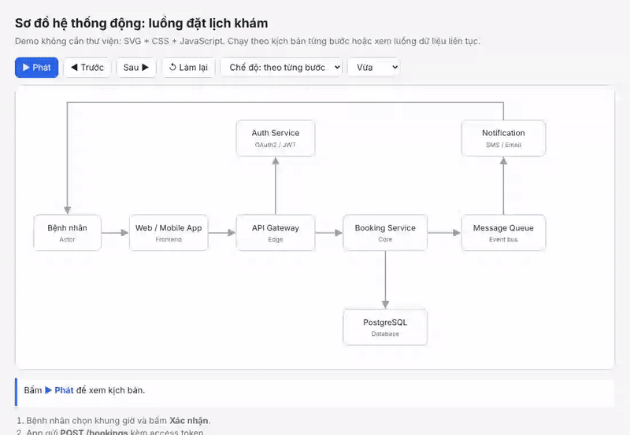
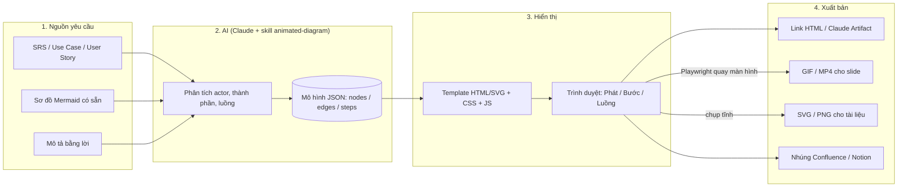
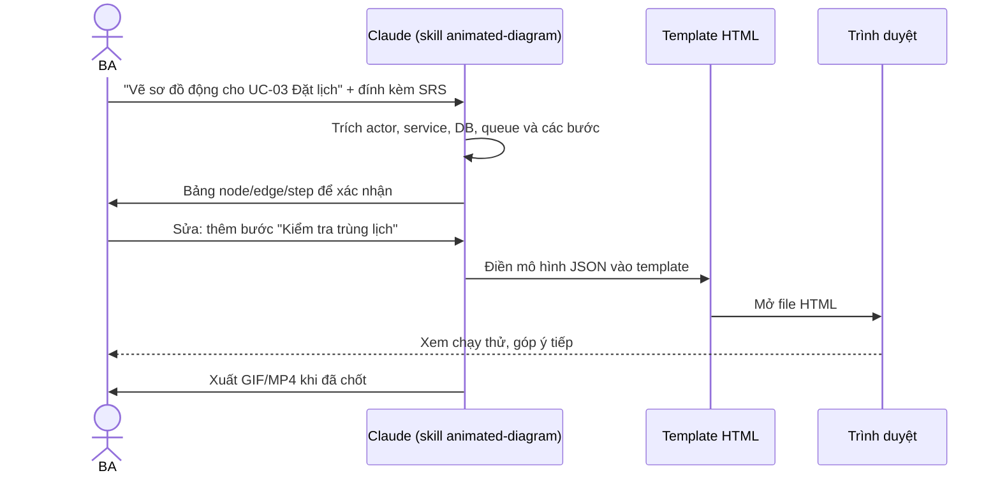

# Giải pháp vẽ sơ đồ hệ thống có chuyển động (Animated System Diagram)

> **Đối tượng:** BA, PO, Solution Architect.
> **Mục tiêu:** dùng AI vẽ sơ đồ hệ thống mà luồng dữ liệu chạy được theo từng bước, để trình bày với stakeholder, dev và khách hàng.
> **Demo chạy được:** [demo-so-do-dong.html](demo-so-do-dong.html), mở bằng trình duyệt là chạy, không cần cài gì.



## 1. Tóm tắt

Sơ đồ tĩnh (flowchart, sequence) buộc người xem tự lần theo mũi tên. Sơ đồ có chuyển động chạy luồng theo kịch bản: gói tin đi qua từng thành phần, thành phần đang xử lý sáng lên, chú thích đổi theo từng bước. Nhờ vậy buổi review yêu cầu hay demo kiến trúc dễ hiểu hơn nhiều.

Giải pháp đề xuất có 3 tầng, tách riêng **nội dung** khỏi **hình thức**:

1. **Mô hình** (diagram-as-code: node, edge, kịch bản các bước). AI hoặc BA soạn, lưu trong git.
2. **Hiển thị**: SVG/HTML chạy trên trình duyệt.
3. **Xuất bản**: chia sẻ dạng link HTML, nhúng Confluence/Notion, hoặc xuất GIF/MP4 cho slide.

## 2. Bài toán & yêu cầu

- **Bài toán:** BA cần giải thích luồng nghiệp vụ và kiến trúc (ví dụ: đặt lịch → xác thực → ghi DB → gửi thông báo) cho nhiều đối tượng. Slide tĩnh dễ gây hiểu sai thứ tự và trách nhiệm của từng thành phần.
- **Yêu cầu chức năng:**
  - Vẽ node (actor, service, database, queue) và edge (gọi đồng bộ, sự kiện bất đồng bộ).
  - Chạy kịch bản theo bước: Phát / Dừng / Trước / Sau, có chú thích cho từng bước.
  - Có chế độ "luồng liên tục" để xem tổng quan.
  - Xuất ra HTML (tương tác), GIF/MP4 (đưa vào slide), SVG/PNG (in tài liệu).
  - AI sinh được sơ đồ từ mô tả bằng tiếng Việt, từ SRS/Use Case hoặc từ sơ đồ Mermaid có sẵn.
- **Yêu cầu phi chức năng:**
  - Không phụ thuộc phần mềm trả phí, mở được offline.
  - Sửa được bằng văn bản (diff trong git, review như code).
  - Hỗ trợ chế độ sáng/tối, xem được trên điện thoại, tôn trọng cài đặt `prefers-reduced-motion`.
  - Không đưa dữ liệu mật của khách hàng lên dịch vụ bên ngoài.
- **Ngoài phạm vi:** mô phỏng hiệu năng thật (tải, độ trễ), giám sát hệ thống thời gian thực.

## 3. So sánh các phương án

| Phương án | Kiểu chuyển động | AI sinh được? | Xuất | Ưu điểm | Hạn chế | Phù hợp |
|---|---|---|---|---|---|---|
| **A. HTML/SVG + JS tự viết** (demo kèm theo) | Gói tin chạy theo đường, highlight node, kịch bản từng bước, luồng liên tục | ✅ Rất tốt (Claude viết trực tiếp, hoặc qua Artifact) | HTML, GIF/MP4 (quay bằng Playwright), SVG | Linh hoạt nhất, không phụ thuộc, chạy offline | Phải giữ đúng cấu trúc dữ liệu node/edge/step | ⭐ **Khuyến nghị chính** |
| **B. Mermaid** (v11.6+ có `animate` cho edge) | Nét đứt chạy trên cạnh | ✅ Rất tốt | SVG, PNG; nhúng GitHub, Notion, Confluence | Phổ biến, BA đã quen, ClauKit `/ba:diagram` sinh sẵn | Không có kịch bản theo bước, không có gói tin | Sơ đồ nhanh trong tài liệu |
| **C. D2** (`--animate-interval`) | Chuyển qua lại giữa các "board" (bước) | ✅ Tốt | SVG động, GIF | Dạng code, bố cục tự động đẹp, hợp sơ đồ kiến trúc | Cần cài CLI, tương tác hạn chế | Sơ đồ kiến trúc nhiều bước |
| **D. draw.io / diagrams.net** (`flowAnimation=1`) | Nét đứt chạy trên cạnh | ⚠️ Trung bình (AI sinh XML được nhưng dễ lỗi) | `.drawio`, SVG, HTML | Kéo thả quen thuộc, miễn phí, có plugin Confluence | Không kịch bản bước; khó review diff | BA thích kéo thả |
| **E. Excalidraw + excalidraw-animate** | Vẽ dần từng nét theo thứ tự | ⚠️ Trung bình | SVG động, WebM | Phong cách vẽ tay, thân thiện | Không thể hiện luồng dữ liệu | Workshop, brainstorm |
| **F. Figma/FigJam (Smart Animate), Lucid, Miro** | Chuyển frame/slide | ⚠️ Qua connector MCP | Prototype link, video | Đẹp, cộng tác tốt | Trả phí, làm thủ công nhiều | Demo cho khách hàng |
| **G. Motion Canvas / Remotion / Manim** | Hoạt cảnh đầy đủ theo timeline | ✅ Tốt (dạng code) | MP4 | Chất lượng video cao | Cần lập trình, mất thời gian render | Video giới thiệu sản phẩm |

**Khuyến nghị:**
- **Mặc định dùng phương án A** cho sơ đồ cần trình bày và giải thích luồng.
- **Dùng Mermaid (B)** cho sơ đồ trong tài liệu SRS, vì ClauKit và GitHub hiển thị sẵn.
- Khi cần, **chuyển từ B sang A**: AI đọc Mermaid rồi sinh mô hình node/edge/step tương ứng.

## 4. Kiến trúc giải pháp



**Nguyên tắc cốt lõi:** template (phần vẽ và hoạt cảnh) cố định, AI chỉ sinh **mô hình dữ liệu**. Cách này cho ra sơ đồ ổn định, dễ review và ít lỗi hơn hẳn so với để AI viết lại toàn bộ HTML mỗi lần.

## 5. Thành phần chính

| Thành phần | Vị trí | Trách nhiệm |
|---|---|---|
| Mô hình sơ đồ | Khối `nodes`, `edges`, `steps` trong [demo-so-do-dong.html](demo-so-do-dong.html) | Nội dung: thành phần, kết nối, kịch bản. **Phần duy nhất cần sửa** |
| Bộ vẽ | Hàm tạo `<rect>`, `<path>` từ mô hình | Sinh SVG từ dữ liệu |
| Bộ hoạt cảnh | `movePacket()` dùng `getPointAtLength` + `requestAnimationFrame`; CSS `stroke-dashoffset` | Gói tin chạy trên đường đi; nét đứt chạy ở chế độ luồng |
| Bộ điều khiển kịch bản | `show(i)`, `play()`, `stop()` | Highlight node/edge theo bước, cập nhật chú thích |
| Giao diện | CSS biến màu `:root` (sáng/tối), `viewBox` co giãn | Đọc tốt trên mọi thiết bị |
| Bộ xuất | Script Playwright (mục 9) | Quay WebM rồi chuyển sang GIF/MP4 bằng ffmpeg |

## 6. Luồng xử lý chính

### 6.1 BA tạo sơ đồ động bằng AI



### 6.2 Hoạt cảnh chạy trong trình duyệt

1. `show(i)` xoá trạng thái cũ, đánh dấu các node đã qua là `done`.
2. Edge của bước `i` chuyển sang `active` (đổi màu, đậm hơn), node đích sáng lên.
3. `movePacket()` di chuyển chấm tròn theo `path`, có hiệu ứng giảm tốc (ease-out).
4. `setInterval` chuyển sang bước tiếp theo theo tốc độ đã chọn. Nếu người xem bật giảm chuyển động, gói tin nhảy thẳng tới đích.

## 7. Mô hình dữ liệu

```js
nodes = [{ id, label, tag, x, y, w, h }]            // tag: Actor, Service, Database...
edges = [{ id, d }]                                  // d: đường SVG, ví dụ "M140 250 H188"
steps = [{ edge, node, text }]                       // edge chạy tới node, text là chú thích
```

**Quy ước để AI sinh ổn định:**
- Bố cục lưới: cột cách nhau 190–210px, hàng ở y = 50 / 218 / 386; khung 1040×480.
- Đường đi chỉ dùng đoạn ngang/dọc (`H`, `V`), dừng trước mép node khoảng 2px để mũi tên không bị che.
- Mỗi bước ứng với đúng 1 edge. Luồng phản hồi (response) là một edge riêng.
- `text` ngắn gọn (dưới 15 từ), in đậm tên API hoặc sự kiện.

## 8. Tech stack

| Lớp | Công nghệ | Vai trò |
|---|---|---|
| Mô hình | JSON/JS object (hoặc Mermaid làm đầu vào) | Nội dung sơ đồ |
| Hiển thị | SVG, CSS animation, JavaScript thuần | Vẽ và hoạt cảnh, không cần thư viện |
| AI | Claude (claude.ai Artifact, Cowork, Claude Code) + skill | Sinh và chỉnh mô hình |
| Xuất video | Playwright (Chromium) + ffmpeg | WebM → GIF/MP4 |
| Lưu trữ | Git (repo tài liệu dự án) | Quản lý phiên bản, review |

## 9. Triển khai & vận hành

### 9.1 Dùng ngay
- Mở [demo-so-do-dong.html](demo-so-do-dong.html) bằng trình duyệt.
- Muốn sơ đồ của mình: đưa file này cho Claude và yêu cầu *"Giữ nguyên template, chỉ thay `nodes`, `edges`, `steps` theo Use Case sau: …"*.

### 9.2 Chia sẻ
- **claude.ai / Cowork:** yêu cầu Claude xuất bản thành Artifact để có link chia sẻ.
- **Confluence:** dùng macro HTML (nếu admin cho phép), hoặc đính kèm file `.html` cùng GIF xem trước.
- **Notion:** nhúng link Artifact (`/embed`), hoặc chèn GIF.
- **Slide (PowerPoint/Google Slides):** chèn MP4/GIF.

### 9.3 Xuất GIF/MP4 bằng Playwright

```js
// record.mjs: node record.mjs demo-so-do-dong.html
import { chromium } from 'playwright';
const file = new URL(process.argv[2], `file://${process.cwd()}/`).href;
const browser = await chromium.launch();
const ctx = await browser.newContext({ viewport: { width: 1100, height: 760 },
  recordVideo: { dir: 'video', size: { width: 1100, height: 760 } } });
const page = await ctx.newPage();
await page.goto(file);
await page.click('#play');
await page.waitForTimeout(9500);          // 8 bước × ~1 giây + đệm
await ctx.close(); await browser.close(); // video được lưu trong ./video/*.webm
```

```bash
ffmpeg -i video/*.webm -c:v libx264 -pix_fmt yuv420p so-do.mp4
ffmpeg -i video/*.webm -vf "fps=12,scale=900:-1:flags=lanczos" -loop 0 so-do.gif
```

### 9.4 Giới hạn đã biết
- Bố cục toạ độ vẫn làm thủ công hoặc do AI tính. Với hơn khoảng 15 node, nên dùng D2 hoặc ELK để tự bố trí, rồi đưa toạ độ vào template.
- Chưa có chế độ nhiều luồng song song (fork/join) chạy cùng lúc.

## 10. Điểm mở rộng

| Mở rộng | Cách làm |
|---|---|
| Nhập từ Mermaid | Skill đọc `flowchart`/`sequenceDiagram` rồi chuyển sang `nodes/edges/steps` |
| Tự bố cục | Dùng thư viện `elkjs` hoặc `dagre` (qua CDN) để tính `x, y` thay vì nhập tay |
| Nhiều kịch bản | `scenarios = { happy: [...], tokenHetHan: [...] }` và thêm ô chọn kịch bản; tốt cho luồng ngoại lệ trong Use Case |
| Icon | Thêm `icon` vào node (SVG inline: user, database, queue) |
| Truy vết yêu cầu | Thêm `ref: "FR-001"` vào step, chú thích hiển thị mã yêu cầu (khớp ClauKit `/ba:spec`) |
| Swimlane | Thêm `lane` vào node, vẽ dải nền theo phòng ban hoặc hệ thống |
| Xuất từ Lucid/Figma | Dùng connector MCP để đưa bố cục từ Lucid/FigJam sang, rồi gắn hoạt cảnh |

## 11. Skill cho Claude (tái sử dụng)

Lưu đoạn sau thành `SKILL.md` trong thư mục `animated-diagram/`. Với Claude Code, đặt vào `.claude/skills/`; với claude.ai, nén thư mục thành zip rồi upload ở Settings → Capabilities → Skills. Đặt file [demo-so-do-dong.html](demo-so-do-dong.html) cạnh SKILL.md, đổi tên thành `template.html`.

```markdown
---
name: animated-diagram
description: Vẽ sơ đồ hệ thống/luồng nghiệp vụ có chuyển động (gói tin chạy theo bước, highlight thành phần) dưới dạng HTML/SVG tự chạy. Dùng khi người dùng muốn "sơ đồ động", "animate luồng", "minh hoạ luồng dữ liệu", hoặc chuyển Use Case/SRS/Mermaid thành sơ đồ trình chiếu.
---

# Animated System Diagram

1. Đọc nguồn (mô tả, Use Case, SRS, Mermaid). Liệt kê: actor, thành phần (service/DB/queue/bên ngoài), các bước theo thứ tự.
2. Trình bày bảng `Bước | Từ → Đến | Mô tả` cho người dùng xác nhận trước khi vẽ. Nếu thiếu thông tin, hỏi thay vì tự bịa.
3. Mở `template.html`. CHỈ thay 3 mảng `nodes`, `edges`, `steps` và tiêu đề; giữ nguyên CSS và JS.
   - Lưới: cột x = 20, 190, 380, 570, 780; hàng y = 50, 218, 386; node 120–150 × 64.
   - Edge chỉ dùng H/V, dừng cách mép node 2px. Mỗi step đúng 1 edge.
   - Chú thích dưới 15 từ, tiếng Việt, in đậm tên API/sự kiện bằng <b>.
4. Nếu hơn 8 node hoặc không vừa lưới: mở rộng viewBox (cả hai chiều) thay vì chồng node.
5. Kiểm tra: mọi `step.edge` và `step.node` đều tồn tại; không có node chồng nhau.
6. Bàn giao file HTML. Nếu được yêu cầu video: dùng Playwright quay rồi ffmpeg chuyển sang MP4/GIF.
```

## 12. Bài học & cách áp dụng

- **Tách nội dung khỏi hình thức:** AI làm tốt phần trích xuất nội dung; phần hiển thị nên cố định bằng template. Đây cũng là cách ClauKit tách `/ba:spec` (nội dung) khỏi `/ba:diagram` (hiển thị).
- **Kịch bản bước chính là Use Case:** mỗi bước của sơ đồ động tương ứng một bước trong Main Flow. Có thể dùng sơ đồ động để review Use Case với khách hàng trước khi ký SRS.
- **Luồng ngoại lệ:** làm thêm kịch bản (token hết hạn, trùng lịch) để dev và QA thấy rõ nhánh lỗi; nên lấy thẳng làm test scenario.
- **Ưu tiên định dạng mở:** HTML/SVG xem được ở mọi nơi và lưu trữ lâu dài. GIF/MP4 chỉ là bản xuất cho slide.

## 13. Tham khảo

- Mermaid: hiệu ứng trên edge (`e1@{ animate: true }`): https://mermaid.js.org/syntax/flowchart.html
- D2 animation (`--animate-interval`): https://d2lang.com/blog/animation/
- draw.io animate connectors: https://www.drawio.com/doc/faq/connector-animate
- excalidraw-animate: https://github.com/dai-shi/excalidraw-animate
- Motion Canvas: https://motioncanvas.io · Remotion: https://www.remotion.dev · Manim: https://www.manim.community
- Playwright quay video: https://playwright.dev/docs/videos
- ClauKit BA Kit `/ba:diagram`: https://github.com/trungdo9/ClauKit/tree/main/skills/ba
