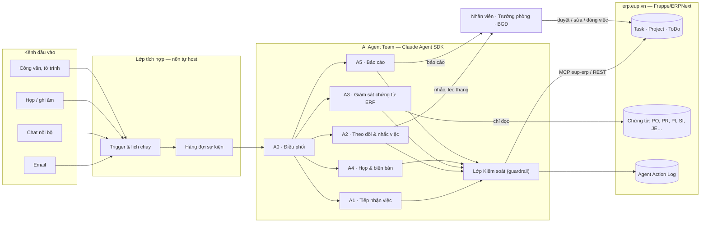
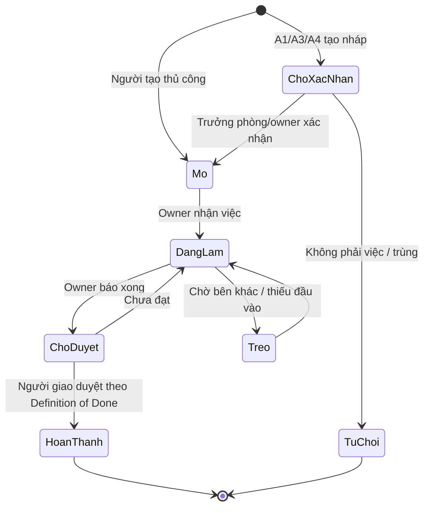
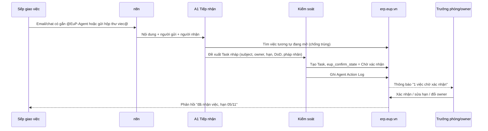
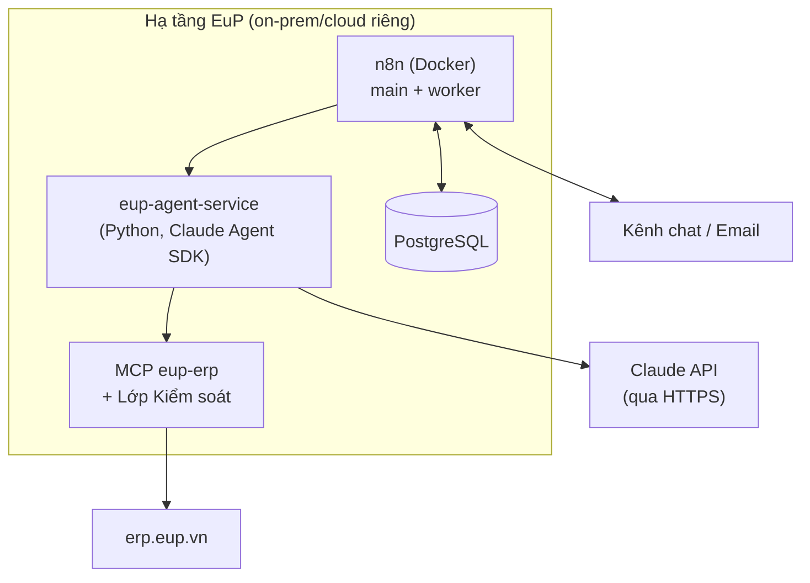
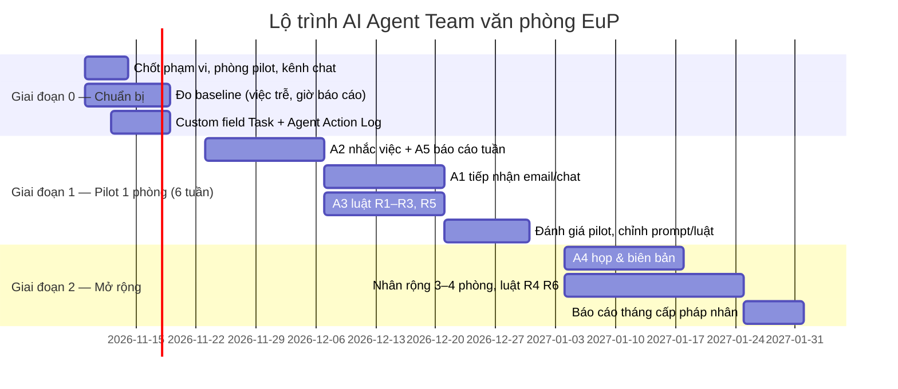

# AI Agent Team quản lý tiến độ công việc văn phòng — giải pháp cho EuP Group

> **Phạm vi:** khối văn phòng của EuP Group (văn phòng tập đoàn và các công ty thành viên) · **Phiên bản:** 1.0 · 31/10/2026
> **Quy ước:** `[CẦN XÁC NHẬN: …]` là điểm cần EuP chốt; **MINH HỌA** là ví dụ, không phải số liệu thật; mọi số "ước tính" đều ghi giả định.

---

## 0. Executive summary

**Đề xuất:** dựng một đội 6 AI agent chạy trên chính ERP **erp.eup.vn** (Frappe/ERPNext), lấy doctype `Task`/`Project` làm sổ việc duy nhất, để mọi đầu việc giao qua email, họp, chat và chứng từ ERP tồn đọng đều có **owner – hạn – trạng thái** và được nhắc, leo thang, báo cáo tự động.

Ba lý do chọn hướng này:

1. **Không thêm hệ thống mới.** EuP đã có ERP nhiều pháp nhân, có user, phân quyền, workflow và app custom `eupapp`. Đặt sổ việc ngay trong ERP thì việc gắn được với chứng từ (PO, hóa đơn, phiếu nhập…) và báo cáo theo từng công ty — điều Asana/ClickUp không làm được nếu không tích hợp thêm.
2. **Agent làm phần "chạy theo", người giữ phần quyết định.** Agent bóc tách việc, nhắc, gom báo cáo; con người duyệt việc mới, đổi hạn, đóng việc. Agent **không** Submit/Hủy chứng từ kế toán.
3. **Triển khai được trong 12 tuần, pilot 6 tuần ở 1 phòng.** Pilot đề xuất: Phòng Tài chính – Kế toán văn phòng tập đoàn, vì có nhiều việc định kỳ có hạn cứng (đóng sổ, thuế, đối chiếu nội bộ) và đã có lưu đồ thao tác ERP.

| Hạng mục | Nội dung |
|---|---|
| Đội agent | Điều phối · Tiếp nhận việc · Theo dõi & nhắc việc · Giám sát chứng từ ERP · Họp & biên bản · Báo cáo (+ lớp Kiểm soát dùng chung) |
| Nền tảng | ERP erp.eup.vn (sổ việc) · n8n tự host (lịch chạy, kết nối kênh) · dịch vụ agent viết bằng Claude Agent SDK · MCP server `eup-erp` |
| Model | `claude-sonnet-5-5` cho phần lớn tác vụ; `claude-haiku-5-5` cho phân loại/nhắc việc khối lượng lớn; `claude-opus-5-5` cho báo cáo tổng hợp tháng |
| KPI mục tiêu sau pilot | ≥ 95% việc có owner + hạn · tỷ lệ đúng hạn tăng ≥ 15 điểm so với baseline · thời gian làm báo cáo tuần giảm ≥ 70% *(mục tiêu đề xuất, cần đo baseline tuần 1–2)* |
| Quyết định cần BGĐ | Chọn phòng pilot · chọn kênh chat chính thức · duyệt chính sách dữ liệu gửi ra LLM (mục 9) |

---

## 1. Bối cảnh EuP và bài toán

### 1.1 Bối cảnh

- **Tập đoàn đa ngành, nhiều pháp nhân.** EuP Group (tiền thân Công ty CP Nhựa Châu Âu, 2007) có 4 lĩnh vực: hạt nhựa & sản phẩm công nghiệp, khai thác mỏ & nguyên liệu, bất động sản công nghiệp, công nghệ thông tin. Hệ thống công ty gồm các pháp nhân ở Hà Nam, Nghệ An, Yên Bái, Long An, PolyFill, Khoáng sản Công nghiệp Yên Bái, Abbey Việt Nam, EuP Egypt… *(nguồn: eup.vn)*.
- **Giao dịch liên công ty dày.** Mua bán nội bộ 3 bên, logistics, bán hàng tại cảng, thuế — đã được dựng thành các "Lưu đồ thao tác ERP" (10–16/10/2026).
- **ERP chung:** erp.eup.vn trên Frappe/ERPNext, có app custom `eupapp` và trang manual `/manual/eupapp`, có MCP `eup-erp` để đọc dữ liệu.
- **Văn phòng làm việc qua nhiều kênh:** email, họp, chat `[CẦN XÁC NHẬN: Zalo / Microsoft Teams / Google Chat]`, công văn, và chính chứng từ trên ERP.

### 1.2 Bài toán (SCQA)

| | |
|---|---|
| **Situation** | Việc văn phòng phát sinh từ nhiều nguồn, nhiều pháp nhân, nhiều người giao. |
| **Complication** | Việc giao miệng/qua chat không có hạn rõ; trưởng phòng phải hỏi từng người để biết tiến độ; báo cáo tuần làm tay từ Excel; chứng từ ERP nằm ở trạng thái Nháp/Chờ duyệt mà không ai được nhắc. `[CẦN DỮ LIỆU: số việc trễ hạn/tháng, giờ làm báo cáo/tuần, số chứng từ Draft > 7 ngày]` |
| **Question** | Làm sao để mọi việc có owner – hạn – trạng thái, được nhắc đúng lúc, và lãnh đạo xem được tiến độ theo phòng/pháp nhân mà không phải hỏi? |
| **Answer** | Một đội AI agent trên nền ERP: tự gom việc từ mọi kênh vào `Task`, tự nhắc và leo thang, tự làm báo cáo; con người duyệt các điểm quyết định. |

### 1.3 Yêu cầu

| Loại | Yêu cầu |
|---|---|
| Chức năng | Tạo việc từ email/biên bản họp/chat/chứng từ ERP · nhắc việc theo hạn · leo thang · báo cáo ngày/tuần/tháng theo người, phòng, pháp nhân · hỏi đáp tiến độ bằng tiếng Việt |
| Phi chức năng | Tiếng Việt tự nhiên · tôn trọng phân quyền ERP theo công ty · có nhật ký mọi hành động của agent · không ghi lên chứng từ kế toán · chạy được khi LLM lỗi (nhắc việc theo luật vẫn chạy) |
| Ràng buộc | Dùng ERP hiện có, không mua thêm phần mềm quản lý dự án · tuân thủ quy định bảo vệ dữ liệu cá nhân của Việt Nam (mục 9) |

---

## 2. Kiến trúc tổng thể



**Nguyên tắc kiến trúc**

1. **ERP là nguồn sự thật duy nhất (single source of truth).** Agent không giữ trạng thái việc riêng; mọi việc nằm ở `Task` trên erp.eup.vn.
2. **n8n lo "khi nào", agent lo "làm gì".** Lịch chạy, webhook, kết nối email/chat đặt ở n8n (đã phân tích ở [n8n.md](../solution-design/n8n.md)); suy luận, bóc tách, soạn văn bản đặt ở agent.
3. **Mọi lệnh ghi đi qua lớp Kiểm soát.** Lớp này kiểm tra quyền, danh sách doctype được ghi, và ghi nhật ký trước khi gọi ERP.
4. **Suy giảm an toàn (graceful degradation).** Nếu LLM không phản hồi, n8n vẫn chạy nhắc việc theo luật (so hạn với ngày hiện tại) — chỉ mất phần câu chữ "thông minh".

---

## 3. Đội agent: vai trò, đầu vào, đầu ra

| Mã | Agent | Việc chính | Đầu vào | Đầu ra | Quyền ERP | Model |
|---|---|---|---|---|---|---|
| A0 | **Điều phối** | Nhận sự kiện, chọn agent xử lý, gộp kết quả, trả lời câu hỏi tự do ("việc của phòng KT tuần này thế nào?") | Sự kiện từ n8n, câu hỏi của người dùng | Lệnh giao cho A1–A5; câu trả lời | Đọc `Task`, `Project` | Sonnet 5.5 |
| A1 | **Tiếp nhận việc** | Bóc tách đầu việc từ email, chat, công văn; chuẩn hóa thành việc SMART; phát hiện trùng | Nội dung tin nhắn/email/file | **Bản nháp** `Task` (trạng thái `Chờ xác nhận`) | Tạo `Task` nháp | Sonnet 5.5 |
| A2 | **Theo dõi & nhắc việc** | Quét việc hằng ngày, nhắc trước hạn, leo thang khi trễ, hỏi cập nhật tiến độ | Danh sách `Task` mở | Tin nhắc; comment trên `Task`; cờ `Trễ hạn` | Đọc `Task`; thêm comment; sửa trường `escalation_level` | Haiku 5.5 |
| A3 | **Giám sát chứng từ ERP** | Tìm chứng từ Nháp/Chờ duyệt quá hạn, chứng từ thiếu bước sau (VD phiếu nhập chưa có hóa đơn), đối chiếu nội bộ lệch | Truy vấn ERP theo bộ luật ở mục 5.3 | `Task` tự sinh gắn link chứng từ | **Chỉ đọc** chứng từ; tạo `Task` | Haiku 5.5 (luật) + Sonnet 5.5 (diễn giải) |
| A4 | **Họp & biên bản** | Từ transcript/ghi chú họp: soạn biên bản, rút action item kèm owner và hạn | Transcript, ghi chú, lịch họp | Biên bản (Google Docs/ERP Note) + các `Task` nháp | Tạo `Task` nháp, `Note` | Sonnet 5.5 |
| A5 | **Báo cáo** | Báo cáo ngày (cá nhân), tuần (phòng), tháng (pháp nhân/BGĐ); nêu điểm nghẽn và đề xuất | `Task`, lịch sử trạng thái, kết quả A3 | Báo cáo dạng action title, có số | Đọc | Sonnet 5.5 (tuần) · Opus 5.5 (tháng) |
| — | **Lớp Kiểm soát** | Không phải agent tự do: là code kiểm tra trước mọi lệnh ghi | Lệnh ghi từ A0–A5 | Cho phép / chặn / chuyển người duyệt; ghi `Agent Action Log` | — | Không dùng LLM |

> **Vì sao 6 agent chứ không 1?** Mỗi agent có bộ công cụ và quyền hẹp riêng (A3 chỉ đọc chứng từ, A2 chỉ comment), nên dễ kiểm soát rủi ro và dễ đo chất lượng từng khâu. Ngược lại, không tách nhỏ hơn: thêm agent là thêm điểm lỗi khi chuyển giao.

### 3.1 RACI giữa người và agent

| Hoạt động | Agent | Nhân viên (owner) | Trưởng phòng | BGĐ / Ban Điều hành | IT/ERP |
|---|---|---|---|---|---|
| Tạo việc nháp từ kênh | **R** (A1, A4, A3) | I | A | — | — |
| Xác nhận việc, chốt owner & hạn | C | C | **A/R** | — | — |
| Cập nhật tiến độ | C (A2 hỏi) | **R** | A | — | — |
| Đổi hạn | C | R (đề xuất) | **A** | I (nếu việc cấp tập đoàn) | — |
| Nhắc & leo thang | **R** (A2) | I | I | I (cấp 3) | — |
| Đóng việc | — | R | **A** | — | — |
| Báo cáo tuần/tháng | **R** (A5) | — | A (duyệt trước khi gửi BGĐ) | I | — |
| Cấu hình luật, quyền agent | — | — | C | A | **R** |

---

## 4. Mô hình dữ liệu trên ERP

### 4.1 Mở rộng doctype `Task` (custom field qua `eupapp`)

ERPNext đã có `Task` (subject, status, priority, exp_end_date, project, company qua project, `_assign`). Bổ sung các trường sau `[CẦN XÁC NHẬN: tên field khớp quy ước eupapp]`:

| Field | Kiểu | Ý nghĩa |
|---|---|---|
| `eup_company` | Link → Company | Pháp nhân chịu việc (lọc báo cáo, phân quyền) |
| `eup_department` | Link → Department | Phòng ban |
| `eup_assigned_by` | Link → User | Người giao việc |
| `eup_source` | Select: `Email / Chat / Họp / Công văn / ERP tự sinh / Thủ công` | Nguồn phát sinh |
| `eup_source_ref` | Data / Dynamic Link | Mã email, link biên bản, hoặc chứng từ ERP gốc (VD `PO-HN-2026-00123`) |
| `eup_confirm_state` | Select: `Chờ xác nhận / Đã xác nhận / Từ chối` | Việc do agent tạo phải qua bước người xác nhận |
| `eup_definition_of_done` | Small Text | Tiêu chí hoàn thành (kết quả đầu ra cụ thể) |
| `eup_escalation_level` | Int 0–3 | Mức leo thang hiện tại |
| `eup_last_update_at` | Datetime | Lần cập nhật tiến độ gần nhất |
| `eup_recurring_rule` | Data | Việc định kỳ, VD `monthly:5` (ngày 5 hằng tháng) |
| `eup_agent_created` | Check | Đánh dấu việc do agent tạo (để đo chất lượng) |

**Doctype mới `Agent Action Log`:** `agent`, `action`, `target_doctype`, `target_name`, `payload` (JSON), `result`, `approved_by`, `timestamp`. Chỉ cho phép thêm, không cho sửa/xóa.

### 4.2 Vòng đời một việc



Ánh xạ sang `status` chuẩn của ERPNext: `Open` (Mở), `Working` (Đang làm), `Pending Review` (Chờ duyệt), `Completed` (Hoàn thành), `Cancelled` (Từ chối); `Treo` dùng thêm tag `blocked` + lý do trong comment.

---

## 5. Luồng xử lý chính

### 5.1 Luồng 1 — Giao việc qua email/chat thành `Task`



**Quy tắc bóc tách của A1**

- Mỗi đầu việc phải có: **động từ + đối tượng + kết quả** (VD "Đối chiếu công nợ nội bộ Hà Nam – Yên Bái tháng 10, xuất biên bản ký 2 bên").
- Thiếu hạn → đề xuất hạn theo loại việc (bảng SLA mục 5.4) và đánh dấu "hạn do agent đề xuất".
- Thiếu owner → gán cho trưởng phòng của người nhận email để phân công.
- Phát hiện pháp nhân từ tên công ty, mã kho, mã chứng từ, chữ ký email.
- Một email nhiều việc → tách nhiều `Task`, cùng `eup_source_ref`.

### 5.2 Luồng 2 — Nhắc việc và leo thang (A2)

Chạy 2 lần/ngày làm việc (08:00 và 15:00, giờ Việt Nam), bỏ qua thứ Bảy chiều, Chủ nhật và ngày lễ theo `Holiday List` của từng công ty trên ERP.

| Mức | Điều kiện | Ai nhận | Nội dung |
|---|---|---|---|
| 0 — Nhắc trước | Còn 2 ngày làm việc tới hạn, chưa `Pending Review` | Owner | Nhắc nhẹ + hỏi "có rủi ro trễ không?" (nút: Đúng hạn / Cần thêm thời gian / Bị chặn) |
| 1 — Đến hạn | Ngày hạn, chưa xong | Owner | Nhắc + yêu cầu cập nhật trước 17:00 |
| 2 — Trễ 1 ngày | Quá hạn 1 ngày làm việc | Owner + Trưởng phòng | Tóm tắt việc, lịch sử cập nhật, lý do owner đã nêu |
| 3 — Trễ 3 ngày hoặc việc ưu tiên `Urgent` trễ 1 ngày | | Trưởng phòng + Người giao (+ BGĐ nếu việc cấp tập đoàn) | Đề xuất phương án: đổi hạn, đổi owner, gỡ điểm chặn |
| Im lặng | Không cập nhật > 5 ngày làm việc dù chưa tới hạn | Owner | Hỏi tình trạng; không leo thang |

Quy tắc chống "spam": tối đa **1 tin/ngày/người**, gộp mọi việc của người đó vào một tin; người dùng có thể trả lời bằng chat để cập nhật (A2 chuyển thành comment + đổi trạng thái sau khi hỏi lại xác nhận).

### 5.3 Luồng 3 — Giám sát chứng từ ERP sinh việc (A3) — điểm khác biệt riêng của EuP

A3 chạy hằng ngày lúc 07:30, **chỉ đọc**, áp các luật dưới đây theo từng pháp nhân. Mỗi phát hiện sinh một `Task` (`eup_source = ERP tự sinh`) gắn link chứng từ; nếu đã có `Task` mở cho chứng từ đó thì chỉ cập nhật comment.

| # | Luật **MINH HỌA** (cần IT/Kế toán chốt ngưỡng) | Doctype | Owner mặc định |
|---|---|---|---|
| R1 | Chứng từ ở trạng thái Nháp (`docstatus = 0`) quá 3 ngày | Purchase Order, Sales Order, Purchase Invoice, Sales Invoice, Journal Entry | Người tạo chứng từ |
| R2 | Chứng từ chờ duyệt theo workflow quá 2 ngày | Doctype có workflow | Người có quyền duyệt ở bước đó |
| R3 | Phiếu nhập (`Purchase Receipt`) đã Submit quá 7 ngày chưa có hóa đơn mua | Purchase Receipt | Kế toán mua hàng của pháp nhân |
| R4 | Giao dịch nội bộ một chiều: bên bán đã có Sales Invoice nội bộ nhưng bên mua chưa có Purchase Invoice tương ứng | Sales/Purchase Invoice nội bộ (theo lưu đồ mua bán nội bộ 3 bên) | Kế toán bên mua |
| R5 | Việc định kỳ đến kỳ: đóng sổ, kê khai thuế, đối chiếu công nợ nội bộ | `eup_recurring_rule` | Theo cấu hình |
| R6 | Đơn hàng xuất khẩu sắp đến ngày giao nhưng chưa có phiếu xuất/bộ chứng từ logistics | Sales Order + `[CẦN XÁC NHẬN: doctype logistics của eupapp]` | Phòng XNK/Logistics |

Gợi ý truy vấn (Frappe REST, chỉ GET):

```text
GET /api/resource/Purchase Order
    ?filters=[["docstatus","=",0],["creation","<","{{today-3}}"],["company","=","{{company}}"]]
    &fields=["name","owner","company","supplier","grand_total","creation"]
```

### 5.4 Luồng 4 — Họp ra việc (A4)

1. Trước họp: A4 đọc lịch họp, gom các `Task` liên quan đến người dự họp/dự án → gửi **agenda + danh sách việc đang trễ** 30 phút trước họp.
2. Sau họp: nhận transcript (từ công cụ ghi âm) hoặc ghi chú của thư ký → soạn biên bản theo mẫu: *Quyết định · Việc cần làm (owner, hạn) · Vấn đề mở*.
3. Mỗi action item → `Task` nháp; chủ trì họp xác nhận một lần cho cả danh sách.
4. Họp kỳ sau: A4 mở đầu agenda bằng tình trạng các việc của kỳ trước.

**Bảng SLA mặc định để đề xuất hạn khi người giao không nêu** *(MINH HỌA — cần từng phòng chốt)*:

| Loại việc | Hạn đề xuất |
|---|---|
| Trả lời/cung cấp thông tin nội bộ | 1 ngày làm việc |
| Lập/duyệt chứng từ ERP | 2 ngày làm việc |
| Đối chiếu, báo cáo nghiệp vụ | 5 ngày làm việc |
| Tờ trình, phương án | 10 ngày làm việc |

### 5.5 Luồng 5 — Báo cáo (A5)

| Báo cáo | Thời điểm | Người nhận | Nội dung |
|---|---|---|---|
| Bản tin cá nhân | 08:00 hằng ngày | Từng nhân viên | Việc hôm nay, việc sắp hạn, việc chờ người khác |
| Báo cáo tuần phòng | 16:00 thứ Sáu (nháp) → trưởng phòng duyệt → gửi 08:00 thứ Hai | Trưởng phòng, BGĐ phụ trách | Số việc mới/xong/trễ; top 5 việc trễ và lý do; điểm nghẽn liên phòng; chứng từ ERP tồn đọng |
| Báo cáo tháng pháp nhân | Ngày làm việc thứ 2 của tháng | Ban Điều hành tập đoàn | Tỷ lệ đúng hạn theo pháp nhân/phòng; xu hướng 3 tháng; việc cấp tập đoàn; đề xuất |

Văn phong báo cáo theo chuẩn tư vấn của EuP: **kết luận trước, action title có số**. Ví dụ **MINH HỌA**:
> *"Phòng Kế toán Hà Nam đúng hạn 82% (tuần trước 74%); 3/5 việc trễ do chờ hóa đơn từ Yên Bái — đề xuất họp đối chiếu nội bộ thứ Ba."*

---

## 6. Thiết kế từng agent (prompt và công cụ)

### 6.1 Bộ công cụ (tool) chung qua MCP `eup-erp`

| Tool | Mô tả | Agent dùng |
|---|---|---|
| `task_search(filters)` | Tìm `Task` theo owner, công ty, trạng thái, hạn | A0, A1, A2, A3, A5 |
| `task_create_draft(fields)` | Tạo `Task` với `eup_confirm_state = Chờ xác nhận` | A1, A3, A4 |
| `task_comment(name, text)` | Thêm comment | A2, A3 |
| `task_set_escalation(name, level)` | Chỉ sửa `eup_escalation_level` | A2 |
| `doc_query(doctype, filters, fields)` | Đọc chứng từ, **chặn** mọi phương thức khác GET | A3 |
| `user_directory(query)` | Tra người, phòng, công ty, trưởng phòng | A1, A2, A4 |
| `holiday_check(company, date)` | Ngày làm việc/ngày lễ theo công ty | A2, A3 |
| `notify(user, channel, message)` | Gửi tin qua kênh đã cấu hình (n8n webhook) | A2, A5 |

Không có tool nào gọi `submit`, `cancel`, `amend`, `delete` trên chứng từ.

### 6.2 System prompt mẫu — A1 Tiếp nhận việc

```text
Bạn là Agent Tiếp nhận việc của EuP Group. Nhiệm vụ: đọc một email/tin nhắn/công văn và
bóc tách các đầu việc thành Task nháp trên erp.eup.vn.

Quy tắc:
1. Chỉ tạo việc khi có yêu cầu hành động rõ ràng. Thông báo, cảm ơn, CC để biết → không tạo việc.
2. Mỗi việc gồm: subject (động từ + đối tượng + kết quả, ≤ 120 ký tự), owner, hạn,
   eup_definition_of_done, eup_company, eup_department, priority.
3. Hạn: lấy từ nội dung; nếu không có, áp bảng SLA và ghi "hạn do agent đề xuất".
   Quy đổi "cuối tuần", "đầu tháng sau" theo lịch làm việc của công ty (dùng holiday_check).
4. Pháp nhân: suy ra từ tên công ty, mã kho, tiền tố mã chứng từ, chữ ký. Không chắc → để trống
   và ghi lý do, KHÔNG đoán.
5. Trước khi tạo, gọi task_search để tìm việc tương tự đang mở; nếu trùng, đề xuất comment vào việc cũ.
6. Không chép nguyên văn dữ liệu cá nhân (số CCCD, số tài khoản, lương) vào Task.
7. Trả về JSON đúng schema TaskDraft[], kèm confidence 0–1 cho từng việc.
```

### 6.3 Schema đầu ra `TaskDraft`

```json
{
  "subject": "Đối chiếu công nợ nội bộ Nhựa Châu Âu – Yên Bái tháng 10/2026",
  "owner": "user@eup.vn",
  "assigned_by": "sep@eup.vn",
  "exp_end_date": "2026-11-05",
  "due_suggested_by_agent": false,
  "priority": "High",
  "eup_company": "[CẦN XÁC NHẬN: tên Company trên ERP]",
  "eup_department": "Tài chính - Kế toán",
  "eup_definition_of_done": "Biên bản đối chiếu có xác nhận của 2 bên, chênh lệch = 0 hoặc có giải trình",
  "eup_source": "Email",
  "eup_source_ref": "<message-id>",
  "duplicate_of": null,
  "confidence": 0.86
}
```

*(Ví dụ MINH HỌA.)* Việc có `confidence < 0,7` hoặc thiếu owner/pháp nhân luôn chuyển trưởng phòng xác nhận thủ công.

### 6.4 Prompt tóm tắt cho các agent còn lại

| Agent | Điểm chính trong prompt |
|---|---|
| A0 Điều phối | Phân loại sự kiện → agent; trả lời câu hỏi tiến độ chỉ bằng dữ liệu từ `task_search`, luôn nêu số và link `Task`; không tự sửa dữ liệu |
| A2 Nhắc việc | Giọng lịch sự, ngắn, xưng hô theo văn hóa EuP `[CẦN XÁC NHẬN: anh/chị hay bạn]`; gộp việc theo người; không trách móc; luôn kèm 3 lựa chọn trả lời nhanh |
| A3 Giám sát ERP | Chỉ dùng `doc_query`; mỗi phát hiện ghi luật nào (R1–R6), chứng từ nào, bao lâu; không ghi số tiền vào tin nhắc gửi ra kênh chat |
| A4 Biên bản | Tách rõ *quyết định* và *việc cần làm*; việc không rõ owner ghi "Chủ trì phân công"; không suy diễn ý kiến không có trong transcript |
| A5 Báo cáo | Kết luận trước; action title có số; so sánh với kỳ trước; mỗi đề xuất có owner – hạn; dữ liệu thiếu ghi `[CẦN DỮ LIỆU]` |

---

## 7. Tech stack và triển khai

### 7.1 Thành phần

| Lớp | Lựa chọn đề xuất | Lý do | Phương án thay thế |
|---|---|---|---|
| Sổ việc | ERPNext `Task`/`Project` trên erp.eup.vn | Đã có, nhiều pháp nhân, phân quyền sẵn | Asana/ClickUp (cần đồng bộ 2 chiều với ERP — không khuyến nghị) |
| Orchestration & lịch | n8n tự host (Docker), queue mode khi > 1.000 việc/ngày | Nhiều connector email/chat, có cron, giao diện cho IT tự sửa luồng | Frappe Scheduler (`hooks.py`) cho phần luật thuần ERP |
| Agent runtime | Dịch vụ Python dùng **Claude Agent SDK**, mỗi agent là một cấu hình (prompt + tool + model) | Hỗ trợ tool use, sub-agent, MCP | LangGraph |
| Kết nối ERP | MCP server `eup-erp` mở rộng thêm tool ở mục 6.1; xác thực bằng API key của user kỹ thuật `agent@eup.vn` theo từng công ty | Một chỗ kiểm soát quyền | Gọi REST trực tiếp |
| Kênh thông báo | `[CẦN XÁC NHẬN: Zalo OA / Teams / Google Chat]` + email | Theo kênh nhân viên đang dùng | Thông báo trong ERP (Notification Log) |
| Lưu trữ phụ | PostgreSQL của n8n; không lưu nội dung email lâu hơn 30 ngày | Giảm rủi ro dữ liệu | — |
| Giám sát | Dashboard ERP (Report `Agent Action Log`, `Task` theo công ty) + cảnh báo n8n khi job lỗi | Không thêm công cụ | Grafana |

### 7.2 Sơ đồ triển khai



### 7.3 Khung code dịch vụ agent (rút gọn, MINH HỌA)

```python
# eup_agent_service/agents.py
AGENTS = {
    "intake":   {"model": "claude-sonnet-5-5", "prompt": "prompts/a1_intake.md",
                 "tools": ["task_search", "task_create_draft", "user_directory", "holiday_check"]},
    "tracker":  {"model": "claude-haiku-5-5",  "prompt": "prompts/a2_tracker.md",
                 "tools": ["task_search", "task_comment", "task_set_escalation", "notify"]},
    "erp_watch":{"model": "claude-haiku-5-5",  "prompt": "prompts/a3_erp_watch.md",
                 "tools": ["doc_query", "task_search", "task_create_draft", "task_comment"]},
    "meeting":  {"model": "claude-sonnet-5-5", "prompt": "prompts/a4_meeting.md",
                 "tools": ["task_search", "task_create_draft", "user_directory"]},
    "report":   {"model": "claude-sonnet-5-5", "prompt": "prompts/a5_report.md",
                 "tools": ["task_search", "doc_query"]},
}

WRITE_ALLOWLIST = {"Task": {"create_draft", "comment", "set_escalation"}, "Note": {"create"}}

def guard(agent: str, doctype: str, action: str, payload: dict) -> None:
    """Lớp Kiểm soát: chặn mọi lệnh ghi ngoài allowlist và ghi nhật ký trước khi gọi ERP."""
    if action not in WRITE_ALLOWLIST.get(doctype, set()):
        raise PermissionError(f"{agent} không được {action} trên {doctype}")
    log_action(agent=agent, doctype=doctype, action=action, payload=payload)
```

### 7.4 Luồng n8n cần dựng

| Workflow | Trigger | Gọi agent |
|---|---|---|
| `intake-email` | IMAP/Gmail/Outlook trên hộp `viec@eup.vn` + email có CC agent | A1 |
| `intake-chat` | Webhook kênh chat khi tin nhắn có `@EuP-Agent` | A0 → A1 |
| `daily-erp-watch` | Cron 07:30 T2–T7 | A3 |
| `daily-nudge` | Cron 08:00 và 15:00 | A2 |
| `meeting-pre` / `meeting-post` | Lịch họp −30 phút / có transcript mới | A4 |
| `weekly-report` | Cron 16:00 thứ Sáu | A5 |
| `monthly-report` | Cron ngày làm việc thứ 2 của tháng | A5 |
| `agent-health` | Mỗi giờ | Không (kiểm tra lỗi job, gửi IT) |

---

## 8. Lộ trình triển khai 12 tuần



| Giai đoạn | Đầu ra | Owner | Tiêu chí qua cửa |
|---|---|---|---|
| 0. Chuẩn bị (tuần 1–2) | Phạm vi, baseline, custom field trên môi trường test | Kyle (PMO/Chuyển đổi số) + IT/ERP | BGĐ duyệt phạm vi và chính sách dữ liệu |
| 1. Pilot (tuần 3–8) | A1, A2, A3, A5 chạy cho 1 phòng | Trưởng phòng pilot + IT/ERP | ≥ 90% việc có owner + hạn; ≥ 80% việc agent tạo được xác nhận không sửa nhiều; người dùng chấm ≥ 4/5 |
| 2. Mở rộng (tuần 9–12) | A4, thêm 3–4 phòng và 2 pháp nhân | PMO | KPI mục 10 đạt ở phòng pilot 4 tuần liên tiếp |
| 3. Toàn tập đoàn (sau tuần 12) | Tất cả khối văn phòng; báo cáo tháng cho Ban Điều hành | PMO + các Giám đốc công ty thành viên | Quyết định sau đánh giá giai đoạn 2 |

**Quản trị thay đổi** (văn hóa nể nang, ngại báo trễ): trưởng phòng dùng báo cáo của agent trong họp giao ban ngay từ tuần đầu; nhắc việc chỉ gửi riêng cho owner ở mức 0–1, không công khai; tuần 1–2 pilot chạy chế độ "bóng" (agent đề xuất, người làm như cũ) để so sánh.

---

## 9. An toàn, bảo mật và tuân thủ

| Rủi ro | Biện pháp |
|---|---|
| Agent ghi sai lên chứng từ kế toán | Allowlist chỉ `Task`/`Note`; user kỹ thuật không có quyền Submit/Cancel ở bất kỳ doctype kế toán nào; mọi lệnh ghi qua Lớp Kiểm soát |
| Lộ dữ liệu cá nhân, lương, hợp đồng | Lọc PII trước khi gửi LLM (CCCD, số tài khoản, lương); không gửi file đính kèm HCNS; áp quy định bảo vệ dữ liệu cá nhân hiện hành của Việt Nam (Nghị định 13/2023/NĐ-CP và Luật Bảo vệ dữ liệu cá nhân — *tra văn bản hiện hành trước khi ban hành chính sách*) |
| Vượt quyền giữa pháp nhân | Agent truy vấn bằng token gắn quyền theo `User Permission` của từng Company; báo cáo chỉ gửi cho người có quyền xem công ty đó |
| Agent bịa owner/hạn | Bắt buộc bước `Chờ xác nhận`; hiển thị "hạn do agent đề xuất"; đo tỷ lệ việc bị sửa/từ chối |
| Prompt injection từ email bên ngoài | Nội dung email chỉ là dữ liệu; A1 không có tool gửi email ra ngoài; email từ domain ngoài `eup.vn` không tự tạo việc, chỉ gợi ý |
| Nhắc quá nhiều gây phản cảm | Tối đa 1 tin/người/ngày; tắt nhắc ngoài giờ làm việc và ngày lễ theo công ty |
| LLM/API gián đoạn | n8n vẫn chạy nhắc theo luật; hàng đợi giữ sự kiện để xử lý lại |
| Dữ liệu EuP Egypt / pháp nhân nước ngoài | `[CẦN XÁC NHẬN: quy định dữ liệu tại Ai Cập]`; giai đoạn đầu chỉ áp dụng pháp nhân trong nước |

---

## 10. KPI đo hiệu quả

| KPI | Cách đo trên ERP | Baseline | Mục tiêu sau pilot |
|---|---|---|---|
| % việc có owner + hạn + DoD | `Task` mở có đủ 3 trường / tổng `Task` mở | `[CẦN DỮ LIỆU]` | ≥ 95% |
| Tỷ lệ hoàn thành đúng hạn | `Task` Completed với `completed_on ≤ exp_end_date` | `[CẦN DỮ LIỆU]` | +15 điểm |
| Số ngày trễ trung bình | Trung bình (`completed_on − exp_end_date`) của việc trễ | `[CẦN DỮ LIỆU]` | −30% |
| Chứng từ Nháp/Chờ duyệt > SLA | Kết quả luật R1–R2 của A3 | `[CẦN DỮ LIỆU]` | −50% |
| Thời gian làm báo cáo tuần | Khảo sát trưởng phòng (giờ/tuần) | `[CẦN DỮ LIỆU]` | −70% |
| Chất lượng agent | % việc agent tạo được xác nhận không sửa owner/hạn | — | ≥ 80% |
| Mức hài lòng | Khảo sát 1–5 cuối pilot | — | ≥ 4/5 |

Chi phí vận hành: `[CẦN DỮ LIỆU: số người dùng, số email/việc mỗi ngày]` để ước tính chi phí token Claude API và hạ tầng n8n; đề xuất đặt hạn mức chi tiêu theo tháng trên tài khoản API ngay từ pilot.

---

## 11. Quyết định cần chốt (cho cuộc họp kick-off)

| # | Câu hỏi | Đề xuất mặc định | Owner quyết |
|---|---|---|---|
| 1 | Phòng pilot | Tài chính – Kế toán văn phòng tập đoàn | BGĐ |
| 2 | Kênh chat chính thức để nhắc việc | Kênh nhân viên đang dùng nhiều nhất | BGĐ + IT |
| 3 | Dữ liệu nào được gửi tới LLM | Nội dung email/biên bản công việc; loại trừ HCNS, lương, hợp đồng lao động | BGĐ + Pháp chế |
| 4 | Ngưỡng luật R1–R6 | Như bảng mục 5.3, Kế toán chốt lại | KTT tập đoàn |
| 5 | Ai duyệt báo cáo trước khi gửi BGĐ | Trưởng phòng | BGĐ |
| 6 | Hạ tầng chạy n8n + agent service | Máy chủ/cloud hiện tại của IT EuP | IT |

---

## 12. Tài liệu liên quan

- [n8n — thiết kế giải pháp](../solution-design/n8n.md): queue mode, AI agent node, tự host.
- [DeerFlow](../solution-design/deer-flow.md), [Hermes Agent](../solution-design/hermes-agent.md): mô hình lead agent điều phối sub-agent, memory, cron.
- [goose](../solution-design/goose.md): mô hình tool qua MCP extension và inspector an toàn — tham khảo cho Lớp Kiểm soát.
- Các "Lưu đồ thao tác ERP EuP" (mua bán nội bộ 3 bên, thuế, logistics kế toán, bán hàng tại cảng): nguồn để viết luật R4–R6 cho A3.
- Manual eupapp: `https://erp.eup.vn/manual/eupapp` (cần đăng nhập).
