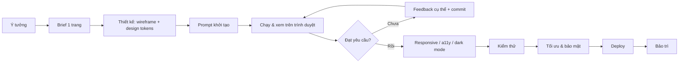

# Quy trình vibe coding HTML — từ ý tưởng đến khi lên mạng

> **Mục tiêu:** một quy trình lặp lại được để làm trang web HTML/CSS/JS (landing page, công cụ nhỏ, dashboard tĩnh, mini game...) bằng cách "nói chuyện" với AI coding agent, nhưng vẫn kiểm soát được chất lượng.
> **Dành cho:** người mới lẫn developer muốn làm nhanh. Không bắt buộc biết code sâu, nhưng cần đọc hiểu được HTML/CSS cơ bản để duyệt kết quả.

## Mục lục

0. [Vibe coding là gì, khi nào nên dùng](#0-vibe-coding-là-gì-khi-nào-nên-dùng)
1. [Chuẩn bị công cụ](#1-chuẩn-bị-công-cụ)
2. [Bước 1 — Viết brief](#2-bước-1--viết-brief-15-phút)
3. [Bước 2 — Thiết kế trước khi code](#3-bước-2--thiết-kế-trước-khi-code)
4. [Bước 3 — Prompt khởi tạo](#4-bước-3--prompt-khởi-tạo)
5. [Bước 4 — Vòng lặp build](#5-bước-4--vòng-lặp-build)
6. [Bước 5 — Responsive, accessibility, dark mode](#6-bước-5--responsive-accessibility-dark-mode)
7. [Bước 6 — Kiểm thử](#7-bước-6--kiểm-thử)
8. [Bước 7 — Tối ưu & bảo mật](#8-bước-7--tối-ưu--bảo-mật)
9. [Bước 8 — Deploy](#9-bước-8--deploy)
10. [Bước 9 — Bảo trì & nâng cấp](#10-bước-9--bảo-trì--nâng-cấp)
11. [Xử lý sự cố thường gặp](#11-xử-lý-sự-cố-thường-gặp)
12. [Checklist tổng](#12-checklist-tổng)
13. [Ví dụ end-to-end](#13-ví-dụ-end-to-end-landing-page-quán-cà-phê)

## Tổng quan quy trình



Nguyên tắc xuyên suốt: **bước nhỏ → chạy thử → commit**. AI viết code rất nhanh, nên nút thắt là khả năng *kiểm tra* của bạn. Mỗi vòng lặp chỉ nên thay đổi một thứ đủ nhỏ để bạn nhìn là biết đúng hay sai.

---

## 0. Vibe coding là gì, khi nào nên dùng

**Vibe coding** là cách làm phần mềm trong đó bạn mô tả mong muốn bằng ngôn ngữ tự nhiên, AI sinh code, bạn chạy thử và phản hồi tiếp, thay vì tự gõ từng dòng.

| Phù hợp | Không phù hợp (hoặc phải cẩn thận gấp đôi) |
|---|---|
| Landing page, portfolio, trang sự kiện | Xử lý thanh toán, đăng nhập, dữ liệu cá nhân |
| Công cụ nhỏ chạy trên trình duyệt (máy tính, chuyển đổi đơn vị, to-do) | Hệ thống nhiều người dùng, có backend phức tạp |
| Prototype để demo ý tưởng | Code cần bảo trì nhiều năm bởi team lớn |
| Mini game, trang học tập, dashboard dữ liệu tĩnh | Thứ bạn không thể tự kiểm tra là đúng |

Với HTML thuần, vibe coding đặc biệt hiệu quả vì: không cần build, kết quả nhìn thấy ngay, lỗi thường hiển thị trực quan.

## 1. Chuẩn bị công cụ

### 1.1. AI coding agent (chọn một)

| Loại | Ví dụ | Khi nào dùng |
|---|---|---|
| Chat trên web | Claude.ai (Artifacts), ChatGPT Canvas | Trang 1 file, muốn xem trước ngay, không cài gì |
| Agent trong terminal | Claude Code, Codex CLI, Gemini CLI | Dự án nhiều file, cần agent tự đọc/sửa file, chạy lệnh, git |
| IDE có AI | Cursor, VS Code + Copilot/Claude, Windsurf | Muốn vừa xem code vừa chat, sửa chọn lọc từng đoạn |
| App builder | v0, Bolt, Lovable | Prototype UI cực nhanh, chấp nhận ít kiểm soát hơn |

### 1.2. Công cụ phụ trợ

- **Trình soạn thảo:** VS Code (kèm extension *Live Server* để tự reload khi lưu file).
- **Trình duyệt + DevTools:** Chrome/Edge/Firefox. Học 4 tab: *Elements*, *Console*, *Network*, *Lighthouse*; và chế độ *Device toolbar* (Ctrl+Shift+M) để xem giao diện mobile.
- **Git + GitHub:** bắt buộc. Đây là "nút undo" khi AI làm hỏng code.
- **Server tĩnh local** (khi cần `fetch` file JSON, tránh lỗi CORS của `file://`):
  ```bash
  npx serve .            # hoặc
  python3 -m http.server 8000
  ```

### 1.3. Cấu trúc thư mục khởi đầu

Dự án nhỏ (dưới ~500 dòng): **một file** `index.html` là tốt nhất, AI dễ nắm toàn bộ ngữ cảnh.

Dự án vừa: tách file ngay từ đầu để AI không phải viết lại một file khổng lồ mỗi lần sửa.

```
my-site/
├── index.html
├── css/
│   └── styles.css
├── js/
│   └── main.js
├── assets/
│   ├── img/
│   └── icons/
├── data/            # JSON tĩnh nếu có
├── BRIEF.md         # brief của dự án (xem bước 1)
├── AGENTS.md        # hoặc CLAUDE.md: quy tắc cho AI agent
└── README.md
```

Khởi tạo git ngay:

```bash
mkdir my-site && cd my-site && git init
```

### 1.4. File quy tắc cho agent (`CLAUDE.md` / `AGENTS.md` / `.cursorrules`)

Agent đọc file này mỗi phiên, nên bạn không phải lặp lại yêu cầu. Mẫu:

```markdown
# Quy tắc dự án

- Stack: HTML5 + CSS thuần + JavaScript ES2020 thuần. KHÔNG dùng framework, KHÔNG build step.
- Thư viện ngoài chỉ qua CDN, ghi rõ phiên bản (vd. chart.js@4.4.1).
- Ngôn ngữ giao diện: tiếng Việt. Comment code: tiếng Việt, ngắn gọn.
- CSS: dùng biến trong :root (màu, font, khoảng cách). Mobile-first, breakpoint 768px và 1024px.
- HTML ngữ nghĩa: header/nav/main/section/footer, mọi  có alt, mọi input có <label>.
- Không dùng innerHTML với dữ liệu người dùng nhập; dùng textContent.
- Không đưa API key/secret vào bất kỳ file nào.
- Mỗi lần sửa: chỉ đổi phần được yêu cầu, không tự ý refactor phần khác.
- Sau khi sửa: liệt kê file đã đổi và cách kiểm tra.
```

## 2. Bước 1 — Viết brief (15 phút)

Prompt mơ hồ → kết quả chung chung. Viết `BRIEF.md` trước khi mở AI:

```markdown
# Brief: <tên dự án>

## Mục đích
Trang này để làm gì? Thành công trông như thế nào? (vd. khách đặt bàn được trong 30 giây)

## Người dùng
Ai dùng, trên thiết bị gì (70% điện thoại?), trình độ công nghệ.

## Nội dung & chức năng (ưu tiên MoSCoW)
- Must: ...
- Should: ...
- Could: ...
- Won't (lần này): ...

## Phong cách
3 tính từ (vd. ấm áp, tối giản, cao cấp). 1–3 trang web tham khảo + điều thích ở mỗi trang.
Màu thương hiệu, font, logo nếu có.

## Ràng buộc kỹ thuật
Một file hay nhiều file? Có cần chạy offline? Hỗ trợ trình duyệt nào? Hosting ở đâu?

## Nội dung thật
Tiêu đề, đoạn văn, giá, số điện thoại, ảnh... (nội dung thật cho ra thiết kế tốt hơn lorem ipsum).
```

**Mẹo:** có thể nhờ chính AI phỏng vấn bạn: *"Hãy hỏi tôi từng câu một để hoàn thiện brief cho một trang web X, tối đa 10 câu, rồi tổng hợp thành BRIEF.md."*

## 3. Bước 2 — Thiết kế trước khi code

Không cần Figma. Mục tiêu là cho AI một khung rõ ràng.

### 3.1. Wireframe bằng chữ

```
[Header] logo trái | menu: Thực đơn, Về chúng tôi, Liên hệ | nút "Đặt bàn" phải
[Hero] ảnh nền full-width, tiêu đề lớn, 1 dòng mô tả, 2 nút (Đặt bàn / Xem thực đơn)
[Thực đơn] tab lọc theo loại; lưới card 3 cột desktop / 1 cột mobile
[Đánh giá] 3 trích dẫn khách hàng
[Liên hệ] bản đồ trái, form đặt bàn phải
[Footer] giờ mở cửa, mạng xã hội, bản quyền
```

Hoặc vẽ tay lên giấy, chụp ảnh và gửi cho AI (các model hiện tại đọc ảnh tốt).

### 3.2. Design tokens

Chốt sớm để giao diện nhất quán, và để AI không "sáng tác" màu mới mỗi lần:

```css
:root {
  --color-bg: #fffaf3;
  --color-surface: #ffffff;
  --color-text: #2b2118;
  --color-muted: #7a6a5c;
  --color-primary: #8b4513;
  --color-primary-contrast: #ffffff;
  --font-heading: "Playfair Display", serif;
  --font-body: "Inter", system-ui, sans-serif;
  --space-1: 4px; --space-2: 8px; --space-3: 16px; --space-4: 24px; --space-5: 48px;
  --radius: 12px;
  --shadow: 0 4px 20px rgb(0 0 0 / 0.08);
  --max-width: 1120px;
}
```

### 3.3. Chọn mức kỹ thuật

| Mức | Khi nào | Stack |
|---|---|---|
| 1 file HTML | < 500 dòng, demo, công cụ cá nhân | HTML + `<style>` + `<script>` |
| Nhiều file tĩnh | Trang nhiều section, có JS đáng kể | HTML + CSS + JS tách file |
| Có tiện ích CSS | Muốn làm nhanh giao diện | + Tailwind qua CDN (prototype) |
| Có build | Nhiều trang, component lặp lại, cần tối ưu | Vite (vanilla), Astro |
| Cần dữ liệu động | Form lưu dữ liệu, đăng nhập | + Supabase/Firebase/serverless function |

Quy tắc: **chọn mức thấp nhất đáp ứng được yêu cầu**. Mỗi tầng thêm vào là thêm thứ AI có thể làm sai.

## 4. Bước 3 — Prompt khởi tạo

### 4.1. Cấu trúc prompt tốt

```
[Vai trò & bối cảnh]   Bạn là front-end developer giỏi. Tôi đang làm <dự án> cho <người dùng>.
[Mục tiêu]             Tạo phiên bản đầu tiên của trang <...>.
[Đầu vào]              Brief và wireframe bên dưới (hoặc: đọc BRIEF.md).
[Ràng buộc kỹ thuật]   HTML/CSS/JS thuần, mobile-first, dùng design tokens sau...
[Phạm vi lần này]      CHỈ làm phần khung + header + hero. Các section khác để placeholder.
[Tiêu chí hoàn thành]  Mở index.html chạy được, không lỗi console, đẹp ở 375px và 1440px.
[Định dạng đầu ra]     Trả về các file đầy đủ / liệt kê file đã tạo và cách chạy.
```

### 4.2. Prompt mẫu (dán được ngay)

```text
Bạn là front-end developer có gu thiết kế tốt.

Hãy tạo phiên bản đầu tiên của landing page theo BRIEF.md và wireframe dưới đây.

Wireframe:
<dán wireframe>

Design tokens (bắt buộc dùng, không thêm màu mới):
<dán :root>

Yêu cầu kỹ thuật:
- index.html + css/styles.css + js/main.js, không framework, không build.
- HTML ngữ nghĩa, mobile-first, breakpoint 768px / 1024px.
- Font từ Google Fonts. Ảnh tạm dùng https://picsum.photos với kích thước cố định, có alt mô tả.
- Menu mobile dạng nút hamburger có aria-expanded.

Phạm vi lần này: toàn bộ khung trang với nội dung thật trong brief.
Chưa cần: form gửi được dữ liệu, animation.

Khi xong: liệt kê file, giải thích ngắn cấu trúc, và nêu 3 điểm tôi nên kiểm tra.
```

### 4.3. Chiến lược "khung trước, chi tiết sau"

1. Lần 1: khung toàn trang + nội dung thật, style cơ bản.
2. Lần 2..n: hoàn thiện từng section.
3. Sau đó: tương tác (JS), animation, responsive tinh chỉnh.

Đừng yêu cầu "trang hoàn chỉnh, đẹp, đầy đủ animation" trong một prompt: kết quả thường dài, khó kiểm tra và khó sửa.

## 5. Bước 4 — Vòng lặp build

Đây là phần chiếm nhiều thời gian nhất. Mỗi vòng:

```
1. Chạy  → mở trang (Live Server / npx serve), mở DevTools Console
2. Nhìn  → so với brief: đúng chưa? lỗi console? mobile thế nào?
3. Ghi   → viết feedback cụ thể (xem 5.2)
4. Sửa   → gửi AI, yêu cầu chỉ đổi phần liên quan
5. Kiểm  → reload, xác nhận đã đúng và KHÔNG làm hỏng chỗ khác
6. Commit → git add -A && git commit -m "feat: thêm section thực đơn"
```

### 5.1. Commit sau mỗi bước thành công

```bash
git add -A
git commit -m "feat(hero): nút CTA và ảnh nền"
# AI làm hỏng? quay lại:
git diff                 # xem AI đã đổi gì
git restore .            # bỏ mọi thay đổi chưa commit
git revert HEAD          # hoàn tác commit gần nhất
```

Với agent trong terminal (Claude Code...), bạn có thể yêu cầu agent tự commit sau mỗi bước, nhưng vẫn nên xem `git diff` trước.

### 5.2. Viết feedback tốt

| ❌ Mơ hồ | ✅ Cụ thể |
|---|---|
| "Làm đẹp hơn" | "Hero trông trống. Tăng tiêu đề lên 56px desktop / 36px mobile, thêm lớp phủ tối 40% lên ảnh để chữ trắng dễ đọc." |
| "Bị lỗi" | "Bấm nút hamburger trên mobile không mở menu. Console: `Uncaught TypeError: Cannot read properties of null (reading 'addEventListener') at main.js:12`." |
| "Mobile xấu" | "Ở 375px, lưới thực đơn tràn ngang và có thanh cuộn ngang. Muốn 1 cột, card full-width, ảnh tỉ lệ 4:3." |
| "Giống Apple" | "Nhiều khoảng trắng như apple.com: padding section 96px, chữ căn giữa, tối đa 2 màu." |

Công thức: **ở đâu + đang thế nào + muốn thế nào + (bằng chứng: screenshot / lỗi console)**.

### 5.3. Đưa đúng ngữ cảnh cho AI

- **Lỗi console:** copy nguyên văn, kèm số dòng.
- **Screenshot:** cực kỳ hiệu quả cho lỗi giao diện. Chụp cả bản mobile (DevTools device mode).
- **Đoạn code liên quan:** nếu dùng chat web, dán file đang có (bản mới nhất), không để AI "nhớ" bản cũ.
- **Chỉ định phạm vi:** "Chỉ sửa `.menu-card` trong styles.css, không đụng file khác."

### 5.4. Các prompt hữu ích trong vòng lặp

- *"Trước khi sửa, giải thích nguyên nhân lỗi và đề xuất cách sửa, chờ tôi đồng ý."* (khi lỗi khó)
- *"Đưa ra 3 phương án thiết kế khác nhau cho section X, mô tả ngắn, tôi chọn rồi mới code."*
- *"Review lại toàn bộ index.html: tìm lỗi accessibility, code thừa, CSS trùng lặp. Chỉ liệt kê, chưa sửa."*
- *"File main.js quá dài, tách thành module theo chức năng mà không đổi hành vi."*
- *"Giải thích đoạn code này cho người mới."* (để bạn hiểu và kiểm soát được code)

### 5.5. Khi nào nên mở phiên chat mới

- Hội thoại quá dài, AI bắt đầu quên quy tắc hoặc sửa lại lỗi cũ.
- Chuyển sang tính năng hoàn toàn khác.

Cách làm: mở phiên mới, đưa `BRIEF.md` + quy tắc + code hiện tại + mô tả việc tiếp theo. (Với agent đọc được repo, chỉ cần quy tắc trong `CLAUDE.md`/`AGENTS.md`.)

## 6. Bước 5 — Responsive, accessibility, dark mode

Làm thành một vòng riêng, có checklist rõ ràng.

### 6.1. Responsive

Kiểm tra ở các chiều rộng: **320, 375, 768, 1024, 1440px**.

- Không có thanh cuộn ngang (thủ phạm thường gặp: `width: 100vw`, ảnh không `max-width: 100%`, chữ dài không xuống dòng).
- Nút bấm cao tối thiểu 44px trên mobile.
- Chữ nội dung ≥ 16px trên mobile (tránh iOS tự zoom khi focus input).
- Có `<meta name="viewport" content="width=device-width, initial-scale=1">`.

Prompt: *"Kiểm tra và sửa responsive cho 320/375/768/1024/1440px. Không được có cuộn ngang. Liệt kê những gì đã sửa."*

### 6.2. Accessibility (a11y)

- Cấu trúc heading đúng thứ tự (một `h1`, rồi `h2`, `h3`).
- `alt` cho ảnh (ảnh trang trí: `alt=""`).
- Mọi input có `<label>`; nút chỉ có icon thì có `aria-label`.
- Điều hướng được bằng bàn phím (Tab), có viền focus thấy rõ.
- Tương phản màu chữ ≥ 4.5:1 (kiểm bằng DevTools hoặc WebAIM Contrast Checker).
- Tôn trọng `prefers-reduced-motion` cho animation.

### 6.3. Dark mode (tùy chọn)

```css
@media (prefers-color-scheme: dark) {
  :root {
    --color-bg: #1a1410;
    --color-surface: #251d17;
    --color-text: #f3ece4;
    --color-muted: #b4a597;
  }
}
```

Nhờ đã dùng design tokens từ đầu, dark mode chỉ là đổi giá trị biến.

## 7. Bước 6 — Kiểm thử

### 7.1. Kiểm thử thủ công (bắt buộc)

- [ ] Mọi link và nút hoạt động; link ngoài mở đúng trang.
- [ ] Form: thử bỏ trống, nhập sai định dạng, nhập rất dài, nhập ký tự đặc biệt `<script>alert(1)</script>`.
- [ ] Console sạch (không lỗi đỏ, không 404 trong tab Network).
- [ ] Thử trên ít nhất 2 trình duyệt (Chrome + Safari/Firefox) và 1 điện thoại thật.
- [ ] Tải lại trang, bấm Back/Forward, thử mạng chậm (Network → Slow 4G).

### 7.2. Công cụ tự động

| Công cụ | Kiểm tra gì | Cách dùng |
|---|---|---|
| Lighthouse (DevTools) | Performance, Accessibility, Best Practices, SEO | Tab Lighthouse → Analyze; mục tiêu ≥ 90 mỗi mục |
| W3C Validator | HTML hợp lệ | validator.w3.org, upload file |
| axe DevTools | Lỗi a11y chi tiết | Extension trình duyệt |
| Playwright | Smoke test tự động, chụp screenshot nhiều kích thước | Xem dưới |

Smoke test Playwright tối thiểu (nhờ AI viết cũng được):

```js
// tests/smoke.spec.js  — chạy: npx playwright test
const { test, expect } = require('@playwright/test');

test('trang tải không lỗi console và có tiêu đề', async ({ page }) => {
  const errors = [];
  page.on('pageerror', e => errors.push(e.message));
  page.on('console', m => m.type() === 'error' && errors.push(m.text()));

  await page.goto('http://localhost:3000');
  await expect(page.locator('h1')).toBeVisible();
  expect(errors).toEqual([]);
});

test('không cuộn ngang trên mobile', async ({ page }) => {
  await page.setViewportSize({ width: 375, height: 800 });
  await page.goto('http://localhost:3000');
  const overflow = await page.evaluate(
    () => document.documentElement.scrollWidth > window.innerWidth
  );
  expect(overflow).toBe(false);
});
```

Prompt: *"Viết test Playwright cho các luồng chính: mở menu mobile, chuyển tab thực đơn, gửi form với dữ liệu hợp lệ và không hợp lệ."*

## 8. Bước 7 — Tối ưu & bảo mật

### 8.1. Hiệu năng

- Ảnh: định dạng WebP/AVIF, đúng kích thước hiển thị, có `width`/`height` (tránh nhảy layout), `loading="lazy"` cho ảnh dưới màn hình đầu tiên.
- Font: chỉ tải weight cần dùng, `font-display: swap`, `<link rel="preconnect">` tới Google Fonts.
- Script: đặt `defer`; bỏ thư viện không dùng (AI hay thêm thừa).
- Tailwind CDN chỉ dành cho prototype; production nên build hoặc chuyển sang CSS thuần.

### 8.2. Bảo mật (quan trọng nhất với code AI sinh ra)

- **Không bao giờ để API key trong HTML/JS phía client.** Mọi thứ trong file tĩnh đều ai cũng xem được (View Source). Cần gọi API có key → dùng serverless function (Netlify/Vercel/Cloudflare Functions) làm trung gian.
- Không dùng `innerHTML`/`insertAdjacentHTML` với dữ liệu người dùng hoặc dữ liệu từ API → dùng `textContent` hoặc tạo element (chống XSS).
- Link mở tab mới: `target="_blank" rel="noopener noreferrer"`.
- Thư viện CDN: ghi rõ phiên bản; có thể thêm `integrity` (SRI).
- Form liên hệ: dùng dịch vụ có chống spam (Formspree, Netlify Forms, Web3Forms) hoặc tự làm có kiểm tra phía server.
- Cân nhắc Content-Security-Policy qua header của hosting.

Prompt rà soát: *"Đóng vai chuyên gia bảo mật, review toàn bộ code: tìm XSS, secret bị lộ, thư viện không rõ phiên bản, link không an toàn. Liệt kê theo mức độ nghiêm trọng."*

### 8.3. SEO & chia sẻ mạng xã hội

```html
<html lang="vi">
<head>
  <meta charset="utf-8">
  <meta name="viewport" content="width=device-width, initial-scale=1">
  <title>Tên trang — mô tả ngắn (≤ 60 ký tự)</title>
  <meta name="description" content="Mô tả 120–160 ký tự.">
  <link rel="icon" href="/assets/icons/favicon.svg">
  <meta property="og:title" content="...">
  <meta property="og:description" content="...">
  <meta property="og:image" content="https://domain/assets/img/og.jpg">
  <link rel="canonical" href="https://domain/">
</head>
```

## 9. Bước 8 — Deploy

| Dịch vụ | Ưu điểm | Cách nhanh nhất |
|---|---|---|
| GitHub Pages | Miễn phí, gắn với repo | Settings → Pages → Deploy from branch `main` / root |
| Netlify | Kéo-thả thư mục, có Forms, Functions | app.netlify.com/drop, kéo thư mục vào |
| Vercel | Preview cho mỗi PR, Functions | Import repo GitHub, framework "Other" |
| Cloudflare Pages | Nhanh, băng thông lớn miễn phí | Connect GitHub repo, build command để trống |

Quy trình chuẩn:

```bash
git remote add origin https://github.com/<user>/my-site.git
git push -u origin main
# Bật GitHub Pages hoặc import repo vào Netlify/Vercel/Cloudflare
```

Sau deploy:

- [ ] Mở link thật trên điện thoại.
- [ ] Kiểm tra đường dẫn tương đối (lỗi hay gặp: `/css/styles.css` chạy local nhưng hỏng trên GitHub Pages dạng `user.github.io/repo/` → dùng `css/styles.css`).
- [ ] Chạy lại Lighthouse trên bản production.
- [ ] (Tùy chọn) gắn tên miền riêng, HTTPS bật tự động.
- [ ] (Tùy chọn) analytics nhẹ, tôn trọng quyền riêng tư: Plausible, Umami, Cloudflare Web Analytics.

## 10. Bước 9 — Bảo trì & nâng cấp

- Mỗi thay đổi mới: tạo branch → vibe code → kiểm thử → PR → merge (preview tự động trên Vercel/Netlify rất tiện).
- Ghi `CHANGELOG` ngắn hoặc commit message rõ ràng để lần sau AI (và bạn) hiểu lịch sử.
- Cập nhật `CLAUDE.md`/`AGENTS.md` mỗi khi phát hiện AI hay mắc một lỗi nào đó ("Không dùng thư viện X", "Luôn dùng class BEM").
- Định kỳ nhờ AI review toàn bộ: code chết, CSS không dùng, thư viện lỗi thời.
- Khi dự án lớn dần (nhiều trang lặp header/footer), cân nhắc chuyển sang Astro hoặc Vite thay vì copy-paste.

## 11. Xử lý sự cố thường gặp

| Triệu chứng | Nguyên nhân | Cách xử lý |
|---|---|---|
| AI sửa A thì hỏng B | Prompt không giới hạn phạm vi; file quá lớn | Chỉ định rõ file/selector được sửa; tách file; `git diff` trước khi chấp nhận |
| Vòng lặp sửa lỗi mãi không xong | AI đoán mò nguyên nhân | Yêu cầu "giải thích nguyên nhân trước, thêm `console.log` để xác minh"; hoặc `git restore` và làm lại theo cách khác |
| AI viết lại cả file, mất phần đã chỉnh | Chat web trả về file đầy đủ từ bản cũ | Luôn dán bản mới nhất; dùng agent sửa trực tiếp trên file; commit thường xuyên |
| Giao diện "chung chung kiểu AI" | Không có tokens, không có tham chiếu | Đưa design tokens, ảnh tham khảo, 3 tính từ phong cách, nội dung thật |
| Chạy `file://` lỗi CORS khi `fetch` JSON | Trình duyệt chặn | Chạy qua `npx serve` hoặc `python3 -m http.server` |
| Chạy local được, deploy thì vỡ CSS/ảnh | Đường dẫn tuyệt đối `/...`, phân biệt hoa thường tên file trên Linux | Dùng đường dẫn tương đối, thống nhất tên file chữ thường |
| AI "bịa" thuộc tính/thư viện không tồn tại | Hallucination | Yêu cầu dùng API chuẩn, kiểm tra trên MDN; ghim phiên bản thư viện |
| Hội thoại dài, AI quên quy tắc | Ngữ cảnh quá dài | Mở phiên mới với brief + quy tắc + code hiện tại |
| Code chạy nhưng bạn không hiểu | Tiến quá nhanh | Dừng lại, nhờ AI giải thích; không deploy thứ bạn không hiểu khi nó xử lý dữ liệu người dùng |

## 12. Checklist tổng

**Trước khi code**
- [ ] `BRIEF.md` có mục đích, người dùng, MoSCoW, phong cách, nội dung thật
- [ ] Wireframe (chữ hoặc ảnh)
- [ ] Design tokens
- [ ] Đã chọn mức kỹ thuật thấp nhất phù hợp
- [ ] `git init` + file quy tắc cho agent

**Trong lúc build**
- [ ] Mỗi vòng: một thay đổi nhỏ → chạy → kiểm → commit
- [ ] Feedback có vị trí + hiện trạng + mong muốn + bằng chứng
- [ ] Console sạch sau mỗi vòng

**Trước khi deploy**
- [ ] Responsive 320 → 1440px, không cuộn ngang
- [ ] A11y: heading, alt, label, bàn phím, tương phản
- [ ] Lighthouse ≥ 90, HTML hợp lệ
- [ ] Không secret trong code, không `innerHTML` với dữ liệu ngoài
- [ ] Meta SEO, favicon, Open Graph
- [ ] Test trên điện thoại thật

**Sau deploy**
- [ ] Kiểm tra link production, đường dẫn tài nguyên
- [ ] Analytics (nếu cần), tên miền (nếu cần)
- [ ] Cập nhật README: cách chạy, cách deploy

## 13. Ví dụ end-to-end: landing page quán cà phê

Minh họa chuỗi prompt thực tế (mỗi dòng là một vòng lặp, sau mỗi vòng đều chạy thử và commit):

| # | Prompt (rút gọn) | Kết quả / commit |
|---|---|---|
| 1 | "Hỏi tôi tối đa 8 câu để viết BRIEF.md cho landing page quán cà phê 'Gió Bấc' ở Đà Lạt." | `docs: brief` |
| 2 | "Theo BRIEF.md + wireframe + tokens, tạo khung trang 3 file, nội dung thật, style cơ bản." | `feat: khung trang` |
| 3 | "Hero: ảnh nền phủ tối 40%, tiêu đề Playfair 56/36px, 2 nút CTA. Chỉ sửa hero." | `feat(hero)` |
| 4 | "Section thực đơn: tab lọc Cà phê/Trà/Bánh, dữ liệu từ data/menu.json, render bằng createElement." | `feat(menu): tab lọc` |
| 5 | (gửi screenshot mobile) "Card bị tràn ngang ở 375px, muốn 1 cột, ảnh 4:3." | `fix(menu): responsive` |
| 6 | "Form đặt bàn: validate tên, SĐT VN, ngày ≥ hôm nay, số khách 1–20; gửi qua Formspree; thông báo thành công/thất bại dễ thấy." | `feat(booking)` |
| 7 | "Rà soát a11y + responsive 320–1440 + dark mode bằng prefers-color-scheme. Liệt kê rồi sửa." | `fix: a11y, dark mode` |
| 8 | "Viết Playwright smoke test: không lỗi console, không cuộn ngang, tab thực đơn hoạt động, form báo lỗi khi bỏ trống." | `test: smoke` |
| 9 | "Review bảo mật & hiệu năng: chuyển ảnh sang WebP, lazy load, defer script, meta SEO + OG." | `perf/seo` |
| 10 | Push lên GitHub, bật Pages, kiểm tra trên điện thoại, chạy Lighthouse production. | 🚀 live |

Thời gian thực tế cho một trang cỡ này: khoảng 2–4 giờ, trong đó phần lớn là **xem, kiểm tra và viết feedback**, không phải chờ AI viết code.

---

**Tóm tắt một câu:** brief rõ → thiết kế có tokens → prompt khởi tạo giới hạn phạm vi → lặp *nhỏ – chạy – kiểm – commit* → rà responsive/a11y/bảo mật → test → deploy → ghi lại quy tắc cho lần sau.
