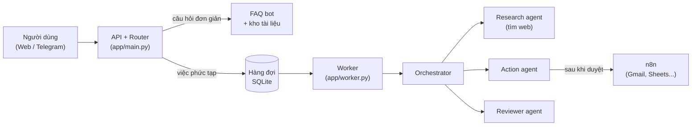

# Hướng dẫn triển khai từng bước: Chatbot + AI Agent Team

> **Dành cho:** người mới, triển khai lần đầu. Không cần kinh nghiệm về AI; chỉ cần biết mở terminal và gõ lệnh.
> **Mã nguồn:** [`starter/chatbot-agent-team/`](../../starter/chatbot-agent-team/) · **Thiết kế:** [Chatbot kết hợp AI Agent Team](../solution-design/chatbot-agent-team.md)

## Bạn sẽ có gì sau khi làm xong

- Một **chatbot trên web** (và tùy chọn **Telegram**) trả lời câu hỏi từ tài liệu của công ty, có ghi nguồn.
- Một **nhóm AI agent** nhận việc phức tạp: lập kế hoạch → tìm kiếm web song song → viết báo cáo → tự kiểm duyệt → gửi kết quả, có báo tiến độ.
- **Hành động có duyệt**: agent đề xuất tạo ticket / gửi email, bạn bấm *Duyệt* thì hệ thống mới thực hiện (qua n8n).
- **Chuyển nhân viên** khi khách yêu cầu.



## Lộ trình và thời gian

| Bước | Nội dung | Thời gian | Cần tiền? |
|---|---|---|---|
| 0 | Cài công cụ | 20–40 phút | Không |
| 1–5 | Tải mã, cài đặt, chạy thử ở chế độ giả lập | 20 phút | Không |
| 6 | Bật AI thật (API key Anthropic) | 10 phút | Có (trả theo mức dùng) |
| 7 | Thay bằng tài liệu thật của bạn | 30–60 phút | Không |
| 8 | Kết nối Telegram | 10 phút | Không |
| 9 | Kết nối n8n để thực hiện hành động thật | 30–45 phút | Không |
| 10 | Chạy bằng Docker | 15 phút | Không |
| 11 | Đưa lên máy chủ (VPS) | 45–60 phút | Có (VPS) |
| 12 | Vận hành hằng ngày | — | — |

**Mẹo:** Bước 1–5 chạy ở **chế độ giả lập** (`FAKE_LLM=1`): toàn bộ hệ thống hoạt động nhưng không gọi AI thật, nên không tốn tiền. Hãy làm cho chạy được ở chế độ này trước, rồi mới bật AI thật.

---

## Bước 0 — Cài công cụ cần thiết

| Công cụ | Dùng để | Cách kiểm tra đã cài |
|---|---|---|
| **Python 3.11 trở lên** | Chạy chương trình | `python3 --version` (Windows: `python --version`) |
| **Git** | Tải mã nguồn | `git --version` |
| **VS Code** (khuyến nghị) | Mở và sửa file | — |
| **Docker Desktop** (từ bước 9) | Chạy n8n và chạy cả hệ thống | `docker --version` |

Cách cài:

- **Windows:** tải Python tại https://www.python.org/downloads/ (khi cài, **tích chọn "Add python.exe to PATH"**), Git tại https://git-scm.com/download/win, Docker Desktop tại https://www.docker.com/products/docker-desktop/.
- **macOS:** cài Homebrew (https://brew.sh) rồi chạy lệnh bên dưới; Docker Desktop tải từ trang Docker.
- **Ubuntu/Linux:** chạy lệnh bên dưới.

macOS:

```bash
brew install python git
```

Ubuntu:

```bash
sudo apt update && sudo apt install -y python3 python3-venv python3-pip git
```

> Trong hướng dẫn này, khối lệnh ghi **macOS/Linux** dùng `python3`; trên **Windows** thay bằng `python`. Mỗi khối lệnh là một lệnh, copy và chạy lần lượt.

---

## Bước 1 — Tải mã nguồn

Mở terminal (Windows: mở **PowerShell**), chuyển tới thư mục bạn muốn lưu dự án rồi chạy:

```bash
git clone https://github.com/mrchinh189/AI-LEARNING.git
```

```bash
cd AI-LEARNING/starter/chatbot-agent-team
```

Từ giờ, **mọi lệnh đều chạy trong thư mục `starter/chatbot-agent-team`**. Mở thư mục này bằng VS Code (`code .`) để tiện xem file.

---

## Bước 2 — Tạo môi trường Python và cài thư viện

Môi trường ảo (virtualenv) giúp thư viện của dự án không lẫn với máy.

**macOS / Linux:**

```bash
python3 -m venv .venv
```

```bash
source .venv/bin/activate
```

**Windows (PowerShell):**

```bash
python -m venv .venv
```

```bash
.venv\Scripts\Activate.ps1
```

> Nếu PowerShell báo lỗi "running scripts is disabled", chạy `Set-ExecutionPolicy -Scope CurrentUser RemoteSigned`, chọn `Y`, rồi kích hoạt lại.

Khi kích hoạt thành công, đầu dòng lệnh có chữ `(.venv)`. **Mỗi lần mở terminal mới đều phải kích hoạt lại** bằng lệnh `activate` ở trên.

Cài thư viện:

```bash
pip install -r requirements-dev.txt
```

---

## Bước 3 — Tạo file cấu hình `.env`

**macOS / Linux:**

```bash
cp .env.example .env
```

**Windows:**

```bash
copy .env.example .env
```

Mở file `.env` bằng VS Code. Lúc này giữ nguyên `FAKE_LLM=1` (chế độ giả lập). Ý nghĩa từng dòng:

| Biến | Ý nghĩa | Khi nào sửa |
|---|---|---|
| `ANTHROPIC_API_KEY` | Khóa gọi Claude API | Bước 6 |
| `FAKE_LLM` | `1` = giả lập, `0` = AI thật | Bước 6 |
| `MODEL_ROUTER` / `MODEL_AGENT` / `MODEL_ORCHESTRATOR` | Model cho từng vai trò | Thường để nguyên |
| `ENABLE_WEB_SEARCH` | Cho Research agent tìm web | Đặt `0` nếu tổ chức chưa bật web search |
| `BOT_NAME` | Tên trợ lý | Tùy ý |
| `TELEGRAM_BOT_TOKEN` | Token bot Telegram | Bước 8 |
| `N8N_WEBHOOK_URL` | Địa chỉ webhook n8n | Bước 9 |

> **Bảo mật:** file `.env` chứa khóa bí mật. Không gửi nó cho ai, không commit lên GitHub (dự án đã có `.gitignore` chặn sẵn).

---

## Bước 4 — Chạy kiểm thử

```bash
pytest -q
```

Kết quả mong đợi:

```text
.......                                                                  [100%]
7 passed
```

Nếu thấy `7 passed` nghĩa là cài đặt đúng. Nếu lỗi, xem mục [Xử lý sự cố](#xử-lý-sự-cố).

---

## Bước 5 — Chạy hệ thống và thử ở chế độ giả lập

### 5.1. Nạp tài liệu mẫu vào kho tri thức

```bash
python -m app.ingest kb --reset
```

Kết quả: `Xong: đã nạp 7 đoạn vào kho tri thức.` (file mẫu là `kb/faq-mau.md`).

### 5.2. Mở 2 terminal

Hệ thống gồm 2 tiến trình chạy song song. Mở 2 cửa sổ terminal, **cả hai đều `cd` vào `starter/chatbot-agent-team` và kích hoạt `.venv`**.

**Terminal 1 — API (nhận tin nhắn):**

```bash
uvicorn app.main:app --reload --port 8000
```

**Terminal 2 — Worker (chạy nhóm agent):**

```bash
python -m app.worker
```

Thấy dòng `Worker sẵn sàng (FAKE_LLM=True)` là được. Để tắt: bấm `Ctrl + C` trong từng terminal.

### 5.3. Mở trình duyệt và thử 4 kịch bản

Truy cập http://localhost:8000.

| Gõ thử | Điều xảy ra | Đường đi |
|---|---|---|
| `Phí giao hàng nội thành bao nhiêu?` | Trả lời ngay, có mục **Nguồn** | Router → FAQ |
| `/sau So sánh 3 hãng máy chiếu phổ biến` | "Đã nhận yêu cầu (mã …)", rồi các dòng ⏳ tiến độ, cuối cùng là báo cáo | Router → hàng đợi → Worker → Orchestrator → Research → Reviewer |
| `Tạo ticket: máy in đơn 123 bị kẹt giấy` | Hiện thẻ **Cần bạn duyệt hành động** → bấm *Duyệt* → "✅ Đã thực hiện… Chế độ thử" | Action agent → duyệt → thực thi |
| `Cho tôi gặp nhân viên` | Chuyển sang chế độ nhân viên; gõ `/bot` để quay lại | Router → handoff |

Ở chế độ giả lập, câu trả lời có chữ `[FAKE_LLM]`. Đó là đúng: luồng hệ thống đã chạy, chỉ phần AI đang được giả lập.

Mẹo: lệnh `/sau <yêu cầu>` luôn giao việc cho nhóm agent, dùng khi router phân loại nhầm một câu hỏi phức tạp thành câu hỏi đơn giản.

---

## Bước 6 — Bật AI thật

### 6.1. Tạo API key Anthropic

1. Vào https://console.anthropic.com, đăng ký tài khoản.
2. Vào mục **Billing**, nạp credit (bắt đầu với 5–10 USD là đủ để thử).
3. Vào mục **Limits**, **đặt giới hạn chi tiêu hằng tháng** để tránh phát sinh ngoài ý muốn.
4. Vào mục **API Keys** → **Create Key**, đặt tên (ví dụ `chatbot-dev`), copy khóa (bắt đầu bằng `sk-ant-`). Khóa chỉ hiện một lần.

### 6.2. Cập nhật `.env`

```dotenv
ANTHROPIC_API_KEY=sk-ant-...khóa-của-bạn...
FAKE_LLM=0
```

### 6.3. Khởi động lại và thử

Tắt cả 2 terminal (`Ctrl + C`) rồi chạy lại hai lệnh ở bước 5.2. Thử lại 4 kịch bản ở bước 5.3. Lần này:

- Câu hỏi FAQ được trả lời tự nhiên bằng tiếng Việt, có [1], [2] trỏ tới nguồn.
- Tác vụ `/sau ...` mất khoảng 1–3 phút, báo cáo có link nguồn từ web.

### 6.4. Model và chi phí

| Vai trò | Model mặc định | Giá (USD / 1 triệu token, vào / ra) | Dùng cho |
|---|---|---|---|
| Router | `claude-haiku-5-5` | 0,10 / 0,50 | Phân loại mọi tin nhắn |
| Agent | `claude-sonnet-5-5` | 2 / 10 | FAQ, Research, Action, Reviewer |
| Orchestrator | `claude-opus-5-5` | 4 / 20 | Lập kế hoạch và viết báo cáo |

Ước tính thô: một câu FAQ khoảng **0,01 USD**; một tác vụ nghiên cứu sâu khoảng **0,3–0,8 USD** (gồm cả phí riêng cho mỗi lượt web search). Con số thực tế phụ thuộc độ dài tài liệu và câu hỏi; hãy xem mục **Usage** trong Console sau vài ngày chạy thử.

Muốn rẻ hơn: đặt `MODEL_ORCHESTRATOR=claude-sonnet-5-5` trong `.env`, rồi so sánh chất lượng báo cáo trước và sau khi đổi.

> **Nếu Research agent báo lỗi liên quan tới web search:** web search có thể chưa được bật cho tổ chức của bạn. Bật trong phần cài đặt của Console, hoặc tạm đặt `ENABLE_WEB_SEARCH=0` (agent khi đó chỉ dùng kiến thức sẵn có và sẽ ghi rõ điều này).

---

## Bước 7 — Dùng tài liệu thật của bạn

1. Xóa hoặc giữ `kb/faq-mau.md`, rồi chép tài liệu của bạn vào thư mục `kb/`:
   - `.md`, `.txt`: dùng được ngay.
   - `.pdf`, `.docx`, `.xlsx`, `.pptx`, `.html`: cài thêm bộ chuyển đổi bằng lệnh bên dưới.
2. Nạp lại kho tri thức (cũng bằng lệnh bên dưới). **Mỗi lần sửa tài liệu đều chạy lại lệnh này.** Không cần khởi động lại API.

```bash
pip install "markitdown[all]"
```

```bash
python -m app.ingest kb --reset
```

**Mẹo viết tài liệu để bot trả lời tốt:**

- Mỗi chủ đề một tiêu đề `##` rõ ràng (ví dụ `## Phí giao hàng`). Tiêu đề được dùng làm tên nguồn.
- Viết câu đầy đủ, có số liệu cụ thể; tránh bảng quá phức tạp.
- Dùng đúng từ khách hay hỏi (ví dụ cả "ship" lẫn "giao hàng").
- Tìm kiếm không phân biệt dấu: khách gõ "phi giao hang" vẫn tìm được "Phí giao hàng".

Muốn đổi giọng văn hoặc quy tắc trả lời: sửa biến `SYSTEM` trong `app/faq.py`. Muốn đổi cách phân loại: sửa `SYSTEM` trong `app/router.py`.

---

## Bước 8 — Kết nối Telegram

1. Trong Telegram, tìm **@BotFather** → gửi `/newbot` → đặt tên và username (phải kết thúc bằng `bot`).
2. BotFather trả về một token dạng `123456789:AA...`. Dán vào `.env`:

   ```dotenv
   TELEGRAM_BOT_TOKEN=123456789:AA...
   ```

3. Mở **terminal thứ 3** (kích hoạt `.venv`), chạy:

   ```bash
   python -m app.telegram_bot
   ```

   Thấy `Bot @ten_bot đang chạy` là thành công.
4. Mở bot trên Telegram, bấm **Start**, rồi thử lại 4 kịch bản ở bước 5.3. Với hành động cần duyệt, bot gửi tin nhắn có nút **✅ Duyệt / ✖ Hủy**.

Bot dùng *long polling* nên **không cần tên miền hay HTTPS**, chạy được ngay trên máy cá nhân. API (terminal 1) không bắt buộc cho Telegram, nhưng **worker (terminal 2) phải đang chạy**.

---

## Bước 9 — Kết nối n8n để thực hiện hành động thật

Mặc định, hành động đã duyệt chỉ được ghi lại ("Chế độ thử"). Bước này nối nó vào n8n để thật sự tạo ticket (ghi Google Sheets) hoặc gửi email (Gmail).

### 9.1. Chạy n8n

Cần Docker Desktop đang mở. Đổi `N8N_VERSION` trong `docker-compose.yml` sang bản mới nhất (xem https://github.com/n8n-io/n8n/releases), rồi:

```bash
docker compose --profile n8n up -d n8n
```

Mở http://localhost:5678 và tạo tài khoản quản trị n8n (lưu trên máy bạn).

### 9.2. Tạo workflow nhận hành động

1. **Create Workflow** → đặt tên `Agent actions`.
2. Thêm node **Webhook**:
   - *HTTP Method*: `POST`
   - *Path*: `agent-action`
   - *Respond*: `Immediately`
3. Thêm node **Switch** nối sau Webhook, *Mode*: `Rules`, so sánh giá trị `{{ $json.body.action }}`:
   - Rule 1: *is equal to* `create_ticket`
   - Rule 2: *is equal to* `send_email`
4. Nhánh `create_ticket`: thêm node **Google Sheets** → *Append Row*, đăng nhập Google, chọn file và sheet, map các cột:
   - `title` ← `{{ $json.body.params.title }}`
   - `description` ← `{{ $json.body.params.description }}`
   - `priority` ← `{{ $json.body.params.priority }}`
5. Nhánh `send_email`: thêm node **Gmail** → *Send*:
   - *To* ← `{{ $json.body.params.to }}`
   - *Subject* ← `{{ $json.body.params.subject }}`
   - *Message* ← `{{ $json.body.params.body }}`
6. **Save**, rồi bật công tắc **Active** (góc trên bên phải).

Hệ thống gửi sang n8n dữ liệu dạng:

```json
{ "action": "create_ticket", "params": { "title": "...", "description": "...", "priority": "high" } }
```

### 9.3. Kiểm tra webhook bằng lệnh

```bash
curl -X POST http://localhost:5678/webhook/agent-action -H "Content-Type: application/json" -d '{"action":"create_ticket","params":{"title":"Test","description":"Thử webhook","priority":"low"}}'
```

Trên Windows, chạy lệnh này trong **Git Bash** (cài kèm Git) vì PowerShell xử lý dấu nháy khác. Kiểm tra Google Sheet có thêm dòng mới, hoặc xem tab **Executions** trong n8n. Lưu ý: `/webhook/...` chỉ chạy khi workflow đã **Active**; còn `/webhook-test/...` chỉ chạy khi bạn đang bấm *Listen for test event*.

### 9.4. Trỏ hệ thống tới n8n

Trong `.env` (khi chạy Python trực tiếp trên máy):

```dotenv
N8N_WEBHOOK_URL=http://localhost:5678/webhook/agent-action
```

Khởi động lại worker, rồi thử `Tạo ticket: ...` và bấm *Duyệt*. Kết quả "✅ Đã thực hiện" giờ là thật.

> **Vì sao dùng n8n?** Agent không giữ mật khẩu Gmail/Google; thông tin đăng nhập nằm trong n8n. Muốn thêm hành động mới (tạo đơn CRM, nhắn Zalo…), thêm nhánh trong n8n và thêm một dòng vào `ACTIONS` trong `app/agents/action.py`.

---

## Bước 10 — Chạy cả hệ thống bằng Docker Compose

Khi đã chạy ổn, dùng Docker để mọi thứ tự khởi động và tự chạy lại khi lỗi. Tắt các terminal ở bước 5, 8 trước.

1. Nếu dùng n8n trong Docker, sửa `.env`. Bên trong Docker, các dịch vụ gọi nhau bằng tên dịch vụ, không dùng `localhost`:

   ```dotenv
   N8N_WEBHOOK_URL=http://n8n:5678/webhook/agent-action
   ```

2. Build và nạp tài liệu:

   ```bash
   docker compose build
   ```

   ```bash
   docker compose run --rm api python -m app.ingest kb --reset
   ```

3. Chạy (bỏ `--profile` nào bạn không dùng):

   ```bash
   docker compose --profile telegram --profile n8n up -d
   ```

Các lệnh hay dùng:

| Việc | Lệnh |
|---|---|
| Xem trạng thái | `docker compose ps` |
| Xem log worker | `docker compose logs -f worker` |
| Khởi động lại sau khi sửa `.env` | `docker compose --profile telegram --profile n8n up -d` |
| Cập nhật sau khi sửa code | `docker compose build && docker compose --profile telegram --profile n8n up -d` |
| Nạp lại tài liệu | `docker compose run --rm api python -m app.ingest kb --reset` |
| Tắt tất cả | `docker compose --profile telegram --profile n8n down` |

Dữ liệu (hội thoại, tác vụ, kho tri thức) nằm trong thư mục `data/`, không mất khi tắt container.

---

## Bước 11 — Đưa lên máy chủ (VPS)

Làm bước này khi muốn bot chạy 24/7 mà không cần bật máy tính.

1. **Thuê VPS** Ubuntu 22.04/24.04, tối thiểu 2 GB RAM (n8n tốn khoảng 500 MB).
2. **Đăng nhập:**

   ```bash
   ssh root@IP_CUA_VPS
   ```

3. **Cài Docker và Git:**

   ```bash
   curl -fsSL https://get.docker.com | sh
   ```

   ```bash
   apt install -y git
   ```

4. **Tải mã và cấu hình:**

   ```bash
   git clone https://github.com/mrchinh189/AI-LEARNING.git && cd AI-LEARNING/starter/chatbot-agent-team && cp .env.example .env
   ```

   ```bash
   nano .env
   ```

   Điền giống máy local (`FAKE_LLM=0`, API key, token Telegram, `N8N_WEBHOOK_URL=http://n8n:5678/webhook/agent-action`). Bấm `Ctrl + O`, `Enter` để lưu, `Ctrl + X` để thoát.
5. **Chạy** như bước 10.
6. **Chỉ dùng Telegram?** Vậy là xong: Telegram không cần mở cổng nào ra Internet.
7. **Cần web chat công khai?** Trỏ tên miền (bản ghi A) về IP VPS, rồi cài Caddy (máy chủ web tự cấp HTTPS) theo hướng dẫn chính thức cho Ubuntu: https://caddyserver.com/docs/install#debian-ubuntu-raspbian. Sửa `/etc/caddy/Caddyfile` thành (thay tên miền của bạn):

   ```text
   chat.ten-mien-cua-ban.vn {
       reverse_proxy localhost:8000
   }
   ```

   ```bash
   systemctl reload caddy
   ```

8. **Tường lửa:** chỉ mở SSH và HTTPS.

   ```bash
   ufw allow OpenSSH && ufw allow 80 && ufw allow 443 && ufw enable
   ```

> **Quan trọng:** bộ mã khởi đầu **chưa có đăng nhập**. Ai có link web đều chat được và tiêu tiền API của bạn. Trước khi công khai, hãy: (a) đặt giới hạn chi tiêu trong Console, (b) bảo vệ trang bằng mật khẩu (thêm khối `basicauth` trong Caddyfile, mật khẩu băm bằng `caddy hash-password`), hoặc (c) chỉ dùng kênh Telegram. Giao diện n8n (cổng 5678) chỉ mở trên `127.0.0.1`; khi cần vào, dùng SSH tunnel: `ssh -L 5678:localhost:5678 root@IP_CUA_VPS` rồi mở http://localhost:5678.

---

## Bước 12 — Vận hành hằng ngày

| Việc | Tần suất | Cách làm |
|---|---|---|
| Xem log lỗi | Hằng ngày | `docker compose logs --since 24h worker \| grep -i error` |
| Theo dõi chi phí | Hằng tuần | Console → Usage; giới hạn chi tiêu đã đặt ở bước 6 |
| Sao lưu dữ liệu | Hằng ngày | Copy thư mục `data/` (hoặc `sqlite3 data/app.db ".backup backup.db"`) |
| Cập nhật tài liệu | Khi có thay đổi | Sửa `kb/` → chạy lại lệnh ingest |
| Đánh giá chất lượng | Hằng tuần | Giữ 30–50 câu hỏi mẫu, hỏi lại bot sau mỗi lần sửa prompt/model, so sánh câu trả lời |
| Xem hội thoại thật | Hằng tuần | Mở `data/app.db` bằng [DB Browser for SQLite](https://sqlitebrowser.org), bảng `messages` (cột `route` cho biết đi đường nào) |

Câu SQL hữu ích (chạy trong DB Browser):

```sql
-- Tỷ lệ các đường đi trong 7 ngày
SELECT route, COUNT(*) FROM messages
WHERE role = 'assistant' AND created_at > CAST(strftime('%s','now','-7 days') AS REAL)
GROUP BY route;

-- Tác vụ thất bại gần đây
SELECT id, request, error FROM tasks WHERE status = 'failed' ORDER BY created_at DESC LIMIT 20;
```

---

## Xử lý sự cố

| Triệu chứng | Nguyên nhân thường gặp | Cách sửa |
|---|---|---|
| `python: command not found` / `'python' is not recognized` | Chưa cài Python hoặc chưa thêm vào PATH | Cài lại Python, tích "Add to PATH"; trên macOS/Linux dùng `python3` |
| `ModuleNotFoundError: No module named 'app'` | Chạy lệnh sai thư mục | `cd` vào `starter/chatbot-agent-team` |
| `ModuleNotFoundError: No module named 'fastapi'` (hoặc thư viện khác) | Chưa kích hoạt `.venv` | Chạy lệnh `activate` ở bước 2 |
| `[Errno 48/98] Address already in use` | Cổng 8000 đang bị chiếm | Tắt tiến trình cũ, hoặc dùng `--port 8001` |
| Gửi `/sau ...` nhưng không có tiến độ | Worker chưa chạy | Mở terminal 2: `python -m app.worker` |
| Trả lời "hệ thống đang gặp sự cố" | Lỗi gọi API | Xem log ở terminal 1; thường do key sai hoặc hết credit |
| `AuthenticationError` / `401` | API key sai hoặc thiếu | Kiểm tra `ANTHROPIC_API_KEY` trong `.env`, khởi động lại |
| `RateLimitError` / `429` | Gọi quá nhiều trong thời gian ngắn | Chờ một lúc; xem giới hạn tài khoản trong Console |
| Bot trả lời "chưa có thông tin" dù tài liệu có | Chưa nạp lại tài liệu, hoặc từ ngữ khác nhau | Chạy lại ingest; thêm từ đồng nghĩa vào tài liệu |
| Câu hỏi đơn giản bị đưa vào agent team (hoặc ngược lại) | Router phân loại nhầm | Sửa mô tả trong `SYSTEM` của `app/router.py`; người dùng có thể gõ `/sau` |
| Telegram: `Token Telegram không hợp lệ` | Copy thiếu token | Lấy lại token từ @BotFather |
| Telegram nhận tin nhưng không báo tiến độ | Worker không chạy | Chạy worker (hoặc `docker compose ps` để kiểm tra) |
| Hành động "thất bại" sau khi duyệt | n8n workflow chưa **Active** hoặc sai URL | Thử lại lệnh `curl` ở bước 9.3; xem tab Executions trong n8n |
| Trong Docker, worker không gọi được n8n | Dùng `localhost` trong `.env` | Đổi thành `http://n8n:5678/webhook/agent-action` |
| `database is locked` | Nhiều tiến trình ghi cùng lúc trên ổ mạng | Đặt `data/` trên ổ cục bộ; khi tải lớn, chuyển sang Postgres |

---

## Bản đồ mã nguồn: muốn sửa gì thì mở file nào

| Muốn… | Mở file | Sửa ở đâu |
|---|---|---|
| Đổi giọng văn chatbot | `app/faq.py` | Biến `SYSTEM` |
| Đổi tiêu chí chuyển đường nhanh / sâu / nhân viên | `app/router.py` | Biến `SYSTEM` |
| Thêm loại hành động mới | `app/agents/action.py` + n8n | Dict `ACTIONS` + một nhánh Switch trong n8n |
| Đổi cách lập kế hoạch, số việc song song | `app/agents/orchestrator.py` | `PLAN_SYSTEM`, `[:3]` |
| Đổi tiêu chí kiểm duyệt | `app/agents/reviewer.py` | Biến `SYSTEM` |
| Đổi số vòng sửa bản nháp | `.env` | `MAX_REVIEW_ROUNDS` |
| Đổi giao diện web | `app/static/index.html` | CSS / HTML |
| Thêm kênh mới (Zalo OA, Messenger…) | Tạo file mới giống `app/telegram_bot.py` | Gọi `core.handle_message(...)` và `core.decide(...)` |

---

## Nâng cấp khi hệ thống lớn dần

| Khi nào | Nâng cấp | Ghi chú |
|---|---|---|
| Tài liệu nhiều, tìm kiếm theo từ khóa chưa đủ | Thêm tìm kiếm ngữ nghĩa (vector) | Postgres + pgvector, hoặc Qdrant; giữ FTS5 làm tìm kiếm từ khóa song song |
| Nhiều người dùng, nhiều máy chủ | SQLite → Postgres | Thay `app/db.py`; hàng đợi dùng `SELECT ... FOR UPDATE SKIP LOCKED` |
| Cần xem từng bước agent làm gì, tốn bao nhiêu | Thêm Langfuse / OpenTelemetry | Ghi trace tại `app/llm.py` (mọi lời gọi model đi qua đây) |
| Mở web chat cho khách hàng | Đăng nhập / giới hạn tần suất | Gắn session với tài khoản; rate limit theo IP |
| Cần tra số liệu nội bộ | Data agent | SQL chỉ đọc, chạy qua công cụ riêng |
| Nhân viên trả lời trong khung chat | Trang quản trị cho nhân viên | Đọc bảng `messages` có `status = 'human'`, gửi phản hồi qua kênh tương ứng |
| Chi phí cao | Prompt caching, giảm model | Giữ `SYSTEM` cố định để tận dụng cache; thử Sonnet cho Orchestrator |

Kiến trúc đầy đủ và các đánh đổi: xem [tài liệu thiết kế](../solution-design/chatbot-agent-team.md).

## Checklist trước khi dùng thật

- [ ] `pytest -q` báo `7 passed`
- [ ] Đã đặt giới hạn chi tiêu trong Anthropic Console
- [ ] Tài liệu thật đã nạp; 20 câu hỏi mẫu được trả lời đúng
- [ ] Đã thử 4 kịch bản ở bước 5.3 với AI thật
- [ ] Hành động thật (n8n) chỉ chạy sau khi bấm *Duyệt*
- [ ] `.env` không nằm trên GitHub; web chat có bảo vệ hoặc chỉ dùng Telegram
- [ ] Đã lên lịch sao lưu thư mục `data/`
