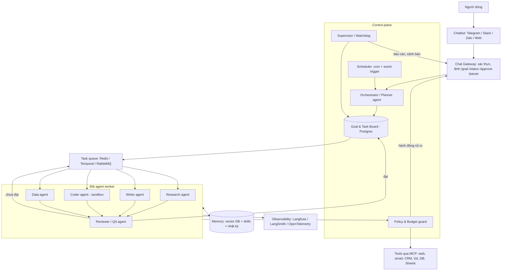
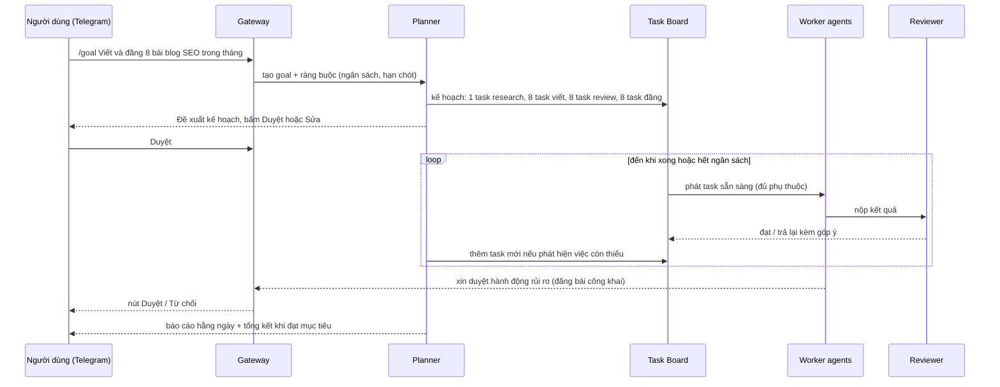

# Xây dựng đội AI agent tự động chạy 24/7, điều khiển qua chatbot

> **Câu hỏi:** Có những giải pháp nào để xây dựng một đội AI agent tự động, chạy 24/7, tự phân chia, điều phối, bổ sung và thực hiện công việc theo mục tiêu, và được điều khiển qua chatbot?
> **Cập nhật:** 11/2026. Hệ sinh thái agent thay đổi rất nhanh, nên hãy kiểm tra lại phiên bản và tính năng trên trang chính thức trước khi dùng.

## 1. Tóm tắt

- Một hệ thống như vậy không phải **một công cụ** mà là **7 lớp ghép lại**: kênh chat → bộ điều phối (planner) → bảng công việc/hàng đợi → các agent worker → tool (MCP) → bộ nhớ → runtime bền vững có giám sát.
- **"Tự động 100%" là mục tiêu thiết kế, không phải thực tế vận hành.** Hệ thống chạy ổn định 24/7 được là nhờ có **chốt chặn**: ngân sách token/tiền, giới hạn số vòng lặp, danh sách hành động cần người duyệt (gửi tiền, xóa dữ liệu, gửi ra ngoài) và cơ chế báo động. Nên nhắm tới "tự động 95%, con người duyệt 5% hành động rủi ro qua chatbot".
- Có 4 hướng, chọn theo năng lực và quy mô:

| Hướng | Công cụ tiêu biểu | Phù hợp khi | Thời gian dựng MVP |
|---|---|---|---|
| A. No-code / low-code | n8n, Dify, Flowise | Quy trình nghiệp vụ rõ ràng, ít lập trình | 1–3 ngày |
| B. Agent cá nhân có sẵn gateway chat | Hermes Agent, OpenClaw, goose | Một người dùng, muốn có ngay agent 24/7 trên Telegram | vài giờ |
| C. Tự code bằng framework multi-agent | LangGraph, CrewAI (Flows), Microsoft Agent Framework, Claude Agent SDK, OpenAI Agents SDK, Google ADK + Temporal/queue | Cần kiểm soát hoàn toàn, sản phẩm thật, nhiều người dùng | 2–6 tuần |
| D. Nền tảng agent được quản lý (managed) | Claude Code trên cloud (session + scheduled task), AWS Bedrock AgentCore, Google Vertex AI Agent Engine, Azure AI Foundry Agent Service | Không muốn tự vận hành hạ tầng, chấp nhận phụ thuộc nhà cung cấp | 1–2 tuần |

- **Khuyến nghị cho đa số trường hợp:** bắt đầu bằng **hướng B hoặc A** để kiểm chứng giá trị trong 1–2 tuần, sau đó chuyển phần lõi sang **hướng C với LangGraph (hoặc Claude Agent SDK) + Postgres + Redis/Temporal + bot Telegram** khi đã rõ quy trình.

## 2. Bài toán & yêu cầu

**Yêu cầu chức năng:**

1. **Nhận mục tiêu qua chat:** người dùng nhắn "Tăng 20% lead từ website trong tháng 12", không cần mô tả từng bước.
2. **Tự phân rã:** planner chia mục tiêu thành dự án → task → subtask, có phụ thuộc và tiêu chí hoàn thành.
3. **Tự phân công:** chọn agent theo vai trò/kỹ năng (nghiên cứu, viết nội dung, code, phân tích dữ liệu, QA…).
4. **Tự bổ sung:** khi thiếu năng lực thì sinh agent/skill mới hoặc thêm task mới khi phát hiện việc còn thiếu.
5. **Tự kiểm tra:** reviewer/critic agent đánh giá kết quả, task chưa đạt thì trả lại để làm lại.
6. **Chạy 24/7:** có lịch (cron), trigger theo sự kiện (webhook, email, thay đổi dữ liệu) và chạy lại sau sự cố.
7. **Điều khiển qua chatbot:** giao mục tiêu, xem tiến độ, duyệt/từ chối, tạm dừng, đổi ưu tiên, nhận báo cáo.

**Yêu cầu phi chức năng:**

- **Bền vững (durable):** task dài nhiều giờ/ngày không mất trạng thái khi restart.
- **Quan sát được (observability):** trace từng bước, chi phí theo task/agent.
- **An toàn:** sandbox thực thi code, phân quyền tool, duyệt hành động rủi ro, chống prompt injection từ dữ liệu web/email.
- **Kiểm soát chi phí:** ngân sách theo ngày/mục tiêu, chọn model theo độ khó (model rẻ cho việc đơn giản).

## 3. Kiến trúc tham chiếu



### 3.1 Các thành phần

| Lớp | Vai trò | Lựa chọn phổ biến |
|---|---|---|
| **Kênh chat** | Giao diện điều khiển duy nhất | Telegram Bot API (dễ nhất), Slack, Discord, Zalo OA, web chat |
| **Chat Gateway** | Map tin nhắn → lệnh, xác thực người dùng, gửi thông báo/nút duyệt | Tự viết (FastAPI/Node), gateway của Hermes/OpenClaw, n8n Telegram Trigger |
| **Orchestrator / Planner** | Hiểu mục tiêu, lập kế hoạch, chia task, chọn agent, tái lập kế hoạch | LangGraph supervisor, CrewAI hierarchical process, Agent Framework Magentic orchestration, lead agent kiểu DeerFlow |
| **Goal & Task Board** | Nguồn sự thật về trạng thái: mục tiêu, task, phụ thuộc, người phụ trách, kết quả | Postgres (bảng `goals`, `tasks`, `runs`, `approvals`), hoặc dùng luôn Linear/ClickUp/Asana/Notion qua MCP |
| **Hàng đợi / runtime bền** | Đưa task tới worker, retry, timeout, resume sau crash | Temporal (bền nhất), Redis + BullMQ/Celery, LangGraph checkpointer (Postgres), Inngest |
| **Worker agent** | Thực thi một loại việc, có system prompt + toolset riêng | Bất kỳ framework nào ở mục 4; coding agent: Claude Code, Codex CLI, goose, Gemini CLI |
| **Tools** | Tác động ra thế giới | MCP server (chuẩn chung), API nội bộ, browser-use, Firecrawl/Crawl4AI |
| **Memory** | Nhớ ngữ cảnh dài hạn, kinh nghiệm, kỹ năng | Postgres + pgvector, Qdrant, mem0, Zep; skills dạng `SKILL.md` |
| **Supervisor / Watchdog** | Phát hiện task treo, vòng lặp vô hạn, vượt ngân sách; báo cáo định kỳ | Cron job + rule; một "manager agent" đọc board mỗi giờ |
| **Policy & Budget** | Chặn/duyệt hành động, giới hạn chi phí | Allowlist tool, human-in-the-loop interrupt (LangGraph `interrupt`), hạn mức theo goal |
| **Observability** | Trace, debug, đo chất lượng | Langfuse (self-host), LangSmith, Arize Phoenix, OpenTelemetry |

### 3.2 Vòng đời một mục tiêu



## 4. Các giải pháp chi tiết

### Hướng A — No-code / low-code

- **n8n** (xem [`solution-design/n8n.md`](../solution-design/n8n.md)): node *AI Agent* + *Telegram Trigger*, gọi sub-workflow làm "agent con", có Schedule Trigger để chạy 24/7, queue mode (Redis) để mở rộng. Phù hợp nhất với quy trình **xác định trước** (ví dụ lead → nghiên cứu → soạn email → CRM).
- **Dify / Flowise / Langflow:** dựng agent và RAG bằng giao diện kéo thả, có API và nhúng chatbot.
- **Ưu:** nhanh, có sẵn hàng trăm integration, dễ bàn giao.
- **Nhược:** khó làm phần "tự lập kế hoạch động" (sinh task mới tùy ý), logic phức tạp thì graph rất rối, debug agent khó.
- **Mẹo:** dùng n8n làm **lớp tích hợp + lịch**, còn bộ não planner đặt trong một service code (hướng C) được n8n gọi qua HTTP/MCP.

### Hướng B — Agent cá nhân có sẵn gateway chat

- **Hermes Agent** (xem [`solution-design/hermes-agent.md`](../solution-design/hermes-agent.md)): gateway Telegram/Discord/Slack/WhatsApp, cron, `delegate_task` cho sub-agent, Kanban đa agent, memory và tự tạo skills. Đây là thứ gần với yêu cầu nhất mà dùng được ngay.
- **OpenClaw** (trước đây là Clawdbot): agent tự host chạy liên tục, nhắn qua Telegram/WhatsApp, có cron và bộ nhớ lâu dài; chạy được trên VPS rẻ. Khả năng multi-agent cần kiểm tra trên tài liệu chính thức.
- **goose** (xem [`solution-design/goose.md`](../solution-design/goose.md)): có recipe, scheduler, subagent, mọi tool qua MCP.
- **Ưu:** dựng trong vài giờ, có sẵn memory, skills và chat.
- **Nhược:** thiết kế cho **một người dùng**, việc dài nhiều ngày không thật sự bền, khó tùy biến quy trình duyệt và báo cáo theo tổ chức. Cấp quyền shell/email cho agent 24/7 thì phải sandbox kỹ.

### Hướng C — Tự xây bằng framework (khuyến nghị cho sản phẩm thật)

| Framework | Mô hình điều phối | Điểm mạnh cho 24/7 | Lưu ý |
|---|---|---|---|
| **LangGraph** | Graph trạng thái; supervisor / hierarchical / swarm | Checkpointer Postgres (resume), `interrupt` cho human-in-the-loop, time-travel debug | Đường cong học cao hơn; lựa chọn "an toàn" nhất cho production |
| **CrewAI** (Crews + Flows) | Vai trò (role/goal/backstory), process tuần tự hoặc hierarchical có manager | Prototype nhanh nhất, tư duy "đội" rất tự nhiên | Tốn token hơn; nên đặt crew bên trong Flow để kiểm soát |
| **Microsoft Agent Framework** (kế nhiệm AutoGen + Semantic Kernel, GA 4/2026) | Sequential, concurrent, handoff, group chat, Magentic | Hợp hệ sinh thái .NET/Azure, có workflow checkpoint | AutoGen cũ đã ở chế độ bảo trì |
| **Claude Agent SDK** | Agent loop của Claude Code + subagents + skills + MCP + hooks | Agent làm việc dài, giỏi code/thao tác file, có hook để chặn hành động | Gắn với model Claude |
| **OpenAI Agents SDK** | Agents + handoffs + guardrails + tracing | Gọn nhẹ, tracing tích hợp | Gắn với hệ OpenAI (có hỗ trợ model khác) |
| **Google ADK** | Agent phân cấp, workflow agent (Sequential/Parallel/Loop), giao thức A2A | Tích hợp Vertex AI Agent Engine | Hợp hệ Google Cloud |

**Stack đề xuất (tự host, chi phí thấp):**

```
Telegram Bot ──► FastAPI gateway ──► LangGraph (planner + workers)
                                     │   checkpointer: Postgres
                                     ├── Task board: Postgres (+ pgvector cho memory)
                                     ├── Queue/cron: Redis + Celery/BullMQ (hoặc Temporal)
                                     ├── Tools: MCP servers (Gmail, Sheets, CRM, GitHub, Firecrawl...)
                                     ├── Sandbox code: Docker / E2B / Daytona
                                     └── Trace: Langfuse self-host
Triển khai: Docker Compose trên 1 VPS (4 vCPU, 8 GB) → Kubernetes khi cần nhiều worker
```

**Những điểm thiết kế quan trọng:**

1. **Board là nguồn sự thật, không phải bộ nhớ hội thoại.** Mỗi task có `status` (todo/doing/review/done/blocked), `owner_agent`, `depends_on`, `acceptance_criteria`, `budget`, `attempts`. Planner và worker chỉ đọc/ghi qua tool, nên restart không làm mất gì.
2. **Planner lặp theo chu kỳ (heartbeat):** cứ N phút hoặc khi có sự kiện thì đọc board → so với mục tiêu → thêm/sửa/hủy task. Đây chính là cơ chế "tự bổ sung công việc".
3. **Agent registry:** bảng mô tả vai trò, toolset, model, chi phí. Planner chọn agent theo mô tả. Muốn "tự bổ sung agent" thì cho planner quyền **đề xuất** cấu hình agent mới, con người duyệt một lần qua chat rồi agent đó vào registry.
4. **Reviewer tách riêng khỏi worker** (model khác hoặc prompt khác) và chấm theo `acceptance_criteria`. Giới hạn `attempts` (ví dụ 3) rồi chuyển `blocked` và báo người dùng.
5. **Phân tầng model:** planner/reviewer dùng model mạnh, worker việc lặp lại dùng model nhanh/rẻ. Bật prompt caching cho system prompt dài.
6. **Idempotency:** mọi hành động ra ngoài (gửi email, đăng bài, ghi CRM) đều có khóa idempotency để retry không gây trùng.

### Hướng D — Nền tảng managed

- **Claude Code trên cloud:** mỗi session là một agent trong container riêng; scheduled task chạy theo cron, session cha tạo session con và giao việc qua tin nhắn (fan-out), PR/CI event đánh thức session. Rất hợp cho **đội agent làm phần mềm**.
- **AWS Bedrock AgentCore**, **Google Vertex AI Agent Engine**, **Azure AI Foundry Agent Service:** runtime, memory, identity, observability được quản lý; deploy agent viết bằng LangGraph/CrewAI/ADK/Agent Framework lên đó.
- **Ưu:** không lo uptime, scale, bảo mật hạ tầng.
- **Nhược:** phụ thuộc nhà cung cấp, chi phí khó dự đoán khi chạy liên tục.

## 5. Thiết kế lớp điều khiển qua chatbot

| Lệnh | Tác dụng |
|---|---|
| `/goal <mô tả>` | Tạo mục tiêu mới; planner trả kế hoạch kèm nút **Duyệt / Sửa / Hủy** |
| `/status [goal]` | Tiến độ: % task xong, task đang chạy, task bị chặn, chi phí đã dùng |
| `/tasks` | Danh sách task theo trạng thái |
| `/approve <id>` / `/reject <id> <lý do>` | Duyệt hành động rủi ro (cũng có thể bấm nút inline) |
| `/priority <goal> high` | Đổi ưu tiên; planner sắp lại hàng đợi |
| `/pause` / `/resume` / `/stop` | Dừng toàn đội hoặc một goal (kill switch) |
| `/budget <goal> <số tiền>` | Đặt trần chi phí |
| `/agents` | Xem đội agent, tải hiện tại, tỉ lệ đạt review |
| Chat tự do | Hỏi đáp về kết quả: "Bài số 3 viết về gì?", "Vì sao task X bị chặn?" |

**Thông báo chủ động:** báo cáo sáng (tóm tắt 24h), cảnh báo khi task `blocked`, vượt 80% ngân sách hoặc lỗi lặp lại, và yêu cầu duyệt kèm ngữ cảnh ngắn gọn.

**Bảo mật kênh chat:** chỉ chấp nhận user ID trong allowlist; lệnh nguy hiểm yêu cầu xác nhận hai bước; không bao giờ để nội dung từ web/email gọi trực tiếp lệnh điều khiển (chống prompt injection).

## 6. Rủi ro & cách giảm thiểu

| Rủi ro | Biểu hiện | Giảm thiểu |
|---|---|---|
| Vòng lặp vô hạn / đốt tiền | Agent gọi tool liên tục, planner sinh task không ngừng | Trần token/tiền theo goal và theo ngày, `max_steps`, `max_attempts`, watchdog |
| Ảo giác "đã xong" | Báo hoàn thành nhưng sản phẩm sai | Reviewer độc lập, tiêu chí nghiệm thu đo được, kiểm tra tự động (test, lint, link check) |
| Prompt injection | Email/website chứa lệnh "chuyển tiền", "gửi dữ liệu" | Tách dữ liệu và chỉ thị, tool rủi ro cần duyệt, quyền tối thiểu |
| Hành động không thể hoàn tác | Xóa dữ liệu, gửi hàng loạt | Danh sách hành động bắt buộc duyệt, dry-run, khóa idempotency |
| Trôi mục tiêu | Agent làm việc khác mục tiêu ban đầu | Planner đối chiếu board với goal mỗi chu kỳ, báo cáo hằng ngày |
| Mất trạng thái | Restart làm mất tiến độ | Checkpointer/Temporal, board trong DB, không giữ trạng thái trong RAM |
| Lộ bí mật | API key trong log/prompt | Secret manager, redact log, mỗi agent chỉ có key cần thiết |

## 7. Lộ trình triển khai gợi ý

1. **Tuần 1 — MVP:** bot Telegram + 1 planner + 2 worker (research, writer) + reviewer; board trong Postgres; chạy trên 1 VPS bằng Docker Compose. Chọn **một** mục tiêu thật để thử.
2. **Tuần 2–3 — Bền vững:** checkpointer, hàng đợi + retry, cron heartbeat cho planner, Langfuse, ngân sách và kill switch.
3. **Tuần 4 — An toàn:** phân quyền tool, luồng duyệt qua nút inline, sandbox cho code, test prompt injection.
4. **Tháng 2 — Mở rộng:** agent registry, thêm agent chuyên môn qua MCP, memory dài hạn, skills tự tích lũy (học theo cách của Hermes), dashboard web đọc từ board.
5. **Sau đó:** đo KPI (tỉ lệ task đạt review lần đầu, chi phí/goal, thời gian/goal, số lần cần người can thiệp) rồi giảm dần số hành động cần duyệt khi độ tin cậy đã được chứng minh.

**Ước tính chi phí (tham khảo):** VPS 10–40 USD/tháng; LLM API dao động rất rộng, từ 20 đến 500+ USD/tháng tùy số lượng và độ dài task. Đây là khoản cần đặt trần ngay từ đầu.

## 8. Liên hệ với các tài liệu khác trong repo

- [DeerFlow](../solution-design/deer-flow.md): mẫu lead agent điều phối sub-agent và sandbox theo thread, đáng tham khảo cho planner.
- [Hermes Agent](../solution-design/hermes-agent.md): gateway đa nền tảng chat, cron, memory và tự vá skills.
- [n8n](../solution-design/n8n.md): lớp tích hợp và lịch, queue mode để mở rộng.
- [goose](../solution-design/goose.md), [Codex CLI](../solution-design/codex.md), [Gemini CLI](../solution-design/gemini-cli.md): worker agent cho việc code, kèm cơ chế an toàn tách riêng.
- [browser-use](../solution-design/browser-use.md), [Firecrawl](../solution-design/firecrawl.md), [Crawl4AI](../solution-design/crawl4ai.md): tool cho research agent.
- Pattern 4, 5, 6, 8 trong [README solution-design](../solution-design/README.md#các-pattern-thiết-kế-lặp-lại) chính là nền móng của kiến trúc này.

## 9. Tham khảo

- So sánh framework 2026: [FutureAGI — CrewAI vs LangGraph vs AutoGen 2026](https://futureagi.com/blog/crewai-vs-langgraph-vs-autogen-2026), [Spheron — LangGraph vs CrewAI vs AutoGen 2026](https://www.spheron.network/blog/langgraph-vs-crewai-vs-autogen-2026/)
- OpenClaw: [Elest.io — OpenClaw running 24/7 on your server](https://blog.elest.io/openclaw-free-open-source-ai-agent-running-24-7-on-your-server/), [Ampere — What is OpenClaw](https://www.ampere.sh/blog/what-is-openclaw)
- Tài liệu chính thức nên đọc: LangGraph (multi-agent, persistence, human-in-the-loop), CrewAI Flows, Microsoft Agent Framework, Claude Agent SDK, OpenAI Agents SDK, Google ADK, Temporal, Model Context Protocol, Telegram Bot API.
