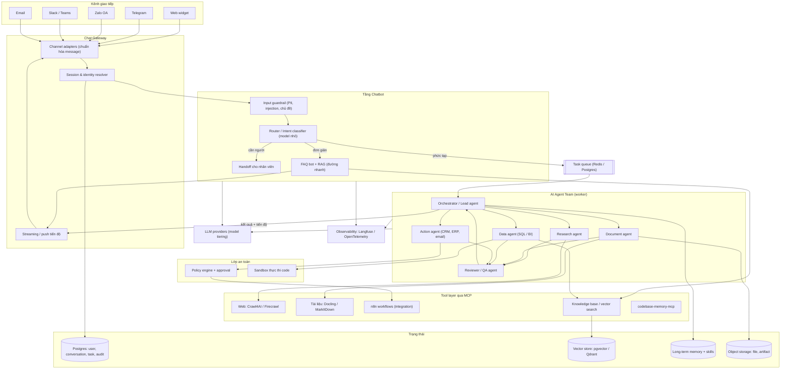
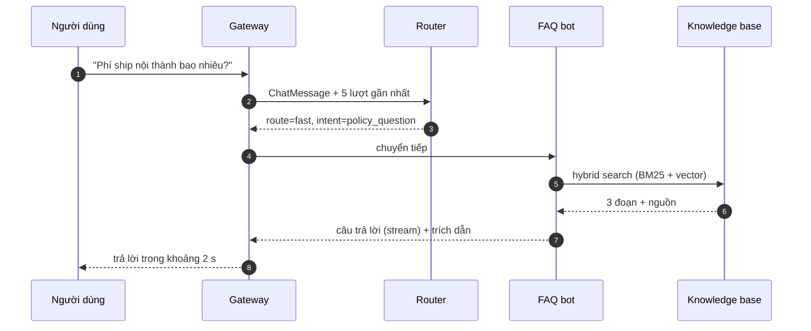
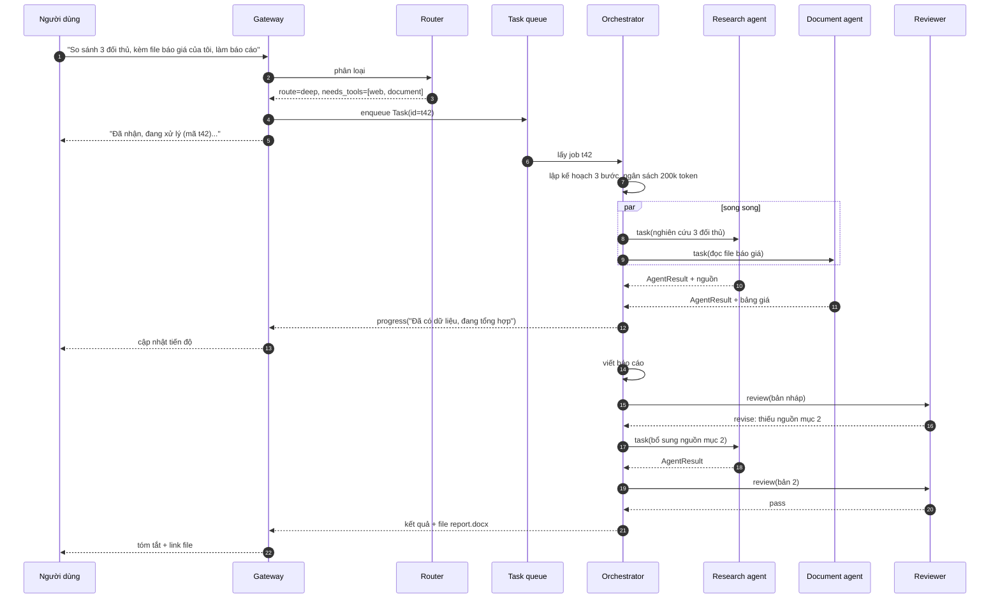

# Chatbot kết hợp AI Agent Team — Thiết kế giải pháp tham chiếu

> **Loại tài liệu:** Kiến trúc tham chiếu (không phải phân tích một repo) — ghép các pattern và thành phần từ những repo đã phân tích trong bộ tài liệu này.
> **Nhóm:** AI Agent / Chatbot / Multi-agent
> **Repo tham chiếu chính:** [Hermes Agent](./hermes-agent.md), [DeerFlow](./deer-flow.md), [n8n](./n8n.md), [goose](./goose.md), [Crawl4AI](./crawl4ai.md), [Firecrawl](./firecrawl.md), [Docling](./docling.md), [MarkItDown](./markitdown.md), [codebase-memory-mcp](./codebase-memory-mcp.md)

## 1. Tóm tắt

Giải pháp gồm hai tầng: **chatbot** ở phía trước nói chuyện với người dùng trên nhiều kênh (Web, Telegram, Zalo, Slack…), trả lời ngay các câu hỏi đơn giản; và **AI agent team** ở phía sau, gồm một agent điều phối (orchestrator) và các agent chuyên trách (nghiên cứu, tài liệu, dữ liệu, tác vụ, kiểm duyệt). Một **router** quyết định mỗi tin nhắn đi đường nhanh (chatbot + RAG, dưới 3 giây) hay đường sâu (giao cho agent team, chạy bất đồng bộ và báo tiến độ về khung chat). Mọi tool được chuẩn hóa qua **MCP**, mọi hành động có rủi ro đi qua **lớp an toàn tách khỏi model**, và trạng thái hội thoại/tác vụ được lưu bền để agent nhớ người dùng giữa các phiên.

## 2. Bài toán & yêu cầu

- **Bài toán:** Chatbot thuần (một LLM + RAG) trả lời tốt câu hỏi ngắn nhưng không làm được việc nhiều bước: nghiên cứu nhiều nguồn, đọc file người dùng gửi, tra dữ liệu nội bộ, gọi hệ thống khác (CRM, ERP, email), rồi tổng hợp thành báo cáo. Ngược lại, nếu đưa mọi tin nhắn vào agent team thì chậm và tốn chi phí. Cần một kiến trúc lấy ưu điểm của cả hai.
- **Yêu cầu chức năng chính:**
  - Đa kênh: Web widget, Telegram, Zalo OA, Slack/Teams, email; một người dùng có thể đổi kênh mà vẫn giữ ngữ cảnh.
  - Trả lời nhanh FAQ, chính sách, sản phẩm bằng RAG trên kho tri thức nội bộ.
  - Giao việc phức tạp cho agent team: lập kế hoạch → chia việc → chạy song song → tổng hợp → kiểm duyệt → trả kết quả (text, file, link).
  - Báo tiến độ ("Đang tìm 5 nguồn…", "Đang đọc file PDF…") và cho phép hủy hoặc hỏi lại giữa chừng (`ask_clarification`).
  - Human-in-the-loop: hành động ghi (gửi email, tạo đơn, sửa dữ liệu) phải được người dùng hoặc nhân viên duyệt.
  - Chuyển cho nhân viên thật (handoff) khi agent không chắc hoặc người dùng yêu cầu.
  - Nhớ dài hạn: sở thích, thông tin người dùng, kết quả tác vụ cũ.
- **Yêu cầu phi chức năng:**
  - Độ trễ: đường nhanh p95 < 3 s; đường sâu trả lời xác nhận < 2 s, kết quả trong vài phút.
  - Chi phí: model rẻ cho router và FAQ, model mạnh chỉ cho orchestrator và việc khó; tận dụng prompt cache.
  - Mở rộng ngang: tách gateway / router / agent worker bằng hàng đợi.
  - Bảo mật: cô lập dữ liệu theo tenant/user, sandbox khi chạy code, policy cho tool, không để lộ secret vào prompt, chống prompt injection từ nội dung web/file.
  - Quan sát được: trace từng bước agent, token, chi phí, tỷ lệ handoff, điểm đánh giá.
- **Ngoài phạm vi:** Huấn luyện/fine-tune model; voice call thời gian thực (có thể thêm sau qua STT/TTS); agent tự chủ hoàn toàn không có giám sát cho hành động tài chính.

## 3. Kiến trúc tổng thể



Giải thích:

- **Gateway** chỉ lo kênh: nhận webhook, chuẩn hóa thành một `ChatMessage` chung, gửi lại câu trả lời/tiến độ. Pattern lấy từ `gateway/platforms/base.py` của [Hermes](./hermes-agent.md) và `backend/app/channels/` của [DeerFlow](./deer-flow.md): mỗi nền tảng là một adapter kế thừa lớp cơ sở.
- **Router** là điểm tiết kiệm chi phí lớn nhất: một model nhỏ phân loại intent và độ phức tạp, phần lớn tin nhắn (thường 70–90%) dừng ở đường nhanh.
- **Agent team chạy trong worker riêng sau hàng đợi**, giống mô hình main/worker của [n8n queue mode](./n8n.md). Gateway không bị chặn khi agent chạy vài phút, và có thể tăng số worker độc lập.
- **Orchestrator theo mô hình supervisor** (lead agent giao việc qua tool `task`, như DeerFlow `SubagentExecutor` hay Hermes `delegate_task`), không để các agent nói chuyện tự do với nhau. Luồng điều khiển dễ dự đoán, dễ trace, dễ giới hạn chi phí.
- **Tool qua MCP**: agent chỉ biết client MCP; crawl, đọc tài liệu, gọi n8n workflow đều là MCP server có thể thay thế ([goose](./goose.md) đẩy pattern này tới cùng).
- **Lớp an toàn nằm ngoài model**: Action agent không gọi thẳng hệ thống ngoài mà đi qua policy engine (allow / ask / deny), tương tự policy TOML của [Gemini CLI](./gemini-cli.md) và inspector chain của goose.

## 4. Thành phần chính

| Thành phần | Có thể dựng từ | Trách nhiệm |
|---|---|---|
| Channel adapters | Hermes `gateway/`, DeerFlow `channels/`, n8n Telegram/Webhook trigger | Nhận/gửi tin nhắn từng nền tảng, xác thực webhook, map user ID kênh → user nội bộ |
| Session resolver | Tự viết (Postgres) | Gom hội thoại xuyên kênh, khóa theo `conversation_id` để không xử lý song song hai tin nhắn cùng phiên |
| Input guardrail | Model nhỏ + regex + danh sách chặn | Che PII, phát hiện prompt injection, từ chối chủ đề ngoài phạm vi |
| Router | Model nhỏ với structured output | Trả `{route, intent, complexity, needs_tools[]}` |
| FAQ bot + RAG | LangChain/LlamaIndex hoặc tự viết; ingest bằng Docling/MarkItDown + Crawl4AI | Trả lời ngắn có trích dẫn nguồn |
| Task queue | Redis (BullMQ / RQ / Celery) hoặc Postgres (`SKIP LOCKED`) | Lưu job, retry, timeout, hủy |
| Orchestrator | LangGraph (DeerFlow lead agent), Claude Agent SDK, OpenAI Agents SDK | Lập kế hoạch, giao việc, theo dõi ngân sách, tổng hợp |
| Specialist agents | Cùng framework, mỗi agent có system prompt + toolset riêng | Làm một loại việc, trả kết quả theo schema |
| Reviewer agent | Model khác hoặc cùng model, prompt chấm điểm | Kiểm tra trích dẫn, độ đầy đủ, chính sách; trả `pass/revise` |
| Policy engine | Tự viết (YAML rule) | Quyết định allow / ask / deny cho từng tool call theo vai trò và tham số |
| Memory & skills | Hermes (`MEMORY.md`, FTS5, skills), DeerFlow memory, mem0 | Nhớ người dùng, lưu quy trình đã thành công thành skill |
| Observability | Langfuse, LangSmith, OpenTelemetry | Trace, chi phí, dataset đánh giá |

### 4.1. Đội agent đề xuất

| Agent | Khi nào được giao | Tool chính | Model gợi ý |
|---|---|---|---|
| **Orchestrator** | Mọi tác vụ đường sâu | `task`, `ask_clarification`, `memory`, `present_files` | Model mạnh nhất (ví dụ Claude Opus) |
| **Research** | Cần thông tin bên ngoài, so sánh, tổng hợp nhiều nguồn | `web_search`, `crawl` (Crawl4AI/Firecrawl) | Model tầm trung (ví dụ Claude Sonnet) |
| **Document** | Người dùng gửi file, cần đọc hợp đồng/báo cáo, sinh file đầu ra | `convert` (Docling/MarkItDown), `write_file` | Tầm trung |
| **Data** | Hỏi số liệu nội bộ, cần SQL, biểu đồ | `sql_query` (read-only), `python` trong sandbox | Tầm trung |
| **Action** | Tạo ticket, gửi email, cập nhật CRM | MCP tới n8n workflow, luôn qua policy | Tầm trung, temperature thấp |
| **Reviewer** | Trước khi trả kết quả cho người dùng | Chỉ đọc | Model khác nhà cung cấp hoặc cùng model, prompt độc lập |

Bắt đầu với 2–3 agent (Orchestrator + Research + Reviewer) rồi thêm dần. Mỗi agent mới phải có bộ test đánh giá riêng trước khi bật.

## 5. Luồng xử lý chính

### 5.1. Đường nhanh — câu hỏi đơn giản



### 5.2. Đường sâu — giao cho agent team



### 5.3. Hành động cần duyệt

1. Action agent đề xuất `send_email(to=..., body=...)`.
2. Policy engine trả `ask` (rule: mọi email ra ngoài cần duyệt).
3. Gateway gửi cho người dùng thẻ xác nhận có nút **Duyệt / Sửa / Hủy**; task chuyển trạng thái `waiting_approval` và giải phóng worker.
4. Khi người dùng bấm Duyệt, job được enqueue lại từ checkpoint và gọi n8n workflow gửi email. Toàn bộ được ghi vào bảng `audit_log`.

## 6. Mô hình dữ liệu & giao diện

### 6.1. Thực thể chính (Postgres)

| Bảng | Trường quan trọng |
|---|---|
| `users` | `id`, `tenant_id`, `channel_identities` (jsonb), `locale`, `role` |
| `conversations` | `id`, `user_id`, `channel`, `status` (`bot` / `agent_team` / `human`), `summary` |
| `messages` | `id`, `conversation_id`, `role`, `content`, `attachments`, `route`, `trace_id` |
| `tasks` | `id`, `conversation_id`, `status` (`queued` / `running` / `waiting_approval` / `done` / `failed` / `cancelled`), `plan` (jsonb), `budget_tokens`, `used_tokens`, `result` |
| `agent_steps` | `task_id`, `agent`, `input`, `output`, `tool_calls`, `tokens`, `latency_ms` |
| `approvals` | `task_id`, `action`, `params`, `decision`, `decided_by`, `decided_at` |
| `memories` | `user_id`, `kind` (`fact` / `preference` / `skill`), `content`, `embedding`, `updated_at` |
| `audit_log` | `actor`, `action`, `target`, `params_hash`, `ts` |

### 6.2. Hợp đồng giữa các agent

Giao tiếp giữa orchestrator và specialist dùng schema cố định, không truyền nguyên lịch sử hội thoại (giữ context nhỏ, tránh rò dữ liệu):

```json
{
  "task_id": "t42.1",
  "agent": "research",
  "goal": "So sánh giá và chính sách bảo hành của 3 đối thủ A, B, C",
  "context": "Người dùng là SME bán thiết bị văn phòng tại HN",
  "constraints": { "max_tokens": 60000, "deadline_s": 180, "language": "vi" },
  "expected_output": { "type": "table", "columns": ["đối thủ", "giá", "bảo hành", "nguồn"] }
}
```

```json
{
  "task_id": "t42.1",
  "status": "ok",
  "summary": "Đã thu thập đủ 3 đối thủ, B không công bố giá công khai",
  "data": { "rows": [] },
  "sources": [{ "url": "https://...", "title": "...", "accessed_at": "2026-10-31" }],
  "confidence": 0.8,
  "usage": { "input_tokens": 41000, "output_tokens": 3200 }
}
```

### 6.3. Khai báo agent bằng cấu hình

```yaml
# agents/research.yaml
name: research
model: tier-mid            # map sang model cụ thể trong models.yaml
system_prompt: prompts/research.md
tools:
  - mcp: crawl4ai          # crawl, fit markdown
  - mcp: web_search
limits:
  max_turns: 15
  max_tokens: 80000
  timeout_s: 240
output_schema: schemas/agent_result.json
```

```yaml
# policy.yaml
rules:
  - tool: "n8n.send_email"
    when: { "to_domain_not_in": ["congty.vn"] }
    decision: ask
  - tool: "sql_query"
    when: { "statement_type": "select" }
    decision: allow
  - tool: "sql_query"
    decision: deny
  - tool: "*"
    decision: allow
```

### 6.4. API của gateway

| Endpoint | Mục đích |
|---|---|
| `POST /webhooks/{channel}` | Nhận tin nhắn từ nền tảng |
| `POST /api/chat` | Web widget gửi tin nhắn, trả SSE stream |
| `GET /api/tasks/{id}` / `GET /api/tasks/{id}/events` | Trạng thái và stream tiến độ (SSE) |
| `POST /api/tasks/{id}/cancel` | Hủy tác vụ |
| `POST /api/approvals/{id}` | Duyệt / từ chối hành động |

## 7. Tech stack

Có ba phương án, chọn theo đội ngũ và mức độ tùy biến cần có:

| Lớp | A. Low-code (nhanh nhất) | B. Code Python (khuyến nghị) | C. Dựng trên repo có sẵn |
|---|---|---|---|
| Gateway & kênh | n8n trigger (Telegram, Webhook) | FastAPI + adapter tự viết | Hermes gateway hoặc DeerFlow channels |
| Router + FAQ | n8n AI Agent node + vector store node | LLM nhỏ + structured output, pgvector | — |
| Agent team | n8n AI Agent gọi sub-workflow (mỗi sub-workflow là một agent) | LangGraph (supervisor) hoặc Claude Agent SDK / OpenAI Agents SDK | DeerFlow lead agent + sub-agents |
| Hàng đợi | n8n queue mode (Bull + Redis) | Redis + Celery/RQ hoặc Postgres | Có sẵn trong n8n; DeerFlow giữ run trong process |
| Tool | n8n node + MCP Client node | MCP server: Crawl4AI, Firecrawl, Docling, MarkItDown, n8n | Như B |
| Lưu trữ | Postgres của n8n | Postgres + pgvector, S3/MinIO | Như B |
| Quan sát | n8n execution log | Langfuse / OpenTelemetry | Langfuse (DeerFlow hỗ trợ sẵn) |
| Phù hợp | PoC 1–2 tuần, đội ít dev | Sản phẩm thật, cần kiểm soát | Nghiên cứu, demo nội bộ |

**Khuyến nghị:** dùng **B** cho lõi (router + orchestrator + agent bằng Python, LangGraph hoặc Claude Agent SDK) và dùng **n8n làm "tay chân" tích hợp**: mỗi thao tác với hệ thống ngoài (CRM, email, Google Sheets, ERP) là một n8n workflow được phơi ra như MCP tool. Nhờ vậy dev lo phần agent, còn người vận hành tự thêm tích hợp trên giao diện n8n mà không sửa code agent.

**Model tiering (ví dụ với Claude, có thể thay bằng provider khác):**

| Vai trò | Tier | Ví dụ |
|---|---|---|
| Router, guardrail, tóm tắt hội thoại | Nhỏ, nhanh | Claude Haiku |
| FAQ, specialist agents, reviewer | Tầm trung | Claude Sonnet |
| Orchestrator cho tác vụ khó | Mạnh nhất | Claude Opus |
| Embedding | Model embedding đa ngôn ngữ hỗ trợ tiếng Việt | — |

## 8. Quyết định thiết kế & đánh đổi

| Quyết định | Lý do | Đánh đổi |
|---|---|---|
| Router tách đường nhanh / sâu | Phần lớn câu hỏi đơn giản; tiết kiệm chi phí và độ trễ | Router phân loại sai → câu trả lời hời hợt; cần cho người dùng nút "Phân tích sâu hơn" và đo tỷ lệ phân loại sai |
| Supervisor thay vì swarm / group chat | Luồng dễ đoán, dễ trace, dễ giới hạn token; một điểm tổng hợp | Orchestrator là nút cổ chai; ít "sáng tạo" hơn khi các agent tranh luận |
| Agent nhận context tối thiểu qua schema | Context nhỏ, rẻ, giảm rò dữ liệu và giảm nhiễu | Agent có thể thiếu thông tin → cần trường `context` do orchestrator viết cẩn thận |
| Chạy agent bất đồng bộ qua hàng đợi | Không chặn gateway; retry, hủy, mở rộng worker | Phức tạp hơn; cần cơ chế push tiến độ và khóa theo hội thoại |
| Reviewer agent trước khi trả lời | Giảm bịa đặt, đảm bảo có nguồn | Tăng 15–30% độ trễ và chi phí; giới hạn tối đa 2 vòng sửa |
| Tool chuẩn hóa qua MCP | Thay/ghép tool không sửa agent; dùng lại giữa nhiều agent | Thêm một lớp mạng; cần quản lý phiên bản MCP server |
| Policy engine ngoài model | Model có thể bị prompt injection; quyết định quyền phải xác định | Phải viết và bảo trì rule; quá chặt thì phiền người dùng |
| System prompt bất biến trong phiên | Tận dụng prompt cache (bài học từ Hermes) | Memory mới chỉ có hiệu lực từ phiên sau hoặc qua tool `memory` |
| n8n làm lớp tích hợp | Người không phải dev tự thêm integration | Thêm một hệ thống phải vận hành; license fair-code của n8n cần xem kỹ khi thương mại hóa |

## 9. Triển khai & vận hành

### 9.1. Sơ đồ triển khai tối thiểu (docker-compose)

```yaml
services:
  gateway:      { build: ./gateway, ports: ["8000:8000"], depends_on: [postgres, redis] }
  agent-worker: { build: ./agents, deploy: { replicas: 2 }, depends_on: [redis, postgres] }
  n8n:          { image: n8nio/n8n, environment: [EXECUTIONS_MODE=queue] }
  crawl4ai:     { image: unclecode/crawl4ai }            # MCP / REST
  docling:      { build: ./mcp-docling }                 # MCP wrapper
  postgres:     { image: pgvector/pgvector:pg16 }
  redis:        { image: redis:7 }
  minio:        { image: minio/minio }
  langfuse:     { image: langfuse/langfuse }
```

Gắn tag phiên bản cụ thể cho mọi image khi đưa vào production.

### 9.2. Vận hành

- **Ngân sách:** mỗi task có `budget_tokens` và `deadline_s`; orchestrator nhận cảnh báo khi dùng 80%, dừng khi vượt và trả kết quả tốt nhất hiện có.
- **Chống vòng lặp:** giới hạn `max_turns` mỗi agent, phát hiện tool call lặp lại giống nhau (như loop detection của DeerFlow, Hermes).
- **Đánh giá liên tục:** bộ 100–300 câu hỏi mẫu có đáp án; chạy mỗi khi đổi prompt/model; theo dõi tỷ lệ đúng route, độ chính xác, có trích dẫn, tỷ lệ handoff.
- **Chỉ số chính:** p95 độ trễ theo route, chi phí / hội thoại, tỷ lệ task thành công, tỷ lệ cần duyệt bị từ chối, CSAT.
- **Bảo mật:** secret chỉ nằm ở MCP server / n8n credential, không vào prompt; nội dung web và file luôn được đánh dấu là dữ liệu không tin cậy trong prompt; tách tenant ở tầng DB (row-level security).

## 10. Lộ trình triển khai

| Giai đoạn | Thời gian gợi ý | Phạm vi | Tiêu chí xong |
|---|---|---|---|
| 0. Chuẩn bị | 1 tuần | Chọn 1–2 use case, gom tài liệu, ingest KB bằng Docling/MarkItDown + Crawl4AI, viết bộ câu hỏi đánh giá | Có KB và bộ đánh giá |
| 1. MVP chatbot | 2 tuần | 1 kênh (Web hoặc Telegram), router + FAQ RAG, handoff cho người | ≥ 80% câu FAQ đúng, p95 < 3 s |
| 2. Agent team v1 | 3 tuần | Hàng đợi, Orchestrator + Research + Reviewer, push tiến độ, trace Langfuse | Task nghiên cứu hoàn thành ≥ 70%, có nguồn |
| 3. Hành động | 2–3 tuần | Action agent + n8n MCP + policy + duyệt; Document agent | Không hành động ghi nào chạy mà không qua policy |
| 4. Mở rộng | Liên tục | Thêm kênh (Zalo, Slack), Data agent, memory dài hạn, skills tự học | Theo KPI kinh doanh |

## 11. Bài học & cách áp dụng

1. **Đừng biến mọi thứ thành agent**: chatbot + RAG xử lý phần đông lượng hỏi; agent team chỉ dành cho việc nhiều bước. Router là thành phần đáng đầu tư nhất.
2. **Supervisor + hợp đồng JSON** giữa các agent dễ debug hơn nhiều so với để agent trò chuyện tự do.
3. **Tách "nói chuyện" khỏi "làm việc"** bằng hàng đợi: gateway luôn phản hồi nhanh, worker chạy lâu tùy ý (pattern main/worker của n8n).
4. **Tool là MCP server, tích hợp là n8n workflow**: dev và người vận hành mở rộng hệ thống độc lập với nhau.
5. **An toàn nằm ngoài model**: policy + approval + audit cho mọi hành động ghi.
6. **Context nhỏ và ổn định**: system prompt bất biến để tận dụng cache, skills nạp lũy tiến (DeerFlow), memory dạng snapshot (Hermes).
7. **Đo trước khi thêm agent**: mỗi agent mới cần bộ đánh giá và trace riêng; nếu một agent đơn lẻ đã đủ tốt thì không cần team.

## 12. Tham khảo

- Tài liệu trong bộ này: [Hermes Agent](./hermes-agent.md) (gateway đa nền tảng, memory, skills, `delegate_task`), [DeerFlow](./deer-flow.md) (lead agent + sub-agent, middleware, sandbox, IM channels), [n8n](./n8n.md) (queue mode, AI Agent node, MCP), [goose](./goose.md) (tool qua MCP, inspector), [Gemini CLI](./gemini-cli.md) (policy engine), [Crawl4AI](./crawl4ai.md), [Firecrawl](./firecrawl.md), [Docling](./docling.md), [MarkItDown](./markitdown.md), [STORM](./storm.md) (nghiên cứu đa góc nhìn có trích dẫn).
- Anthropic — Building effective agents: https://www.anthropic.com/engineering/building-effective-agents
- Model Context Protocol: https://modelcontextprotocol.io
- LangGraph multi-agent (supervisor): https://langchain-ai.github.io/langgraph/
- Claude Agent SDK: https://docs.claude.com/en/api/agent-sdk/overview
- Langfuse: https://langfuse.com/docs
