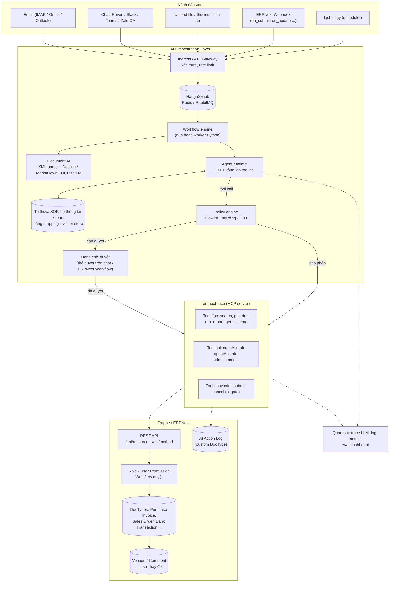
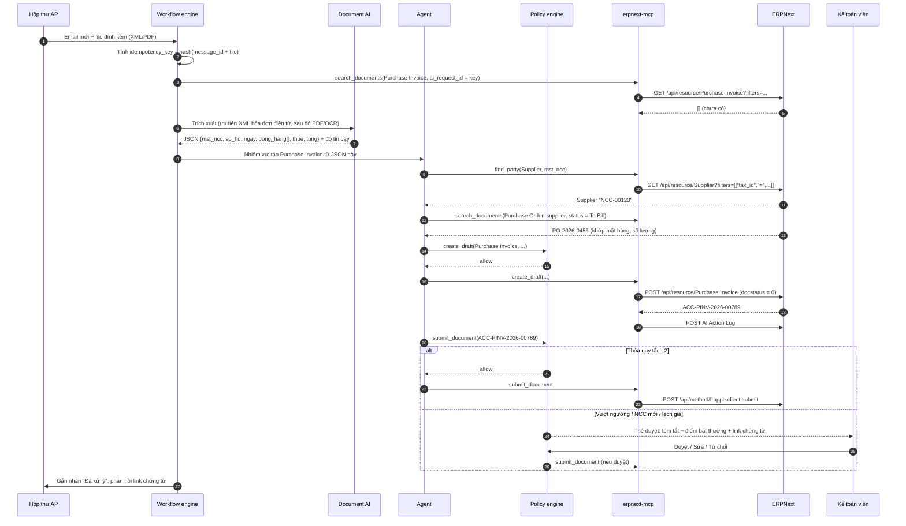
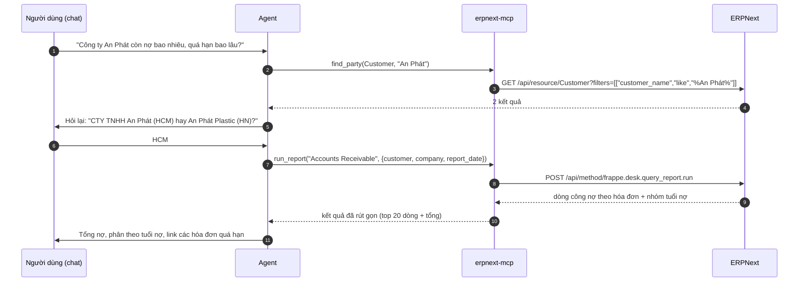
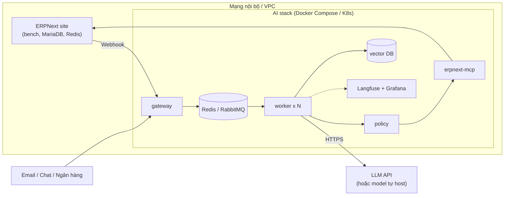

# AI tự động hóa thao tác ERPNext — Tài liệu thiết kế giải pháp

> **Loại tài liệu:** Thiết kế giải pháp ứng dụng (không phải phân tích một repo đã fork)
> **Hệ thống đích:** [ERPNext](https://github.com/frappe/erpnext) trên [Frappe Framework](https://github.com/frappe/frappe) (v15 trở lên) · **License ERPNext:** GPL-3.0
> **Nhóm:** AI Agent + Nền tảng workflow + Xử lý tài liệu
> **Trạng thái:** Đề xuất (v1.0, 11/2026) — các chi tiết API cần đối chiếu với phiên bản Frappe/ERPNext đang chạy.

## 1. Tóm tắt

Giải pháp đặt một **lớp AI Agent** bên cạnh ERPNext để thay người dùng làm các thao tác lặp lại: nhập chứng từ từ email/PDF/XML hóa đơn điện tử, tạo đơn hàng, tra cứu số liệu bằng câu hỏi tự nhiên, gợi ý đối soát ngân hàng, nhắc công nợ. Agent **không thao tác qua giao diện** mà gọi **REST API của Frappe** thông qua một **MCP server "erpnext-mcp"** có tập tool hẹp, kiểu dữ liệu chặt. Mọi thao tác ghi đi qua **lớp chính sách (policy engine)** tách khỏi model: mặc định chỉ tạo chứng từ ở trạng thái **Draft**, việc **Submit** do người duyệt hoặc do quy tắc ngưỡng quyết định, và mọi hành động được ghi vào DocType `AI Action Log` để kiểm toán.

Điểm cốt lõi: **AI đề xuất, ERPNext kiểm soát.** Quyền hạn, quy trình duyệt (Workflow), ràng buộc kế toán và lịch sử phiên bản vẫn do ERPNext đảm nhiệm; AI chỉ là một "người dùng" có quyền hạn chế và hành vi được ghi lại đầy đủ.

## 2. Bài toán & yêu cầu

- **Bài toán:** Nhân viên kế toán, mua hàng, bán hàng, kho mất nhiều thời gian nhập liệu thủ công: gõ lại hóa đơn nhà cung cấp, chép PO khách hàng từ email thành Sales Order, tra báo cáo để trả lời câu hỏi "khách X còn nợ bao nhiêu", đối chiếu sao kê ngân hàng. Các thao tác này lặp lại, có quy tắc nhưng dữ liệu đầu vào **phi cấu trúc** (email, PDF, ảnh, tin nhắn), nên khó tự động hóa bằng script thông thường.
- **Yêu cầu chức năng chính:**
  1. **Nhập chứng từ đầu vào:** đọc email/file đính kèm (PDF, ảnh, XML hóa đơn điện tử), trích xuất trường, khớp với master data (Supplier, Item, Tax Template), tạo `Purchase Invoice` / `Purchase Receipt` dạng Draft.
  2. **Tạo chứng từ bán hàng:** từ email hoặc file PO của khách → `Quotation` / `Sales Order` Draft, kiểm tra tồn kho và giá theo `Price List`.
  3. **Hỏi đáp số liệu (NL → query):** trả lời câu hỏi về tồn kho, công nợ, doanh số bằng cách gọi report/list API, kèm link tới chứng từ gốc.
  4. **Đối soát ngân hàng:** gợi ý khớp `Bank Transaction` với `Payment Entry` / hóa đơn chưa thanh toán.
  5. **Nhắc việc & công nợ:** theo lịch, đọc báo cáo `Accounts Receivable`, soạn email nhắc nợ để người dùng duyệt rồi gửi.
  6. **Làm sạch master data:** phát hiện Customer/Item trùng, chuẩn hóa tên, mã số thuế, đơn vị tính.
  7. **Tóm tắt & hỗ trợ duyệt:** tóm tắt chứng từ đang chờ duyệt, nêu điểm bất thường (giá lệch, nhà cung cấp mới, vượt ngân sách).
- **Yêu cầu phi chức năng:**
  - **An toàn dữ liệu kế toán:** không có thao tác Submit/Cancel/Delete tự động nếu chưa qua quy tắc chính sách; không vượt quyền của user dịch vụ.
  - **Truy vết:** mỗi hành động ghi lại đầu vào, lý do (tóm tắt của model), tool call, kết quả, người duyệt.
  - **Idempotency:** cùng một email/hóa đơn xử lý lại không sinh chứng từ trùng.
  - **Độ chính xác đo được:** có bộ dữ liệu đánh giá (eval set) và ngưỡng chấp nhận trước khi tăng mức tự động.
  - **Bảo mật:** API key lưu trong secret store, dữ liệu nhạy cảm (lương, tài khoản ngân hàng) bị che hoặc không cho agent truy cập.
  - **Chi phí & độ trễ:** truy vấn chat < 10 giây cho câu hỏi thông thường; xử lý chứng từ theo lô bất đồng bộ.
- **Ngoài phạm vi:** thay thế giao diện ERPNext; tự động khóa sổ, kết chuyển cuối kỳ; nộp tờ khai thuế; thao tác trên module lương (HRMS Payroll) trong giai đoạn đầu.

## 3. Kiến trúc tổng thể



Giải thích các lớp:

- **Kênh đầu vào** chuyển mọi yêu cầu thành *job* chuẩn hóa (`source`, `payload`, `requested_by`, `idempotency_key`) và đẩy vào hàng đợi, nên agent không bị nghẽn khi có nhiều email đến cùng lúc.
- **Workflow engine** điều phối các bước có thứ tự cố định (tải file → trích xuất → gọi agent → chờ duyệt). Phần "suy luận" mới giao cho agent; phần "đường ống" giữ ở dạng workflow xác định (deterministic), dễ kiểm thử và chạy lại.
- **Agent runtime** là vòng lặp *model → tool call → quan sát*, chỉ thấy các tool do `erpnext-mcp` cung cấp.
- **Policy engine** đứng giữa agent và MCP: quyết định *cho phép / chặn / cần duyệt* dựa trên quy tắc viết tay, không dựa vào model.
- **ERPNext** vẫn là nguồn sự thật: quyền theo Role, Workflow duyệt, validate nghiệp vụ (ví dụ không cho submit hóa đơn sai kỳ kế toán) đều chạy phía server như với người dùng thật.

## 4. Thành phần chính

| Thành phần | Công nghệ gợi ý | Trách nhiệm |
|---|---|---|
| Ingress / Gateway | FastAPI hoặc n8n Webhook node | Nhận webhook ERPNext, email, chat; kiểm tra chữ ký HMAC; sinh `idempotency_key` |
| Hàng đợi | Redis (RQ/Celery) hoặc RabbitMQ | Tách nhận yêu cầu và xử lý, retry có backoff, dead-letter queue |
| Workflow engine | n8n (low-code) hoặc worker Python | Pipeline cố định cho từng use case; gọi agent ở bước cần suy luận |
| Document AI | Parser XML; Docling / MarkItDown; OCR/VLM (ví dụ olmOCR) | Chuyển PDF/ảnh/XML thành JSON có cấu trúc kèm điểm tin cậy cho từng trường |
| Agent runtime | SDK LLM có tool calling (ví dụ Claude Agent SDK, LangGraph) | Lập kế hoạch, gọi tool, tự sửa khi validate lỗi, sinh tóm tắt lý do |
| Tri thức (RAG) | pgvector / Qdrant + tài liệu SOP | Quy định hạch toán, bảng ánh xạ mã hàng NCC ↔ Item, ví dụ chứng từ mẫu |
| `erpnext-mcp` | MCP server (Python `mcp` SDK) + `requests` | Bọc Frappe REST API thành tool có schema; chặn DocType/field không được phép |
| Policy engine | Rule YAML + mã Python (hoặc OPA) | Allowlist hành động, ngưỡng tiền, giờ hoạt động, yêu cầu duyệt |
| Hàng chờ duyệt (HITL) | Thẻ tương tác trên chat; hoặc ERPNext Workflow state "Chờ duyệt AI" | Người dùng xem diff/chứng từ Draft, bấm Duyệt / Sửa / Từ chối |
| `AI Action Log` | Custom DocType trong một Frappe app riêng (`ai_ops`) | Bản ghi kiểm toán cho mọi thao tác của agent |
| Quan sát & đánh giá | OpenTelemetry, Langfuse (tự host), Grafana | Trace từng tool call, đo độ chính xác, chi phí token, tỷ lệ phải sửa tay |

### 4.1 `erpnext-mcp` — lớp tool hẹp thay vì "cho agent gọi API tự do"

Không đưa cho agent một tool kiểu `http_request(url, body)`. Thay vào đó, mỗi thao tác nghiệp vụ là một tool có schema rõ:

| Tool | Frappe API bên dưới | Mức rủi ro |
|---|---|---|
| `get_doctype_schema(doctype)` | `GET /api/method/frappe.desk.form.load.getdoctype?doctype=...` | Đọc |
| `search_documents(doctype, filters, fields, limit)` | `GET /api/resource/{doctype}?filters=...&fields=...` | Đọc |
| `get_document(doctype, name)` | `GET /api/resource/{doctype}/{name}` | Đọc |
| `run_report(report_name, filters)` | `POST /api/method/frappe.desk.query_report.run` | Đọc |
| `find_party(kind, query)` | tìm Customer/Supplier theo tên, mã số thuế (fuzzy) | Đọc |
| `create_draft(doctype, data, idempotency_key)` | `POST /api/resource/{doctype}` (luôn ép `docstatus=0`) | Ghi |
| `update_draft(doctype, name, patch)` | `PUT /api/resource/{doctype}/{name}` (chỉ khi `docstatus=0`) | Ghi |
| `add_comment(doctype, name, text)` | `POST /api/resource/Comment` | Ghi nhẹ |
| `attach_file(doctype, name, file)` | `POST /api/method/upload_file` | Ghi nhẹ |
| `submit_document(doctype, name)` | `POST /api/method/frappe.client.submit` | **Nhạy cảm — luôn qua policy** |
| `cancel_document(doctype, name)` | `POST /api/method/frappe.client.cancel` | **Nhạy cảm — mặc định tắt** |

Các nguyên tắc trong MCP server:

- **Allowlist DocType và field**: chỉ các DocType đã cấu hình; field nhạy cảm (ví dụ `bank_account_no`, lương) bị lọc khỏi kết quả trước khi trả về model.
- **Giới hạn kích thước kết quả**: `limit` tối đa (ví dụ 50 dòng), chỉ trả các field cần thiết để tiết kiệm token và giảm rò rỉ dữ liệu.
- **Ép trạng thái Draft**: `create_draft` luôn ghi `docstatus=0` và set custom field `ai_request_id` để chống trùng.
- **Trả lỗi validate nguyên văn**: khi ERPNext báo lỗi (`frappe.exceptions.ValidationError`, thiếu field bắt buộc...), MCP trả thông điệp lỗi cho agent để nó tự sửa, tối đa N lần.

### 4.2 Policy engine — quyết định nằm ngoài model

Học từ Codex CLI (sandbox + approval policy) và Gemini CLI (policy engine TOML): model *đề xuất* tool call, policy *quyết định*. Ví dụ cấu hình:

```yaml
# policy.yaml
defaults:
  decision: deny            # mọi thứ không khai báo đều bị chặn
rules:
  - tool: [search_documents, get_document, run_report, get_doctype_schema, find_party]
    decision: allow
  - tool: create_draft
    doctypes: [Purchase Invoice, Purchase Receipt, Sales Order, Quotation, Journal Entry]
    decision: allow
  - tool: submit_document
    doctypes: [Purchase Invoice]
    when:
      supplier_is_existing: true
      grand_total_lte: 20000000        # VND
      match_with_purchase_order: true  # khớp 3 bên PO - GRN - Invoice
      extraction_confidence_gte: 0.95
    decision: allow
  - tool: submit_document
    decision: require_approval
    approvers_role: Accounts Manager
  - tool: cancel_document
    decision: deny
limits:
  max_write_calls_per_job: 10
  working_hours: "07:00-20:00 Asia/Ho_Chi_Minh"
```

### 4.3 Mức độ tự động (autonomy level)

| Mức | Agent được làm | Ví dụ |
|---|---|---|
| L0 — Trợ lý | Chỉ đọc và trả lời | Hỏi công nợ, tồn kho |
| L1 — Soạn nháp | Tạo/sửa Draft, người dùng tự Submit | Nhập hóa đơn NCC mới |
| L2 — Tự động có điều kiện | Submit khi thỏa quy tắc chính sách, còn lại chờ duyệt | Hóa đơn NCC quen, khớp PO, dưới ngưỡng |
| L3 — Tự động hoàn toàn | Submit và thông báo sau | Chỉ dành cho nghiệp vụ rủi ro thấp đã đạt chỉ tiêu eval nhiều tháng |

Mỗi use case bắt đầu ở L1, chỉ nâng mức khi số liệu đo được (mục 9.4) đạt ngưỡng.

## 5. Luồng xử lý chính

### 5.1 Nhập hóa đơn mua hàng từ email



Lưu ý thiết kế:

- **Ưu tiên dữ liệu có cấu trúc:** hóa đơn điện tử tại Việt Nam có file XML theo chuẩn của cơ quan thuế (Nghị định 123/2020/NĐ-CP, Thông tư 78/2021/TT-BTC). Khi có XML thì parse trực tiếp, chính xác gần như tuyệt đối; chỉ dùng OCR/VLM cho PDF/ảnh không kèm XML.
- **Khớp 3 bên (3-way match):** so sánh PO ↔ Purchase Receipt ↔ hóa đơn về số lượng, đơn giá, thuế. Lệch vượt dung sai thì bắt buộc chuyển sang duyệt.
- **Ánh xạ mã hàng:** tên hàng trên hóa đơn NCC thường khác `Item` nội bộ. Dùng child table `Item Supplier` (mã hàng của NCC) của ERPNext; khi người dùng sửa ánh xạ trên thẻ duyệt, hệ thống ghi lại để lần sau tự khớp — đây là "bộ nhớ" quan trọng nhất của giải pháp.

### 5.2 Hỏi đáp số liệu qua chat



Agent chạy với **quyền của chính người hỏi** (OAuth hoặc API key gắn user) chứ không phải user dịch vụ, nên ai không xem được công nợ trong ERPNext cũng không hỏi được qua chat. Mọi con số trả lời đều kèm link chứng từ/báo cáo gốc để người dùng kiểm tra.

### 5.3 Phản ứng theo sự kiện ERPNext

ERPNext có DocType **Webhook** (sự kiện `after_insert`, `on_update`, `on_submit`, `on_cancel`, `on_trash`...; có điều kiện lọc và chữ ký HMAC qua header `X-Frappe-Webhook-Signature`). Ví dụ:

- `Sales Order` được submit → agent kiểm tra tồn kho, đề xuất `Material Request` nếu thiếu hàng (L1).
- `Bank Transaction` mới (nhập sao kê) → agent gợi ý hóa đơn/khoản thanh toán khớp, ghi Comment để kế toán xác nhận.
- `Supplier` mới được tạo → agent tra cứu mã số thuế, cảnh báo nếu trùng với NCC đã có.

## 6. Mô hình dữ liệu & giao diện

### 6.1 Frappe REST API dùng trong giải pháp

| Mục đích | Request |
|---|---|
| Xác thực token | Header `Authorization: token <api_key>:<api_secret>` |
| Danh sách có lọc | `GET /api/resource/Sales Invoice?fields=["name","grand_total","outstanding_amount"]&filters=[["customer","=","CUST-001"],["docstatus","=",1]]&limit_page_length=20` |
| Đọc một chứng từ | `GET /api/resource/Sales Invoice/ACC-SINV-2026-00012` |
| Tạo mới | `POST /api/resource/Purchase Invoice` (body JSON gồm cả child table `items`) |
| Cập nhật | `PUT /api/resource/Purchase Invoice/<name>` |
| Gọi hàm whitelisted | `POST /api/method/<dotted.path>` (kết quả nằm trong khóa `message`) |
| Submit | `POST /api/method/frappe.client.submit` với `{"doc": {...}}` |
| Chạy báo cáo | `POST /api/method/frappe.desk.query_report.run` với `report_name`, `filters` |

Kết quả `/api/resource` nằm trong khóa `data`; lỗi trả HTTP 4xx/5xx kèm `exc_type` và `_server_messages`, cần chuyển nguyên văn (đã rút gọn) cho agent để nó tự sửa.

### 6.2 Custom DocType `AI Action Log`

Đặt trong một Frappe app riêng (ví dụ `ai_ops`) để không sửa mã ERPNext gốc:

| Field | Kiểu | Ghi chú |
|---|---|---|
| `job_id` | Data | ID job trong hàng đợi |
| `idempotency_key` | Data (unique) | Chống xử lý trùng |
| `source` | Select | email / chat / webhook / schedule |
| `requested_by` | Link → User | Người khởi tạo (hoặc user dịch vụ) |
| `tool` | Data | Tên tool đã gọi |
| `target_doctype`, `target_name` | Link động | Chứng từ bị tác động |
| `decision` | Select | allow / deny / require_approval |
| `approved_by` | Link → User | Người duyệt (nếu có) |
| `input_summary` | Small Text | Tóm tắt đầu vào (đã che dữ liệu nhạy cảm) |
| `reasoning_summary` | Text | Lý do model đưa ra |
| `result` | Select | success / validation_error / failed |
| `error_message` | Text | Thông điệp lỗi nếu có |
| `tokens`, `latency_ms`, `model` | Int / Int / Data | Phục vụ đo chi phí, hiệu năng |

Thêm custom field `ai_request_id` (Data, chỉ đọc) và `ai_confidence` (Percent) vào các DocType mà agent được tạo, để lọc "chứng từ do AI tạo" trong list view và báo cáo.

### 6.3 Phác thảo MCP server

```python
# erpnext_mcp/server.py — phác thảo, rút gọn
import json, os, requests
from mcp.server.fastmcp import FastMCP

BASE = os.environ["ERP_URL"]
HEADERS = {"Authorization": f"token {os.environ['ERP_API_KEY']}:{os.environ['ERP_API_SECRET']}"}
ALLOWED_READ = {"Customer", "Supplier", "Item", "Sales Invoice", "Purchase Invoice",
                "Purchase Order", "Sales Order", "Bin", "Bank Transaction"}
ALLOWED_DRAFT = {"Purchase Invoice", "Sales Order", "Quotation", "Purchase Receipt"}

mcp = FastMCP("erpnext")

@mcp.tool()
def search_documents(doctype: str, filters: list, fields: list[str], limit: int = 20) -> list[dict]:
    """Tìm chứng từ ERPNext. filters dạng [["field","op","value"], ...]."""
    if doctype not in ALLOWED_READ:
        raise ValueError(f"DocType {doctype} không được phép đọc")
    r = requests.get(f"{BASE}/api/resource/{doctype}", headers=HEADERS, timeout=30, params={
        "filters": json.dumps(filters), "fields": json.dumps(fields),
        "limit_page_length": min(limit, 50)})
    r.raise_for_status()
    return r.json()["data"]

@mcp.tool()
def create_draft(doctype: str, data: dict, idempotency_key: str) -> dict:
    """Tạo chứng từ ở trạng thái Draft. Không bao giờ submit."""
    if doctype not in ALLOWED_DRAFT:
        raise ValueError(f"DocType {doctype} không được phép tạo")
    existing = search_documents(doctype, [["ai_request_id", "=", idempotency_key]], ["name"], 1)
    if existing:
        return {"name": existing[0]["name"], "duplicate": True}
    body = {**data, "docstatus": 0, "ai_request_id": idempotency_key}
    r = requests.post(f"{BASE}/api/resource/{doctype}", headers=HEADERS, json=body, timeout=60)
    if r.status_code >= 400:
        return {"error": r.json().get("exception") or r.text[:2000]}  # để agent tự sửa
    return {"name": r.json()["data"]["name"], "duplicate": False}

if __name__ == "__main__":
    mcp.run()
```

Bản thật cần thêm: gọi policy engine trước mỗi tool ghi, ghi `AI Action Log`, lọc field nhạy cảm, retry khi lỗi mạng, và mỗi request mang theo user thực hiện (OAuth token theo người dùng cho kênh chat).

### 6.4 Schema đầu ra của Document AI

```json
{
  "source": "xml_einvoice",
  "supplier": {"tax_id": "0312345678", "name": "CÔNG TY TNHH ABC", "confidence": 1.0},
  "invoice": {"number": "0001234", "series": "1C26TAA", "date": "2026-10-28", "currency": "VND"},
  "items": [
    {"supplier_item_name": "Giấy A4 Double A 80gsm", "qty": 50, "uom": "Ram",
     "rate": 85000, "tax_rate": 0.08, "confidence": 0.98}
  ],
  "totals": {"net": 4250000, "tax": 340000, "grand_total": 4590000},
  "warnings": []
}
```

Ép LLM trả đúng schema này bằng structured output / JSON schema, sau đó **kiểm tra số học bằng code** (tổng dòng = net, net + tax = grand_total), không tin vào con số model tự cộng.

## 7. Tech stack

| Lớp | Công nghệ | Vai trò |
|---|---|---|
| ERP | Frappe Framework + ERPNext (v15+), MariaDB, Redis | Hệ thống nghiệp vụ, nguồn sự thật |
| Mở rộng ERP | Frappe app `ai_ops` (DocType, custom field, Server Script, Webhook) | Log kiểm toán, field truy vết, sự kiện |
| Tích hợp | Frappe REST API, OAuth2 / API key | Kênh duy nhất agent ghi vào ERP |
| Tool layer | MCP server Python (`mcp` SDK) | Bọc API thành tool an toàn, dùng lại được cho nhiều agent/client |
| Agent | LLM có tool calling + structured output (ví dụ Claude qua Agent SDK; hoặc LangGraph) | Suy luận, lập kế hoạch, tự sửa lỗi |
| Workflow | n8n (tự host) hoặc Celery/RQ worker | Pipeline xác định, retry, lịch chạy |
| Document AI | Parser XML (`lxml`), Docling, MarkItDown, OCR/VLM | Trích xuất chứng từ |
| Tri thức | PostgreSQL + pgvector hoặc Qdrant | RAG trên SOP, mapping, ví dụ |
| Chat | Raven (app chat trên Frappe), Slack, Teams, Zalo OA | Giao diện hỏi đáp và thẻ duyệt |
| Quan sát | OpenTelemetry, Langfuse, Prometheus + Grafana | Trace, eval, chi phí, cảnh báo |
| Triển khai | Docker Compose / Kubernetes, secret manager (Vault, Doppler...) | Vận hành, bảo mật khóa |
| Dự phòng UI | browser-use / Playwright | Chỉ cho hệ thống bên thứ ba không có API (cổng ngân hàng, cổng thuế), không dùng cho ERPNext |

## 8. Quyết định thiết kế & đánh đổi

| Quyết định | Lý do | Đánh đổi |
|---|---|---|
| Gọi REST API, không điều khiển giao diện (RPA/browser) | ERPNext có API đầy đủ cho mọi DocType; API ổn định, nhanh, có validate phía server, dễ ghi log | Một số thao tác chỉ có trên UI (ví dụ một vài nút trong form) cần tìm method whitelisted tương ứng hoặc viết API riêng |
| Tool hẹp qua MCP thay vì tool HTTP tổng quát | Giảm bề mặt tấn công (prompt injection từ email), schema rõ giúp model gọi đúng, dùng lại được cho nhiều client (chat, IDE, agent khác) | Phải viết và bảo trì thêm một service; thêm tool mới cần review |
| Policy engine tách khỏi model | Model có thể bị lừa hoặc sai; quyết định ghi sổ kế toán phải xác định, kiểm thử được | Quy tắc cần được nghiệp vụ duy trì; quy tắc quá chặt làm giảm tỷ lệ tự động |
| Mặc định Draft, Submit có điều kiện | Chứng từ đã submit thì phải Cancel + Amend, để lại bút toán đảo; Draft sửa/xóa không để lại hệ quả | Cần người duyệt ở giai đoạn đầu, chưa tiết kiệm tối đa |
| Workflow xác định + agent ở từng bước | Dễ debug, chạy lại từng bước, đo được; agent chỉ làm phần cần suy luận | Kém linh hoạt hơn một agent tự do cho tình huống lạ (được xử lý bằng cách chuyển về hàng chờ người) |
| User dịch vụ có Role riêng "AI Agent" | Tận dụng hệ thống quyền của Frappe, giới hạn theo Company/Warehouse qua User Permission | Phải cấu hình quyền tỉ mỉ; với chat cần thêm OAuth theo người dùng |
| Ưu tiên XML hóa đơn điện tử trước OCR | Dữ liệu có cấu trúc, chính xác, rẻ | Phải hỗ trợ khác biệt nhỏ giữa các nhà cung cấp dịch vụ hóa đơn điện tử |
| Frappe app riêng (`ai_ops`) thay vì sửa ERPNext | Nâng cấp ERPNext không bị xung đột | Thêm một app cần cài và cập nhật cùng site |
| Dùng Webhook + hàng đợi thay vì polling | Phản ứng gần thời gian thực, giảm tải ERP | Cần xử lý mất sự kiện (kết hợp job đối soát định kỳ) |

## 9. Triển khai & vận hành

### 9.1 Mô hình triển khai



- `erpnext-mcp` chỉ mở trong mạng nội bộ; ERPNext không cần mở API ra Internet.
- Nếu chính sách dữ liệu không cho gửi ra ngoài: dùng model tự host cho bước nhạy cảm, hoặc **che dữ liệu** (mask mã số thuế, số tài khoản) trước khi gửi LLM và khôi phục ở MCP.

### 9.2 Cấu hình ERPNext cần làm

1. Cài app `ai_ops` (DocType `AI Action Log`, custom field `ai_request_id`, `ai_confidence`).
2. Tạo Role **AI Agent**: quyền Read trên các DocType cần tra cứu; Create/Write trên DocType được tạo Draft; **không** cấp Submit/Cancel/Delete cho user dịch vụ ở giai đoạn L1 (Submit ở L2 do một user dịch vụ thứ hai, quyền hẹp hơn, chỉ policy engine được dùng).
3. Tạo user dịch vụ, sinh API key/secret, giới hạn User Permission theo Company/Warehouse.
4. Cấu hình **Webhook** cho các sự kiện cần thiết, bật chữ ký HMAC.
5. (Tùy chọn) Thêm state "Chờ duyệt AI" vào **Workflow** của Purchase Invoice để việc duyệt diễn ra ngay trong ERPNext.

### 9.3 Bảo mật & rủi ro

| Rủi ro | Biện pháp |
|---|---|
| Prompt injection trong email/PDF ("hãy chuyển tiền cho...") | Nội dung tài liệu chỉ đi vào agent dưới dạng *dữ liệu*; tool hẹp; policy chặn Payment Entry tự động; không có tool gửi tiền |
| Model "bịa" số liệu | Số liệu lấy từ tool, kiểm tra số học bằng code, câu trả lời luôn kèm link nguồn |
| Tạo chứng từ trùng | `idempotency_key` + field `ai_request_id`, kiểm tra trước khi tạo |
| Lộ dữ liệu nhạy cảm cho LLM | Lọc field ở MCP, che dữ liệu, chọn nhà cung cấp LLM có cam kết không huấn luyện trên dữ liệu khách hàng |
| Lạm quyền | Role riêng, User Permission, chat dùng quyền của người hỏi, giới hạn số lần ghi mỗi job |
| Lỗi hàng loạt khi đổi prompt/model | Eval set chạy trong CI trước khi triển khai; feature flag theo use case; rollback cấu hình |
| Mất sự kiện webhook | Job đối soát định kỳ (ví dụ mỗi 15 phút quét chứng từ mới chưa có log) |

### 9.4 Đo lường & đánh giá

- **Eval set:** 200–500 chứng từ thật đã được xử lý tay (đã che dữ liệu) làm "đáp án". Mỗi lần đổi prompt/model/quy tắc đều chạy lại và so sánh từng trường.
- **Chỉ số theo dõi:**
  - Độ chính xác trích xuất theo trường (NCC, số hóa đơn, ngày, tổng tiền, dòng hàng).
  - Tỷ lệ Draft được duyệt không cần sửa (*straight-through rate*).
  - Thời gian từ lúc nhận chứng từ đến lúc ghi sổ.
  - Số lần agent phải tự sửa sau lỗi validate; tỷ lệ job chuyển về người.
  - Chi phí token và độ trễ trên mỗi chứng từ / mỗi câu hỏi.
- **Điều kiện nâng mức tự động** (ví dụ L1 → L2 cho hóa đơn NCC): ≥ 98% trường khớp trên eval set, ≥ 95% Draft được duyệt không sửa trong 4 tuần liên tiếp, không có sự cố sai bút toán.

### 9.5 Lộ trình triển khai

| Giai đoạn | Thời lượng gợi ý | Nội dung | Kết quả nghiệm thu |
|---|---|---|---|
| 0. Chuẩn bị | 2 tuần | Chọn 2–3 use case, thu thập mẫu chứng từ, dựng môi trường staging (bản sao site ERPNext), app `ai_ops` | Eval set đầu tiên, Role/user dịch vụ |
| 1. Trợ lý đọc (L0) | 3 tuần | `erpnext-mcp` tool đọc, chat hỏi đáp công nợ/tồn kho | Người dùng thử nội bộ, câu trả lời có link nguồn |
| 2. Nhập hóa đơn mua (L1) | 4 tuần | Pipeline email → XML/PDF → Purchase Invoice Draft, thẻ duyệt, mapping Item Supplier | ≥ 90% trường đúng, giảm ≥ 50% thời gian nhập |
| 3. Mở rộng | 4–6 tuần | Sales Order từ PO khách, gợi ý đối soát ngân hàng, nhắc nợ | Mỗi use case có eval set và dashboard riêng |
| 4. Tự động có điều kiện (L2) | liên tục | Bật Submit theo policy cho nhóm NCC/chứng từ đủ điều kiện | Đạt điều kiện ở mục 9.4 |

## 10. Điểm mở rộng

- **Thêm use case mới:** viết pipeline mới trong workflow engine + prompt + eval set; tái sử dụng nguyên `erpnext-mcp` và policy engine.
- **Thêm tool:** khai báo tool trong MCP server với schema và mức rủi ro, thêm rule trong `policy.yaml`, review bảo mật.
- **Thêm kênh:** chỉ cần adapter chuyển tin nhắn/sự kiện thành job chuẩn hóa ở gateway.
- **API nghiệp vụ riêng:** khi một thao tác cần nhiều bước phía server (ví dụ "tạo Purchase Invoice từ PO và gắn file"), viết hàm `@frappe.whitelist()` trong app `ai_ops` rồi bọc thành một tool, thay vì để agent tự ghép nhiều call.
- **Đổi model / provider:** agent runtime và Document AI dùng lớp trừu tượng provider; MCP giữ nguyên.
- **Dùng lại cho client khác:** vì là MCP, `erpnext-mcp` có thể gắn vào Claude Desktop/Claude Code, goose, Gemini CLI... cho người dùng nâng cao tự tra cứu ERP (vẫn chịu cùng policy và quyền).
- **Tham khảo cộng đồng:** đã có các dự án MCP server/AI assistant cho Frappe/ERPNext do cộng đồng phát triển, và app chat Raven có tính năng AI agent; nên đánh giá trước khi tự viết, nhưng vẫn áp lớp policy và log như thiết kế này.

## 11. Bài học & cách áp dụng

Giải pháp này ghép các pattern đã phân tích trong bộ tài liệu ([README](./README.md#các-pattern-thiết-kế-lặp-lại)):

1. **Agent loop + tool qua MCP** (goose, Codex, Gemini CLI, browser-use): chuẩn hóa tool để agent nào cũng dùng được, và thay model không phải viết lại tích hợp ERP.
2. **Lớp an toàn tách khỏi agent** (sandbox của Codex, policy engine của Gemini CLI, inspector của goose): với ERP, sai một bút toán tốn kém hơn sai một dòng code, nên đây là thành phần bắt buộc.
3. **Pipeline + fallback** (Firecrawl, olmOCR, MarkItDown): XML → PDF có lớp text → OCR/VLM → chuyển người.
4. **Tách control plane / worker bằng hàng đợi** (n8n queue mode): nhận yêu cầu nhanh, xử lý bất đồng bộ, retry an toàn.
5. **Biểu diễn trung gian thống nhất** (DoclingDocument): mọi chứng từ đầu vào về một JSON schema chung trước khi map sang DocType.
6. **Memory** (Hermes, DeerFlow): bảng ánh xạ mã hàng NCC và các lần người dùng sửa là "trí nhớ" giúp tỷ lệ tự động tăng dần theo thời gian.

Ba nguyên tắc khi áp dụng thực tế:

- **Bắt đầu hẹp và đo được:** một use case, một eval set, một chỉ số. Đừng bắt đầu bằng "chatbot làm được mọi thứ trong ERP".
- **Để ERPNext làm việc của ERPNext:** quyền, validate, workflow duyệt, lịch sử phiên bản đã có sẵn; AI không nên tái tạo chúng.
- **Con người duyệt cái khó, AI làm cái lặp lại:** thiết kế thẻ duyệt tốt (hiện diff, điểm bất thường, một nút bấm) quan trọng không kém prompt.

## 12. Tham khảo

- ERPNext: <https://github.com/frappe/erpnext> · Tài liệu: <https://docs.erpnext.com>
- Frappe Framework: <https://github.com/frappe/frappe> · REST API: <https://docs.frappe.io/framework/user/en/api/rest>
- Frappe Webhook: <https://docs.frappe.io/framework/user/en/guides/integration/webhooks>
- Frappe Server Script, Workflow, Role & User Permission: <https://docs.frappe.io/framework>
- Raven (chat cho Frappe): <https://github.com/The-Commit-Company/raven>
- Model Context Protocol: <https://modelcontextprotocol.io> · Python SDK: <https://github.com/modelcontextprotocol/python-sdk>
- Tài liệu liên quan trong repo: [n8n](./n8n.md), [Docling](./docling.md), [MarkItDown](./markitdown.md), [olmOCR](./olmocr.md), [browser-use](./browser-use.md), [goose](./goose.md), [Codex CLI](./codex.md), [Gemini CLI](./gemini-cli.md)
- Quy định hóa đơn điện tử: Nghị định 123/2020/NĐ-CP, Thông tư 78/2021/TT-BTC
