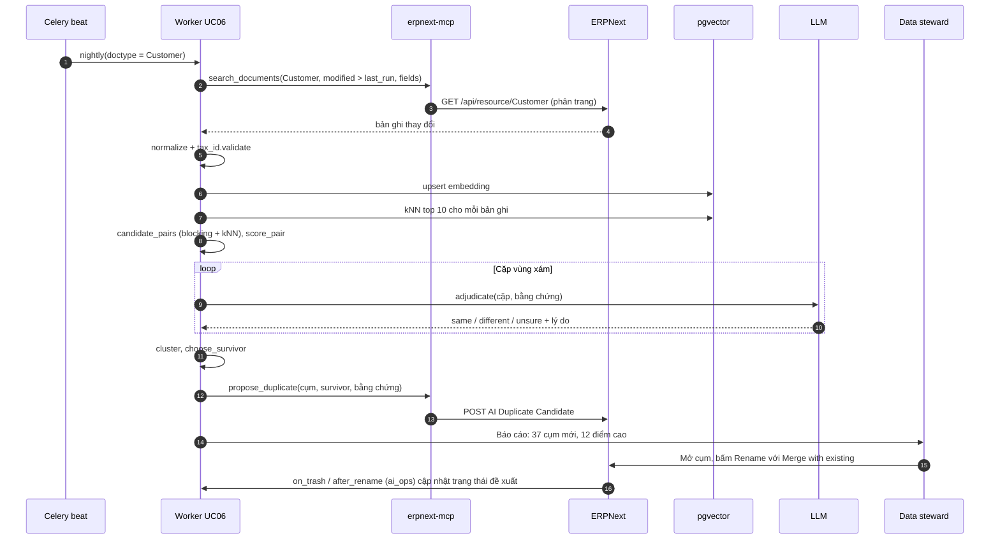
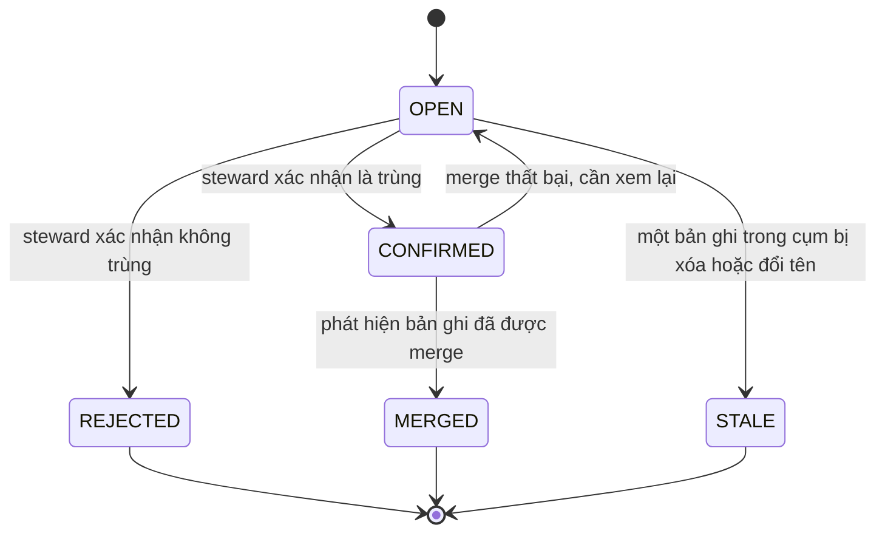

# UC06 — Làm sạch master data: thiết kế kỹ thuật chi tiết

> Thuộc bộ: [AI tự động hóa thao tác ERPNext](../erpnext-ai-automation.md) · Nền tảng chung: [00](./00-nen-tang-chung.md)
> **Mã UC:** UC06 · **Mức tự động:** L0 (phát hiện, báo cáo) và L1 (đề xuất sửa/merge, người thực hiện). **Không** có mục tiêu L2: merge dữ liệu gốc luôn do người làm.
> **DocType liên quan:** Customer, Supplier, Item, Contact, Address, UOM, Item Group, Customer Group, Supplier Group, AI Duplicate Candidate, AI Normalization Suggestion, AI Job, AI Action Log

## 1. Mục tiêu & KPI

| KPI | Mục tiêu |
|---|---|
| Precision của cặp trùng đề xuất (người xác nhận là trùng thật) | ≥ 90% với nhóm điểm cao, ≥ 70% nhóm điểm trung bình |
| Recall trên eval set (cặp trùng đã biết) | ≥ 85% |
| Số Customer/Supplier/Item trùng còn lại sau 3 tháng | giảm ≥ 80% so với baseline |
| Tỷ lệ bản ghi mới tạo bị trùng (sau khi bật "cửa chặn") | < 1% |
| Customer/Supplier có MST sai định dạng | 0 với bản ghi đang hoạt động |
| Thời gian chạy lô ban đêm (50.000 Item, 20.000 đối tác) | < 2 giờ |

## 2. Phạm vi, đầu vào, đầu ra, điều kiện tiên quyết

- **Trong phạm vi:** phát hiện trùng Customer, Supplier, Item (kèm Contact/Address); chuẩn hóa tên pháp nhân, số điện thoại, email, UOM, Item Group, Customer/Supplier Group; kiểm tra MST (định dạng, chữ số kiểm tra dạng cảnh báo, trùng MST, nguồn ngoài tùy chọn); đề xuất merge/sửa và theo dõi xử lý; **cửa chặn khi tạo mới** cảnh báo ngay khi người dùng tạo bản ghi có khả năng trùng.
- **Ngoài phạm vi:** tự động merge, tự động sửa field có ảnh hưởng kế toán (tài khoản mặc định, thuế), xóa bản ghi, dọn dữ liệu giao dịch.
- **Đầu vào:** toàn bộ bản ghi master (đọc theo lô, chỉ field cần thiết), Contact/Address liên kết, số giao dịch liên quan (để chọn bản ghi "giữ lại").
- **Đầu ra:** `AI Duplicate Candidate` (cặp/cụm trùng có điểm và bằng chứng), `AI Normalization Suggestion` (đề xuất sửa từng field), báo cáo tuần, cảnh báo khi tạo mới.
- **Điều kiện tiên quyết:** user dịch vụ có quyền Read trên các DocType master; pgvector sẵn sàng; người phụ trách dữ liệu (data steward) cho từng nhóm (khách, NCC, hàng hóa) được chỉ định.

## 3. Luồng xử lý chi tiết

### 3.1 Các bước pipeline (lô ban đêm)

| # | Bước | Module / hàm | Đầu vào | Đầu ra | LLM |
|---|---|---|---|---|---|
| 1 | Kích hoạt | `pipelines/uc06_master_clean.py::nightly` (01:00) | doctype, company | Job UC06 | Không |
| 2 | Trích xuất tăng dần | `steps/master.py::extract_changed` | `modified` > lần chạy trước | Bản ghi mới/đổi + toàn bộ khóa chặn đã lưu | Không |
| 3 | Chuẩn hóa | `steps/normalize.py::normalize_party` / `normalize_item` | bản ghi | `NormalizedRecord` | Không |
| 4 | Kiểm tra MST | `steps/tax_id.py::validate` | tax_id | `TaxIdCheck` | Không |
| 5 | Embedding | `steps/embed.py::upsert_embeddings` | chuỗi chuẩn hóa | vector trong pgvector | Model embedding |
| 6 | Blocking | `steps/dedupe.py::candidate_pairs` | khóa chặn + kNN | cặp ứng viên | Không |
| 7 | Chấm điểm | `steps/dedupe.py::score_pair` | cặp | điểm + bằng chứng theo đặc trưng | Không |
| 8 | Phân xử vùng xám | `steps/dedupe.py::adjudicate` | cặp điểm 0,60–0,85 | `same / different / unsure` + lý do | **Có** |
| 9 | Gom cụm | `steps/dedupe.py::cluster` | cặp được chấp nhận | cụm (connected components, giới hạn kích thước) | Không |
| 10 | Chọn bản ghi giữ lại | `steps/dedupe.py::choose_survivor` | cụm + số giao dịch | `survivor`, danh sách `merge_into` | Không |
| 11 | Đề xuất chuẩn hóa | `steps/normalize.py::suggest` | bản ghi có giá trị khác bản chuẩn hóa | `AI Normalization Suggestion` | Có (chỉ UOM/Item Group khó) |
| 12 | Ghi kết quả | tool bổ sung `propose_duplicate`, `propose_fix` | cụm, đề xuất | bản ghi trong `ai_ops` | Không |
| 13 | Báo cáo | `steps/master.py::weekly_report` | trạng thái đề xuất | tin nhắn cho data steward | Có (tóm tắt) |

### 3.2 Luồng "cửa chặn" khi tạo mới (đồng bộ, không dùng LLM)

| # | Bước | Nơi chạy | Mô tả |
|---|---|---|---|
| 1 | `validate` của Customer/Supplier/Item | `ai_ops.dedupe_guard.check` (doc_events trong `hooks.py`) | Chỉ khi `doc.is_new()` |
| 2 | Kiểm tra nhanh | trong Frappe, SQL | MST trùng tuyệt đối; tên chuẩn hóa trùng tuyệt đối (cột `ai_norm_name` có index); số điện thoại/email trùng |
| 3 | Kết quả | `frappe.msgprint` cảnh báo (không chặn) hoặc `frappe.throw` khi trùng MST và setting `block_on_tax_id_duplicate=1` | Hiển thị link tới bản ghi có sẵn |
| 4 | Kiểm tra sâu bất đồng bộ | `after_insert` → `frappe.enqueue` → gateway → UC06 `deep_check` | Fuzzy + embedding; nếu nghi trùng thì tạo `AI Duplicate Candidate` và nhắn người tạo |

### 3.3 Sơ đồ tuần tự



### 3.4 Trạng thái của một đề xuất trùng



`REJECTED` được lưu thành **cặp loại trừ** (`AI Duplicate Exclusion`) để lần chạy sau không đề xuất lại.

## 4. Thiết kế dữ liệu

### 4.1 Schema Pydantic

```python
class NormalizedRecord(BaseModel):
    doctype: Literal["Customer", "Supplier", "Item"]
    name: str
    display_name: str
    norm_name: str                 # bỏ dấu, chữ thường, bỏ loại hình doanh nghiệp, bỏ ký tự đặc biệt
    name_tokens: list[str]
    tax_id: str | None             # đã chuẩn hóa: chỉ số và dấu '-'
    phones: list[str]              # E.164: +84xxxxxxxxx
    emails: list[str]              # chữ thường
    email_domains: list[str]       # bỏ domain phổ thông (gmail.com, yahoo.com ...)
    address_key: str | None        # tỉnh/thành + quận/huyện chuẩn hóa + số nhà
    item_attrs: dict | None        # Item: item_group, stock_uom, brand, barcode, kích thước trích từ tên
    txn_count_12m: int
    disabled: bool

class TaxIdCheck(BaseModel):
    raw: str | None
    normalized: str | None
    kind: Literal["enterprise_10", "branch_13", "personal_12", "invalid", "missing"]
    checksum_ok: bool | None       # None khi không áp dụng
    duplicates: list[str]          # các bản ghi khác cùng MST
    external_status: str | None    # nếu có tra cứu ngoài: "active", "suspended", "closed"...

class PairEvidence(BaseModel):
    a: str
    b: str
    features: dict[str, float]     # tax_id_eq, name_jw, token_jaccard, phone_eq, email_eq, domain_eq, addr_sim, emb_cos ...
    score: float
    decision: Literal["auto_high", "llm_same", "llm_unsure", "below"]
    llm_reason: str | None

class DuplicateCluster(BaseModel):
    doctype: str
    members: list[str]
    survivor: str
    survivor_reason: str
    pairs: list[PairEvidence]
    risk_notes: list[str]          # ví dụ "2 bản ghi khác Customer Group", "khác tiền tệ mặc định"
```

### 4.2 Ánh xạ sang ERPNext

| Dữ liệu | Field ERPNext |
|---|---|
| Customer | `customer_name`, `tax_id`, `customer_group`, `territory`, `mobile_no`, `email_id`, `customer_primary_address`, `default_currency`, `disabled` |
| Supplier | `supplier_name`, `tax_id`, `supplier_group`, `country`, `mobile_no`, `email_id`, `default_currency`, `disabled` |
| Item | `item_code`, `item_name`, `item_group`, `stock_uom`, `uoms` (child: `uom`, `conversion_factor`), `barcodes` (child: `barcode`), `brand`, `is_stock_item`, `has_variants`, `has_batch_no`, `has_serial_no`, `disabled` |
| Liên hệ | `Contact` (`email_ids`, `phone_nos`, `links` → Customer/Supplier), `Address` (`address_line1`, `city`, `state`, `links`) |
| Số giao dịch 12 tháng | `count_documents` trên Sales Invoice / Purchase Invoice / Stock Ledger Entry theo party hoặc item |
| Merge | Người dùng dùng **Rename** trên form, tích **Merge with existing**; phía server tương đương `frappe.rename_doc(doctype, old, new, merge=True)`. ERPNext cập nhật mọi Link trỏ tới bản ghi cũ. |

### 4.3 Bổ sung trong app `ai_ops`

| Thành phần | Field chính | Ghi chú |
|---|---|---|
| DocType `AI Duplicate Candidate` | `ref_doctype`, `survivor`, `members` (child: `record`, `score`, `txn_count`), `evidence_json`, `risk_notes`, `status` (Open/Confirmed/Rejected/Merged/Stale), `assigned_to` | Có nút "Mở bản ghi giữ lại", "Xác nhận", "Không trùng" |
| DocType `AI Duplicate Exclusion` | `ref_doctype`, `record_a`, `record_b`, `reason` | Cặp đã bị từ chối |
| DocType `AI Normalization Suggestion` | `ref_doctype`, `ref_name`, `field`, `current_value`, `suggested_value`, `rule`, `status` | Người dùng bấm "Áp dụng" → gọi `frappe.client.set_value` dưới quyền người dùng |
| Custom field `ai_norm_name` (Data, có index, hidden) | Customer, Supplier, Item | Ghi trong `validate` của `ai_ops` để cửa chặn tra nhanh |
| Setting trong `AI Settings` | `block_on_tax_id_duplicate`, `guard_enabled_doctypes`, `generic_email_domains` | |
| Tool bổ sung `propose_duplicate`, `propose_fix` | write-light | Chỉ ghi vào DocType của `ai_ops`, không sửa master |

Không có tool merge hay rename trong `erpnext-mcp`.

## 5. Thuật toán & quy tắc nghiệp vụ

### 5.1 Chuẩn hóa tên đối tác tiếng Việt

```text
1. Chữ thường, Unicode NFC → bỏ dấu (đ → d), bỏ ký tự đặc biệt, gộp khoảng trắng.
2. Bỏ cụm loại hình doanh nghiệp (danh sách có thứ tự, dài trước ngắn sau):
   "cong ty trach nhiem huu han mot thanh vien", "cong ty tnhh mtv", "cong ty tnhh",
   "cong ty co phan", "cong ty cp", "cty tnhh", "cty cp", "cty", "cong ty",
   "doanh nghiep tu nhan", "dntn", "ho kinh doanh", "hkd", "chi nhanh",
   "jsc", "co ltd", "co., ltd", "ltd", "corp", "corporation", "company"
3. Bỏ từ nhiễu cuối: "viet nam", "vn", "vietnam" chỉ khi còn ≥ 2 token khác.
4. Ví dụ: "CÔNG TY TNHH THƯƠNG MẠI AN PHÁT" → "thuong mai an phat"
          "Cty TNHH TM An Phat"             → "tm an phat" → mở rộng viết tắt "tm" → "thuong mai an phat"
```

Bảng viết tắt (`tm` → thương mại, `dv` → dịch vụ, `sx` → sản xuất, `xnk` → xuất nhập khẩu, `xd` → xây dựng...) đặt trong file cấu hình, data steward bổ sung được.

### 5.2 Kiểm tra MST

| Dạng | Quy tắc | Kết quả |
|---|---|---|
| 10 chữ số | doanh nghiệp / tổ chức | `enterprise_10`, chạy chữ số kiểm tra |
| 10 chữ số + `-` + 3 chữ số | chi nhánh, đơn vị phụ thuộc | `branch_13`; 10 số đầu phải là MST hợp lệ |
| 12 chữ số | MST cá nhân, hộ kinh doanh dùng số định danh cá nhân (theo Thông tư 86/2024/TT-BTC, áp dụng từ 01/07/2025 — cần đối chiếu quy định hiện hành) | `personal_12`, không chạy checksum |
| Khác | | `invalid` |

- Chữ số kiểm tra của MST 10 số: thuật toán trọng số trên 9 chữ số đầu thường được dùng trong thực tế nhưng **không phải tài liệu công bố chính thức** — chỉ dùng để **cảnh báo**, không chặn.
- Tra cứu nguồn ngoài (cổng tra cứu MST của cơ quan thuế hoặc nhà cung cấp dữ liệu doanh nghiệp): tùy chọn, chạy chậm (≤ 1 request/giây), kết quả lưu cache 30 ngày, cần đánh giá điều khoản sử dụng của nguồn trước khi bật.
- Hai bản ghi đang hoạt động trùng MST (cùng loại `enterprise_10`) → **luôn** tạo đề xuất trùng với điểm 1,0, trừ khi một bên là chi nhánh (`branch_13`) có ý định tách riêng (data steward đánh dấu exclusion).

### 5.3 Blocking (sinh cặp ứng viên)

Không so sánh mọi cặp (n² quá lớn). Một cặp là ứng viên nếu cùng ít nhất một khóa:

| Khóa | Áp dụng |
|---|---|
| `tax_id` (10 số đầu) | Customer, Supplier |
| Số điện thoại E.164 | Customer, Supplier |
| Email đầy đủ, hoặc domain email không phổ thông | Customer, Supplier |
| 2 token hiếm nhất của `norm_name` (theo IDF) | tất cả |
| Barcode | Item |
| kNN embedding top 10, cosine ≥ 0,85 | tất cả |

Cụm khóa có > 200 bản ghi (ví dụ token quá phổ biến) bị bỏ qua để tránh bùng nổ.

### 5.4 Chấm điểm cặp

```text
Customer/Supplier:
score = 1.0                                       nếu tax_id_eq (cùng 10 số đầu, không phải chi nhánh khác nhau)
      = 0.35·name_jw + 0.15·token_jaccard + 0.15·phone_eq + 0.10·email_eq
        + 0.05·domain_eq + 0.10·addr_sim + 0.10·emb_cos          trong trường hợp còn lại
  trừ 0.30 nếu cả hai có tax_id và khác nhau (tín hiệu mạnh là khác pháp nhân)

Item:
score = 1.0                                       nếu barcode_eq
      = 0.40·name_jw + 0.20·emb_cos + 0.15·attr_match (kích thước, quy cách, màu trích từ tên)
        + 0.10·same_item_group + 0.10·same_stock_uom + 0.05·same_brand
  trừ 0.40 nếu thuộc tính số khác nhau (ví dụ "ống PVC 21mm" và "ống PVC 27mm")

Phân vùng:
  ≥ 0.85  → auto_high (đề xuất, không cần LLM)
  0.60–0.85 → LLM phân xử
  < 0.60  → bỏ
```

`name_jw` = Jaro–Winkler trên `norm_name`; `addr_sim` = so khớp tỉnh/quận + số nhà; trọng số tinh chỉnh bằng eval set (logistic regression trên đặc trưng khi đã có ≥ 500 cặp gán nhãn).

### 5.5 Chọn bản ghi giữ lại (survivor)

Thứ tự ưu tiên: (1) không `disabled`; (2) có MST hợp lệ; (3) nhiều giao dịch 12 tháng nhất; (4) tạo sớm nhất; (5) tên đầy đủ hơn. Lý do được ghi trong `survivor_reason`.

`risk_notes` cảnh báo trước khi merge: khác `default_currency`, khác `customer_group`/`supplier_group`, có hạn mức tín dụng khác nhau, khác tài khoản mặc định trong `accounts` child. Với Item: ERPNext kiểm tra một số thuộc tính trước khi cho merge (ví dụ `has_variants`, `is_stock_item`, `has_batch_no`, `has_serial_no` — cần đối chiếu phiên bản); khác `stock_uom` thì merge sẽ làm sai số lượng tồn lịch sử → **không đề xuất merge**, chỉ đề xuất ngừng dùng (`disabled`) một bản ghi.

### 5.6 Chuẩn hóa khác

| Field | Quy tắc | Tự sửa? |
|---|---|---|
| Số điện thoại | `0xxxxxxxxx` → `+84xxxxxxxxx`; đầu số cũ 11 số đổi sang 10 số theo bảng chuyển đổi | Đề xuất, người bấm áp dụng |
| Email | chữ thường, bỏ khoảng trắng, kiểm tra cú pháp | Đề xuất |
| Tên | Viết hoa đúng (Title Case cho tên riêng, giữ nguyên viết tắt TNHH, CP) | Đề xuất |
| UOM | Gộp đồng nghĩa ("cái", "Cái", "chiếc", "pcs") theo bảng chuẩn; LLM gợi ý cho giá trị lạ | Đề xuất, người duyệt bảng UOM chuẩn trước |
| Item Group | LLM gợi ý nhóm cho Item đang ở nhóm "All Item Groups" hoặc nhóm "Khác" dựa trên tên + mô tả + nhóm của Item tương tự | Đề xuất |

## 6. Agent

UC06 không dùng agent lặp tool tự do. LLM chỉ được gọi như **hàm phân loại có cấu trúc** ở bước 8 và bước 11.

| Tool | Bước | Loại |
|---|---|---|
| `search_documents` (phân trang theo `modified`) | 2 | read |
| `count_documents` | 10 | read |
| `get_document` | 8 (khi cần thêm Contact/Address) | read |
| `propose_duplicate` (tool bổ sung) | 12 | write-light |
| `propose_fix` (tool bổ sung) | 12 | write-light |

Prompt phân xử (`prompts/uc06/adjudicate.v1.md`):

```text
[system]
Bạn so sánh hai bản ghi {doctype} trong ERP của một doanh nghiệp Việt Nam và cho biết
chúng có phải CÙNG MỘT pháp nhân / mặt hàng hay không.
- Chi nhánh khác MST với công ty mẹ là KHÁC pháp nhân.
- Mặt hàng khác quy cách (kích thước, dung tích, màu, model) là KHÁC mặt hàng.
- Nếu không đủ thông tin, trả "unsure".
Trả JSON: {"decision": "same|different|unsure", "reason": "<= 40 từ", "key_evidence": [...]}
<data trust="internal">
A: {record_a_json}
B: {record_b_json}
Đặc trưng: {features_json}
</data>
```

Ví dụ tool call ghi đề xuất:

```json
{
  "tool": "propose_duplicate",
  "args": {
    "ref_doctype": "Supplier",
    "survivor": "SUP-00123",
    "members": [
      {"record": "SUP-00123", "score": 1.0, "txn_count": 84},
      {"record": "SUP-00871", "score": 0.91, "txn_count": 3}
    ],
    "evidence": {"tax_id_eq": 1, "name_jw": 0.93, "phone_eq": 1},
    "risk_notes": ["SUP-00871 có default_currency USD"],
    "idempotency_key": "uc06:Supplier:SUP-00123|SUP-00871"
  }
}
```

## 7. Policy

```yaml
# trích policy.yaml cho UC06
rules:
  - {id: uc06-read, use_case: UC06, tool: [search_documents, get_document, count_documents], decision: allow}
  - {id: uc06-propose, use_case: UC06, tool: [propose_duplicate, propose_fix], decision: allow}
  - {id: uc06-deny-writes, use_case: UC06, tool: [create_draft, update_draft, submit_document, apply_workflow_action, send_email], decision: deny}
limits:
  uc06_max_proposals_per_run: 2000
  uc06_read_rate_per_sec: 5        # chạy ban đêm nhưng vẫn giới hạn để không ảnh hưởng backup
```

Việc **áp dụng** đề xuất (set_value, Rename/Merge) do người dùng thực hiện trên giao diện ERPNext bằng quyền của họ, không đi qua agent.

## 8. Xử lý ngoại lệ

| Tình huống | Hành động |
|---|---|
| Cụm quá lớn (> 10 bản ghi) | Không đề xuất merge cả cụm; tách theo cặp điểm cao nhất, đánh dấu "cần xem thủ công" |
| Bản ghi bị sửa giữa lúc chạy lô | Đề xuất lưu `modified` của từng bản ghi; khi steward mở, nếu `modified` khác thì hiển thị cảnh báo "dữ liệu đã thay đổi" |
| Merge thất bại (ERPNext báo lỗi, ví dụ thuộc tính Item không tương thích) | Trạng thái về `OPEN`, ghi lỗi; lần sau không đề xuất merge mà đề xuất `disabled` |
| Hai Supplier cùng MST nhưng cố ý tách (theo hợp đồng, theo tiền tệ) | Steward chọn "Không trùng" kèm lý do → `AI Duplicate Exclusion` |
| Nguồn tra cứu MST ngoài lỗi / chặn | Bỏ qua bước tra cứu, không ảnh hưởng phần còn lại |
| Embedding service lỗi | Chạy blocking không có kNN, đánh dấu báo cáo "recall có thể thấp hơn" |
| Cửa chặn chậm (> 300 ms) | Bỏ kiểm tra đồng bộ cho lần lưu đó, chỉ chạy kiểm tra sâu bất đồng bộ; ghi metric |
| Người dùng import hàng loạt (Data Import) | Cửa chặn chỉ cảnh báo trong log import, không `msgprint` từng dòng; kiểm tra sâu chạy sau khi import xong |

## 9. Giao diện người dùng

- **List view `AI Duplicate Candidate`** trong workspace "AI — Dữ liệu gốc": lọc theo DocType, điểm, trạng thái, người phụ trách; cột "Số giao dịch bị ảnh hưởng".
- **Form đề xuất:** bảng so sánh song song các bản ghi (field khác nhau được tô màu), `risk_notes`, lý do của LLM; nút "Mở bản ghi cần gộp" (kèm hướng dẫn *Menu → Rename → nhập tên bản ghi giữ lại → tích Merge with existing*), "Xác nhận trùng", "Không trùng (nhập lý do)".
- **Cửa chặn khi tạo mới:** hộp cảnh báo trên form: "Có thể trùng với **CTY TNHH An Phát (CUST-00042)** — cùng MST 0312345678. [Mở bản ghi] [Vẫn tạo mới]". Khi `block_on_tax_id_duplicate=1`, trùng MST sẽ chặn lưu.
- **Báo cáo tuần** cho data steward: số cụm mới, số đã xử lý, top 10 cụm ảnh hưởng nhiều giao dịch nhất, tỷ lệ MST lỗi.

## 10. Kiểm thử & eval

| Nhóm | Số ca | Nội dung |
|---|---|---|
| Chuẩn hóa tên | 300 | Tên pháp nhân thật (đã che): loại hình doanh nghiệp, viết tắt, có/không dấu, tiếng Anh |
| MST | 150 | 10 số, 13 số, 12 số, sai định dạng, có khoảng trắng/dấu chấm |
| Cặp trùng Customer/Supplier | 600 cặp | 40% trùng thật, 30% gần giống nhưng khác (chi nhánh, công ty cùng tên khác tỉnh), 30% ngẫu nhiên cùng khối |
| Cặp trùng Item | 600 cặp | 35% trùng, 40% khác quy cách (cạm bẫy chính), 25% ngẫu nhiên |
| Cửa chặn | 50 | Thời gian phản hồi, đúng cảnh báo, không chặn nhầm |
| Hiệu năng | 1 | Dữ liệu tổng hợp 50.000 Item + 20.000 đối tác, đo thời gian và bộ nhớ |

Tiêu chí nghiệm thu: §1 (precision/recall), cửa chặn p95 < 300 ms, 0 đề xuất merge Item khác `stock_uom`.

UC06 giữ ở L0/L1 vĩnh viễn; "nâng mức" chỉ áp dụng cho việc **tự áp dụng chuẩn hóa định dạng** (số điện thoại, email chữ thường) sau khi steward duyệt 3 lô liên tiếp không sửa — vẫn thực hiện bằng một nút "Áp dụng hàng loạt" do người bấm.

## 11. Kế hoạch triển khai & ước lượng công

| Hạng mục | Người-ngày |
|---|---|
| DocType `AI Duplicate Candidate`, `AI Duplicate Exclusion`, `AI Normalization Suggestion`, custom field `ai_norm_name` | 3 |
| Chuẩn hóa tên, điện thoại, email, địa chỉ + test | 4 |
| Kiểm tra MST + tra cứu ngoài (tùy chọn) | 2 + 2 |
| Embedding + pgvector + blocking | 4 |
| Chấm điểm, phân xử LLM, gom cụm, chọn survivor | 5 |
| Chuẩn hóa UOM / Item Group | 3 |
| Cửa chặn trong `ai_ops` (validate + after_insert) | 3 |
| Giao diện form so sánh, báo cáo tuần | 3 |
| Eval set (gán nhãn 1.200 cặp cùng nghiệp vụ) | 6 |
| Chạy lần đầu trên toàn bộ dữ liệu, xử lý tồn đọng cùng steward | 5 |
| **Tổng** | **≈ 40 người-ngày** (không gồm tra cứu ngoài: ≈ 38) |

## 12. Rủi ro còn mở / câu hỏi cho nghiệp vụ

1. Chính sách công ty với chi nhánh: một Customer cho cả tập đoàn hay mỗi chi nhánh (MST 13 số) một Customer?
2. Có được bật `block_on_tax_id_duplicate` (chặn lưu) không, hay chỉ cảnh báo?
3. Ai là data steward cho từng nhóm và thời gian xử lý tồn đọng ban đầu (có thể hàng nghìn cụm)?
4. Có được dùng nguồn tra cứu MST bên ngoài không (điều khoản sử dụng, chi phí)?
5. Merge Customer ảnh hưởng báo cáo lịch sử (doanh số theo khách) — cần thông báo cho bộ phận dùng báo cáo.
6. Item trùng nhưng khác `stock_uom`: phương án chuẩn là ngừng dùng một bản ghi và chuyển tồn bằng Stock Entry — cần kế toán kho đồng ý quy trình.
