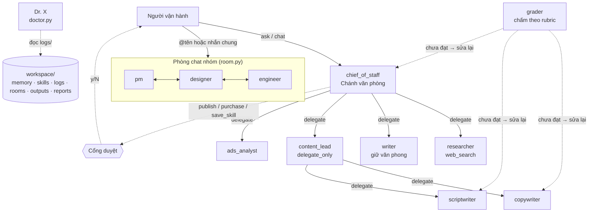

# AI Team — đội AI agent theo 6 nguyên tắc của đội Grok Bot

Prototype hiện thực hoá các nguyên tắc trong ghi chú "Tư duy xây đội AI Agents" (Lauren Tan & Peng Zheng, đội Grok Bot): thay vì chat với AI từng việc lẻ, người vận hành có **một đội bot** — mỗi bot có tên, vai trò, trí nhớ riêng — do một bot quản lý điều phối, tự kiểm tra bài trước khi nộp, và chỉ được làm việc rủi ro khi người duyệt.

Viết bằng Python trên [Anthropic Python SDK](https://github.com/anthropics/anthropic-sdk-python) (model mặc định `claude-opus-5-5`), không dùng framework agent nào khác để logic phối hợp hiện rõ trong chưa đến 1.000 dòng code.

## 1. Ánh xạ nguyên tắc → cơ chế

| # | Nguyên tắc | Cơ chế trong code | Ở đâu |
|---|---|---|---|
| 1 | Bot quản lý nhận cả chuỗi việc trong một lệnh | Bot `chief_of_staff` là đầu mối mặc định của `ask`; tool `delegate` gọi bot khác (đệ quy, giới hạn độ sâu) và nhận kết quả về để tổng hợp | `agent.py` `_tool_delegate`, `team.json` |
| 2 | Mỗi bot có tên, vai trò, trí nhớ; họp trong group chat | System prompt dựng từ `team.json` + `memory/<bot>.md` (tool `remember`) + nhật ký việc gần đây ở mọi dự án. Phòng chat: `@tên` gọi riêng, nhắn chung thì bot tự quyết lên tiếng hay `PASS`, bot @nhắc nhau để phản biện | `agent.py` `system_prompt`, `room.py` |
| 3 | Việc lặp lại → quy trình | Skill = file Markdown (`## Mô tả`, `## Các bước`, `## Tiêu chí đạt`). Nạp bằng `--skill` hoặc tool `load_skill`; đóng gói quy trình mới bằng tool `save_skill` | `team/skills/`, `store.py` |
| 4 | Bot tự kiểm tra trước khi nộp | Khi có rubric (truyền vào hoặc từ skill), bài nộp được chấm bởi một lời gọi model **độc lập** (structured output `Grade`); chưa đạt thì phản hồi được gửi lại để bot tự sửa, tối đa 3 lần | `grader.py`, vòng lặp trong `Runtime.run` |
| 5 | Trưởng nhóm chỉ phân việc — "bếp Michelin" | `delegate_only: true` ⇒ bot không được cấp bất kỳ tool làm việc nào (cấu hình sai sẽ bị từ chối khi nạp) và chỉ giao được cho danh sách `delegates` | `config.py`, bot `content_lead` |
| 6 | Trao quyền từng bước | `publish`, `purchase`, `save_skill` luôn qua cổng duyệt của người (chặn ở code, không phụ thuộc model "tự giác"); `ask_human` khi thiếu thông tin. Dr. X đọc nhật ký để đề xuất skill mới, tách/gộp bot | `agent.py` `APPROVAL_REQUIRED`, `doctor.py` |

## 2. Kiến trúc



Vòng lặp của một bot (`Runtime.run`):

```
dựng system prompt (hiến chương đội + danh tính + đồng đội + skill + trí nhớ + việc gần đây)
lặp:
  gọi model với các tool được cấp
  stop_reason == tool_use  → chạy tool (qua cổng duyệt nếu rủi ro), trả kết quả, lặp tiếp
  stop_reason == end_turn  → nếu có rubric: chấm độc lập
                               chưa đạt & còn lượt → gửi phản hồi, lặp tiếp
  ghi nhật ký (task, kết quả, điểm, số lần sửa, tool đã dùng) cho Dr. X
```

Chi tiết kỹ thuật đáng chú ý:

- **Lịch sử chỉ thêm, không sửa**: luôn nối nguyên `response.content` (kể cả thinking block) vào hội thoại.
- **Refusal fallback** bật mặc định (`fallbacks: "default"`, beta `server-side-fallback-2026-07-01`): nếu model từ chối, API tự chạy lại trên model dự phòng. Tắt bằng cách xoá hai hằng số trong `llm.py`.
- **Effort theo vai trò**: bot quản lý `high` (lập kế hoạch nhiều bước), bot chuyên môn `medium`, Dr. X `high` — chỉnh trong `team.json`.
- **Tool `strict: true`** để tham số tool luôn đúng schema; lỗi tool được trả lại cho model dưới dạng `is_error` chứ không làm sập vòng lặp.
- **Sandbox file**: mọi đọc/ghi giới hạn trong `workspace/outputs/`.
- `publish`/`purchase` trong prototype là **mô phỏng** (ghi file); thay bằng API thật (Facebook, Shopee, Notion…) ở `agent.py` khi cần.

## 3. Cài đặt và chạy

```bash
cd projects/ai-team
python -m venv .venv && source .venv/bin/activate
pip install -r requirements.txt
export ANTHROPIC_API_KEY=...        # hoặc đăng nhập bằng `ant auth login`
```

```bash
# Nguyên tắc 1 — một lệnh, cả chuỗi việc (bot quản lý tự giao cho researcher, writer...)
python -m ai_team ask --skill marketplace-listing \
  "Bán micro DJI Mic 2 đã dùng 6 tháng, còn hộp, ở Cầu Giấy Hà Nội. Muốn bán trong 2 tuần."

# Nguyên tắc 4 — giao thẳng một bot, tự chấm theo rubric của skill
python -m ai_team ask --bot copywriter --skill sales-post "Bài bán hàng cho trà sữa ít đường, ưu đãi mua 2 tặng 1"

# Nguyên tắc 5 — trưởng nhóm chỉ phân việc
python -m ai_team ask --bot content_lead "Chiến dịch ra mắt son môi thuần chay: 1 bài bán hàng + 1 kịch bản TikTok"

# Nguyên tắc 2 — phòng chat nhiều bot
python -m ai_team chat meow --members pm,designer,engineer "Ý tưởng: app dịch tiếng mèo sang tiếng Anh"
python -m ai_team chat meow "@designer phác luồng màn hình chính"
python -m ai_team chat meow            # chế độ tương tác

# Trí nhớ & skill
python -m ai_team memory writer
python -m ai_team skills

# Dr. X khám đội, ghi báo cáo vào workspace/reports/
python -m ai_team doctor
```

Mỗi hành động `publish`/`purchase`/`save_skill` sẽ dừng lại hỏi `Đồng ý? [y/N]`. Cờ `--auto-approve` tự duyệt tất cả — chỉ dùng khi demo.

**Chạy định kỳ (bước cuối của nguyên tắc 6)** — chỉ bật khi skill đã chạy ổn nhiều lần dưới giám sát:

```cron
# Thứ Hai 8:17 — Dr. X khám đội
17 8 * * 1  cd /path/to/projects/ai-team && .venv/bin/python -m ai_team -q doctor
```

Lệnh chạy theo lịch không có người ngồi duyệt nên mọi hành động cần duyệt sẽ bị từ chối (trừ khi thêm `--auto-approve`) — đó là chủ ý.

## 4. Tuỳ biến đội

Sửa `team/team.json`:

```json
{
  "name": "seo_writer",
  "title": "Viết bài SEO",
  "role": "Viết bài blog chuẩn SEO ...",
  "effort": "medium",
  "tools": ["write_file"],
  "delegates": [],
  "delegate_only": false
}
```

- `tools` chọn trong: `write_file`, `read_file`, `publish`, `purchase`, `save_skill`, `web_search`. Mọi bot luôn có `remember`, `load_skill`, `ask_human`; có `delegates` thì có thêm `delegate`.
- Thêm skill: tạo `team/skills/<ten-skill>.md` (dùng chung, đưa vào git) hoặc để bot tự đề xuất qua `save_skill` (lưu vào `workspace/skills/`, ghi đè skill mẫu cùng tên).
- Trí nhớ bot là file `workspace/memory/<bot>.md` — có thể sửa tay, ví dụ dán vài bài cũ vào trí nhớ của `writer` để nó học văn phong.

## 5. Kiểm thử

```bash
pip install pytest
python -m pytest -q
```

Test dùng `FakeLLM` kịch bản hoá phản hồi của từng bot, nên không gọi API, không tốn tiền. Bao phủ: giao việc chuỗi, `delegate_only`, cổng duyệt (duyệt/không duyệt), tự chấm và sửa lại, bỏ cuộc sau số lần tối đa, trí nhớ xuyên phiên, sandbox đường dẫn, định tuyến `@tên` trong phòng chat, `PASS`, tranh luận có giới hạn, skill ghi đè.

## 6. Giới hạn và hướng mở rộng

| Hiện tại | Hướng mở rộng |
|---|---|
| Chạy tuần tự, đồng bộ | `AsyncAnthropic` + chạy song song các nhánh giao việc độc lập |
| `publish`/`purchase` mô phỏng | Nối API thật; giữ nguyên cổng duyệt, thêm hạn mức chi tiêu |
| Trí nhớ là file Markdown nối thêm | Dr. X định kỳ tóm gọn trí nhớ; tách trí nhớ theo dự án |
| Phòng chat qua CLI | Gắn vào Slack/Telegram/Zalo để giống "group chat" thật |
| Tự chạy hạ tầng | [Claude Managed Agents](https://platform.claude.com/docs) — Anthropic chạy vòng lặp, sandbox, lịch (scheduled deployments), outcome/rubric và multi-agent |
| Chưa đo chi phí | Ghi `response.usage` vào nhật ký để Dr. X phát hiện bot tốn tài nguyên |

Chi phí: mỗi lần giao việc là một chuỗi lời gọi model riêng; chấm rubric thêm một lời gọi mỗi lần nộp. Một lệnh `ask` qua bot quản lý có thể tốn hàng chục lời gọi — hãy thử với việc nhỏ trước.
